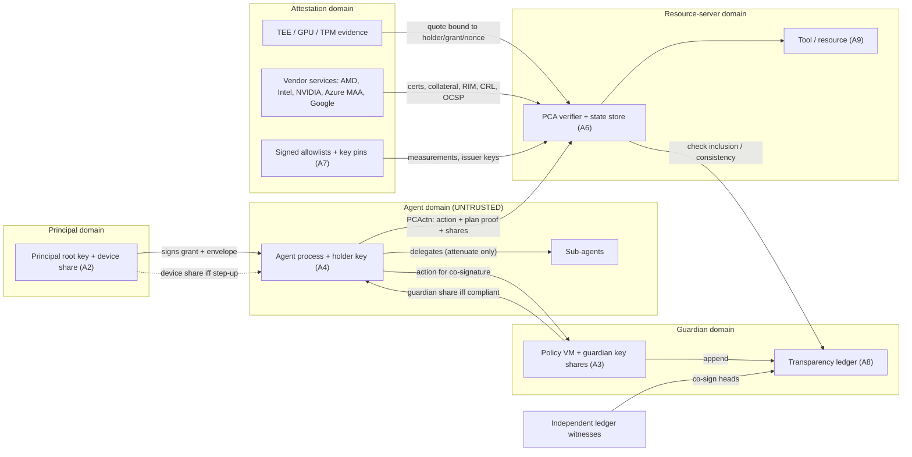

# Threat model

This page is the integrator-facing threat model for Proof-Carrying Authority (PCA). It states what we protect, who we assume the attacker is, what each attacker can and cannot do, a catalogue of concrete attacks with the mechanism that stops each one, and the guarantees PCA documents as a result.

Read it together with the [Trust model](./trust-model.md), which says what each party is trusted for and where the current release is a reference rather than a hardened component, and the [Security contract](./security-contract.md), which states the invariants a resource server relies on and where each one is enforced today. Auditors: the mapping from every attack and guarantee below to the automated tests that exercise it is in [Traceability](./traceability.md).

**Status, stated plainly.** The stable core and the production-tier packages are supported for production use; units whose claims need an outside action are labelled "hardened, awaiting independent audit" (or the ceremony, hardware evaluation, independent witnesses or final standard they wait on). PCA has an extensive automated test suite and cross-language conformance vectors, but it has **not had an external cryptographic or security audit**. Until one is published, do not make any single PCA deployment the sole control over high-value or irreversible actions. Every mitigation below names the mechanism and its assumptions; where a mitigation depends on something the integrator must operate (a replay store, a revocation-root feed, an independent witness), that is called out as an assumption and not hidden.

## 1. Assets

| Asset | Why it matters |
|---|---|
| A1. The principal's authority (the grant) | The root of all delegated power. Its envelope bounds everything an agent can do. |
| A2. Principal root key and device share | Signs the grant; supplies the human share for high-risk (`t = 3`) actions. |
| A3. Guardian signing key / key shares | Releases the policy-gated share only for compliant actions. |
| A4. Agent holder key | Signs actions. Assumed stealable. |
| A5. The trust budget | The bound on total autonomous risk between human recharges. |
| A6. Resource-server state | Counters, budget meters, revocation roots, nonces. Replay and over-spend defenses live here. |
| A7. Attestation trust anchors | Vendor roots, allowlists, key pins, collateral. A wrong anchor makes every attestation meaningless. |
| A8. The transparency ledger | The non-repudiable record of what was authorized and done. |
| A9. Data the agent can reach | Tool arguments, resources, outputs. What a compromised agent would exfiltrate. |

## 2. Trust boundaries

Everything crossing a boundary is treated as attacker-influenced. The agent domain is **untrusted by design**. The strongest guarantees need the principal, guardian and resource-server domains to be operated by separate parties or on separate machines; if one host holds every key share, a compromise of that host collapses the threshold (see the [Trust model](./trust-model.md)).

## 3. Attacker capability matrix

Each row lists what we **assume** the attacker can do, what PCA stops, and what remains. "Residual" is what the attacker can still achieve; it is not hidden by the mitigations in the catalogue.

| # | Attacker | Assumed capabilities | PCA stops | Can still achieve (residual) | Catalogue |
|---|---|---|---|---|---|
| 1 | **Passive network attacker** | Reads all traffic between agent, guardian, resource server, ledger. | Nothing sensitive needs to be secret for safety: there is no bearer token, so a captured PCActn is inert without fresh context. | Reads action contents, identities and timing. PCA provides **no confidentiality**; use TLS. | T-001, T-002, T-015 |
| 2 | **Active network attacker** | Modifies, drops, replays, reorders messages. | Tampering (signed canonical body), replay to another server (signed audience), replay inside the window (counter, with a store), reorder (counter). | Denial of service (drop/delay). Replay inside the validity window **if the resource server keeps no counter store**. | T-001, T-002, T-014 |
| 3 | **Malicious or compromised agent** | Full code execution in the agent; holds the agent key; can craft any request. | Acting outside the committed plan; exceeding the envelope; producing a threshold signature above `t = 1` alone; self-widening a delegation; understating its own risk or taint. | Any in-plan, in-policy, taint-clean, low-risk action, up to the trust-budget bound. | T-004, T-006, T-007, T-012, T-013, T-032, T-033 |
| 4 | **Prompt-injected agent** | Attacker-controlled text steers the agent's tool calls; agent process itself is intact. | Out-of-plan actions (no inclusion proof); actions whose lineage is tainted (risk rises, step-up or refusal); high-risk irreversible actions (human share). | Harmful *in-plan* actions the principal already sanctioned, or low-risk exfiltration within DLP/taint limits. | T-006, T-032, T-034 |
| 5 | **Malicious or compromised tool / resource server** | Sees every PCActn presented to it; may replay it elsewhere; may lie about outcomes. | Re-use of a PCActn at a different server (audience); forging new actions (needs signatures); learning the private plan in the ZK path. | Reads everything in plain-mode actions; can misreport the effect of an action; can act on actions it legitimately receives. | T-002, T-035, T-037 |
| 6 | **Malicious sub-agent** | Receives a delegation; may be fully hostile. | Widening scope, dropping caveats, exceeding depth, over-allocating budget. | Everything its (narrowed) delegation allows. | T-004, T-005 |
| 7 | **Stolen or leaked capability / delegation token** | Obtains a copy of a capability chain or PCActn. | Use without the holder key: chains are holder-bound, not bearer. | Nothing, unless it also obtains the holder key (row 3). | T-013 |
| 8 | **Compromised guardian share(s), below threshold** | Holds `< t` of the guardian shares plus possibly the agent key. | Producing an accepted threshold signature; forging a share. | Learns what those shares see. | T-016, T-017 |
| 9 | **Compromised guardian shares, at/above threshold** | Holds a full quorum (or the single hosted guardian key) and the agent key. | Reaching `t = 3` actions (still needs the principal device share). | Everything up to `t = 2`: all medium-risk actions the guardian would co-sign. **Not bounded by the cryptography.** | T-016, T-019 |
| 10 | **Compromised principal device / root key** | Holds the principal key and device share. | Nothing: this is the root of authority. | Authorize anything within the grant; mint new grants. Detectable afterwards in the ledger, not preventable. | T-019 |
| 11 | **Malicious cloud operator / hypervisor** | Controls the host the agent runs on; can swap images, replay evidence, set debug policy, read memory outside the TEE boundary. | Running modified code under a measured identity (measurement and chain checks); presenting debug-mode silicon; replaying another workload's evidence. | Anything the TEE technology itself does not protect (side channels, availability); host-asserted fields such as HOST_DATA are only as good as the host. | T-020 to T-025, T-029 |
| 12 | **Compromised vendor attestation service** (Azure MAA, Google, a signing key of a vendor) | Can mint tokens/quotes that chain to that vendor's trust anchor. | Silent key rotation abuse (overlap rule, no trust-on-first-use); a single compromised root when several independent roots are required (N-of-M with reconciled identity). | If you rely on **one** vendor root, a compromise of that vendor defeats that root. | T-027, T-028 |
| 13 | **Attestation-collateral staleness** | Serves old but validly-signed collateral (TCB info, CRLs, OCSP, RIM). | Expired collateral, stale CRL/OCSP responses, clock regression, TCB below your floor, VCEK older than the claimed TCB. | The staleness window you configure (collateral `nextUpdate`, OCSP `maxAge`). | T-023, T-024 |
| 14 | **Supply-chain compromise of a dependency** | Ships a malicious version of a cryptographic or parsing library. | Wrong Ed25519/SHA-256/FROST outputs *are* detected by known-answer vectors in CI. | A subtle backdoor that passes vectors (for example a side channel, a nonce bias) is **not** detected. | T-048 |
| 15 | **Insider with log-operator access** | Operates the transparency log; can rewrite, fork, or withhold entries. | Rewriting history or serving different histories, *provided* independent witnesses co-sign heads and a monitor checks consistency. | Withholding or delaying entries (censorship) is not cryptographically detectable on its own. Without independent witnesses, split views are possible. | T-040, T-041 |
| 16 | **Quantum adversary** (harvest now, forge later) | Records all traffic today; has a CRQC later. | Forgery of PQ-suite signatures (ML-DSA, hybrid) and of PQ quorum certificates. | **Default surfaces are classical** (Ed25519, FROST/Ed25519, BN254 Groth16). Anything signed with only classical keys and still trusted later can be forged later. Because PCA is authentication, not encryption, harvested traffic has no secrecy to lose. | T-047 |
| 17 | **Side-channel / timing attacker** | Measures timing or microarchitectural effects of the verifier or signer. | Secret-dependent comparisons in the audited verifier surface; secret base-point multiplication is constant-time via the underlying library. | The reference FROST/DKG scalar arithmetic is **not constant-time**; the implementation has no side-channel hardening claim. | T-049 |
| 18 | **Denial-of-service attacker** | Sends oversized, deeply nested, or adversarially structured inputs; floods verification. | Unbounded recursion/size in the strict parser, chain depth, schemas, regex predicates, parameter stuffing. | Volumetric flooding; verification cost (signature checks) is not rate-limited by PCA. | T-046 |

## 4. Attack catalogue

Each entry has a stable ID. IDs never change meaning and are referenced from [Traceability](./traceability.md). "Mitigation" names the user-visible mechanism; "Guarantee" cross-references section 5; "Detection" says how an operator would notice an attempt.

### Protocol and delegation

### T-001 Replay on the same server
- **Attack.** Capture a valid PCActn and resubmit it (or reorder captured ones).
- **Preconditions.** Attacker can observe or obtain the signed action; resubmission is within the validity window.
- **Impact.** Re-execution of an authorized action (double spend, duplicate side effect).
- **Mitigation.** Every PCActn carries a signed audience, issue time and expiry (bounded lifetime) and a per-holder counter. The core verifier rejects expired, future-dated and over-long-lifetime actions. Counter monotonicity is enforced by the resource-server middleware (`requirePCA`) against a persisted store.
- **Guarantee.** G-5 (freshness), G-6 supports. Assumes the resource server persists counters. **The core verifier alone only checks that the counter is well-formed**; without a store, `requirePCA` reports the counter check as `not-enforced` rather than passing it.
- **Residual.** Replay inside the validity window against a server with no shared store (multi-node without a shared store is exposed).
- **Detection.** Counter-regression rejections; duplicate ledger entries.

### T-002 Replay at a different server (audience confusion)
- **Attack.** Present a PCActn obtained at server A to server B.
- **Preconditions.** Both servers trust the same grant; attacker has the action.
- **Impact.** Authority meant for A is exercised at B.
- **Mitigation.** The audience is part of the signed body; a verifier that has no configured audience **fails closed** on an audience-bearing action; `requirePCA` requires the audience as mandatory configuration.
- **Guarantee.** G-5. Assumes each resource server configures a distinct audience.
- **Residual.** Two servers configured with the same audience string accept each other's actions.
- **Detection.** Audience-mismatch rejections.

### T-003 Confused deputy / action swap
- **Attack.** Re-use a valid inclusion proof or signature for a different action than the one authorized.
- **Preconditions.** Attacker holds a valid proof for action X.
- **Impact.** Executing action Y under X's authority.
- **Mitigation.** The signed body commits the action; the plan-inclusion proof is a Merkle proof of that exact action node. A proof for a swapped action fails inclusion; a tampered action breaks inclusion and the signature. Optimistic claims and ZK statements are bound to the exact action digest.
- **Guarantee.** G-1, G-4.
- **Residual.** If the plan itself contains a dangerous node, it is reachable.
- **Detection.** Inclusion-proof failures.

### T-004 Privilege escalation by delegation widening
- **Attack.** A holder drops, edits or reorders a restricting caveat, re-points a parent link, issues a hop it does not hold, or allocates more budget than its parent.
- **Preconditions.** Holder of any intermediate capability.
- **Impact.** A child more powerful than its parent.
- **Mitigation.** Caveats are append-only and compared per-caveat by hash; every hop is hash-linked and holder-bound and verified against the parent holder's key; body digests are re-derived; chain depth is capped before any signature work; carried budget allocations must be monotone non-increasing.
- **Guarantee.** G-3.
- **Residual.** Chain verification is structural: a caveat type the policy engine does not understand must be rejected by the policy layer. Unknown caveat types are rejected in the mesh and agent-native evaluators; an integrator writing a custom evaluator must fail closed.
- **Detection.** Chain verification failures with the failing hop.

### T-005 Malicious sub-agent over-spend or depth abuse
- **Attack.** A delegated sub-agent spends beyond its allocation or delegates further than allowed.
- **Preconditions.** A sub-agent holds a narrowed capability.
- **Impact.** Parent budget drained by a child.
- **Mitigation.** A sub-budget cannot exceed its parent; consolidated debit charges the node and every ancestor and refuses if any cannot cover; a delegation-depth predicate and the chain depth cap bound recursion.
- **Guarantee.** G-3, G-7.
- **Residual.** A sub-agent can spend everything it was legitimately allocated.
- **Detection.** Per-node budget meters in the console.

### T-006 Plan deviation and out-of-plan action (including prompt injection)
- **Attack.** A compromised or prompt-injected agent performs an action that is not in the committed plan.
- **Preconditions.** Agent can sign actions.
- **Impact.** Arbitrary actions the principal never sanctioned.
- **Mitigation.** No inclusion proof exists for an action that is not a plan node, so verification fails *before* credentials are read. Prohibitions (a "constitution") veto matching actions regardless of plan and permission, and cannot be disabled by granting a permission.
- **Guarantee.** G-4, G-18.
- **Residual.** In-plan actions chosen maliciously by the principal or planner.
- **Detection.** `plan_inclusion` failures; prohibition vetoes with signed evidence.

### T-007 Budget exhaustion / autonomous over-spend
- **Attack.** An agent hammers free (low-risk) actions to accumulate unbounded autonomous risk.
- **Preconditions.** Agent can sign low-risk actions.
- **Impact.** Large aggregate effect from many individually benign actions.
- **Mitigation.** The trust budget: each machine-only action debits the budget; depletion forces step-up even for low-risk actions. The total risk-weighted autonomous activity between two human recharges is at most `bMax / κ`.
- **Guarantee.** G-7. **Assumes the verifier computes or vouches for the risk inputs** rather than trusting the agent's `risk_claim`, and persists the meter.
- **Residual.** Within the bound, the agent can do anything low-risk; the bound caps the total, not each action. The hosted surface takes blast radius from a per-class table (0.5 for reversible and costly, 0.75 for irreversible actions) unless the grant commits objective risk facts, so it is a heuristic, not a measurement, for non-monetary actions.
- **Detection.** Budget-depletion step-ups; immune-system drift scores.

### T-008 Counter and budget races across nodes
- **Attack.** Submit the same action (or many spends) concurrently to several verifier nodes before state converges.
- **Preconditions.** Multi-node deployment.
- **Impact.** Double execution or over-spend beyond the budget.
- **Mitigation.** Counter and budget state belong in a shared store with atomic check-and-set. A single-node store denies replay and drains the budget.
- **Guarantee.** G-5/G-7 hold only per atomic store.
- **Residual.** **Atomicity is the integrator's store's property.** Concurrent verifiers over one store are tested in-process, and the hosted surface is tested with several servers and operating-system processes on one database. `requirePCA` reads, then writes, its state: across processes it is safe only when the store supplies `withKeyLock` (its default lock is in-process), or when replay is checked with `guardPCActnReplay` over an atomic `ReplayStore` / `CounterStore`.
- **Detection.** Duplicate counter values in audit logs.

### T-009 Time-of-check to time-of-use
- **Attack.** Authority is valid at verification, then revoked, expired or changed before the effect lands.
- **Preconditions.** Gap between verify and execute.
- **Impact.** An action executes after its authority ended.
- **Mitigation.** The signed action pins the exact action; freshness windows and signed revocation epochs bound how stale a decision can be; a pre-revocation action fails against a newer epoch.
- **Guarantee.** G-1, G-5, G-8, bounded by the configured window.
- **Residual.** A long-running effect started before revocation is not interrupted. Re-checking at effect time is the resource server's responsibility.
- **Detection.** Epoch and beacon freshness telemetry.

### T-010 Signature malleability and small-order keys
- **Attack.** Present `S + L`, a non-canonical point, or a small-order key/commitment to bypass verification or create ambiguity.
- **Preconditions.** Control of signature bytes.
- **Impact.** Forged or ambiguous signatures; duplicate-signature double counting.
- **Mitigation.** Strict RFC 8032 verification that rejects non-canonical S and non-canonical encodings and then rejects small-order and mixed-order points; fixed-length canonical base64url fields; FROST rejects small-order commitment points.
- **Guarantee.** G-1.
- **Residual.** Correctness of the underlying curve library (T-048).
- **Detection.** Signature failures.

### T-011 Signature suite downgrade and confusion
- **Attack.** Strip or alter the signed suite identifier, swap the PQ public key, or replace a hybrid signature with its classical half.
- **Preconditions.** Control of the message in transit or of a signer's output.
- **Impact.** Verification under a weaker scheme.
- **Mitigation.** The suite identifier and PQ public key are part of the signed body; unknown suites fail closed; a hybrid requires **both** components to verify; wire validation forbids fields a suite does not use. Applies to actions, capabilities, guardian shares, tree heads, witness cosignatures and attestation documents.
- **Guarantee.** G-9.
- **Residual.** A pure-PQ action is accepted only under the PQ key committed by the holder's `holder_pq` (F-2); a holder minted without one cannot present a PQ-suite action unless the TypeScript verifier sets the legacy `allowUnboundPq` (the native verifiers have no such opt-out). A PQ root grant is accepted only when it is byte-identical to the verifier's stored grant or its `pq_pk` equals a verifier-side pin for the issuer; when both exist they must agree. The same rules hold in all nine native verifiers.
- **Detection.** Wire-validation failures.

### T-012 Threshold downgrade and role confusion
- **Attack.** Present a lower-threshold signature as a higher one, replay a guardian share as a principal share or at another `t` or signer set, or let one key fill two roles.
- **Preconditions.** Holds some valid share.
- **Impact.** Reaching a higher threshold than earned.
- **Mitigation.** Each share is domain-, role-, signer-set- and `t`-bound; distinct keys are counted (duplicates never double count); a signer set that reuses one key across roles is rejected; a `t = 2` verifier rejects an agent-only signature.
- **Guarantee.** G-6.
- **Residual.** The default threshold is a multi-signature, not FROST; a verifier that does not pass an explicit `requiredT` inherits the claimed risk.
- **Detection.** Threshold-insufficient rejections.

### T-013 Stolen or leaked capability, or stolen agent key
- **Attack.** Exfiltrate a capability chain, a PCActn, or the agent's key.
- **Preconditions.** Read access to agent memory or storage.
- **Impact.** Impersonate the agent.
- **Mitigation.** No bearer tokens: a chain is inert without a valid holder signature. A stolen agent key alone is `t - 1` short for any action above `t = 1`. Outside a TEE the quote will not match the grant's agent binding.
- **Guarantee.** G-1, G-6, G-10.
- **Residual.** With the key, the thief can do anything a `t = 1` action allows until revocation.
- **Detection.** Counter divergence, ledger anomalies, revocation.

### T-014 Active tampering of a message
- **Attack.** Modify fields of a PCActn or capability in flight.
- **Preconditions.** Active network position.
- **Impact.** Altered authority.
- **Mitigation.** The whole body is covered by the signature over its single canonical form; unknown fields are a wire failure; a signed number that cannot be encoded canonically is rejected.
- **Guarantee.** G-1, G-2.
- **Residual.** None for integrity. Availability is not protected.
- **Detection.** Signature and wire failures.

### T-015 Passive eavesdropping
- **Attack.** Record traffic to learn actions, plans or identities.
- **Preconditions.** Passive network position.
- **Impact.** Loss of confidentiality of action contents.
- **Mitigation.** None inside PCA. Plan-privacy is available only through commitments and the ZK compliance path.
- **Guarantee.** None (see non-goals N-3).
- **Residual.** Full: use TLS and, if privacy matters, the commitment-only compliance mode.
- **Detection.** Not detectable.

### Humans and guardians

### T-016 Guardian collusion below threshold
- **Attack.** `k < t` guardians (or one guardian plus the agent) collude to sign.
- **Preconditions.** Compromise of fewer than `t` shares.
- **Impact.** A forged guardian authorization.
- **Mitigation.** A sub-threshold FROST aggregate does not verify; a PQ quorum requires `t` distinct valid member signatures (`t - 1` fails); the quorum set identity binds `t`, keys, suites and diversity constraints so `t` cannot be lowered.
- **Guarantee.** G-6, G-17. Assumes shares live in **separate trust domains**.
- **Residual.** At or above `t` the cryptography no longer protects; the hosted guardian is a single online software key, so a guardian-key compromise plus the agent key reaches `t = 2`. Only the principal share stands between that adversary and `t = 3`.
- **Detection.** Anomalous guardian co-signature volume; ledger audit.

### T-017 Guardian share forgery and DKG cheating
- **Attack.** A signer submits a bad share, a dealer equivocates, a session's packages are replayed into another.
- **Preconditions.** A participant in signing or key generation.
- **Impact.** Invalid group key or an unattributed failure.
- **Mitigation.** Signing shares are checked against verification shares and the cheater is named; the DKG aborts on equivocation, disqualifies a cheating dealer via justified complaints, rejects false complaints and cross-session replay.
- **Guarantee.** G-6.
- **Residual.** The DKG is a reference implementation needing an authenticated broadcast channel and private point-to-point channels that PCA does not itself provide; the DKG is hardened, awaiting independent audit.
- **Detection.** Named participants in aborted sessions.

### T-018 Step-up fatigue and social engineering
- **Attack.** Spam the human with approval prompts, or craft prompts that induce blanket approval.
- **Preconditions.** Ability to cause step-up requests.
- **Impact.** Human share given to a harmful action.
- **Mitigation.** The trust budget bounds recharge-driven risk and makes depletion force step-up; the number of machine-only actions between recharges is bounded. Step-up messages carry the action summary and goal lineage.
- **Guarantee.** G-7 (bounds autonomous risk, not human judgement).
- **Residual.** A human who approves everything approves everything. The prompt UX is outside this library.
- **Detection.** Step-up rate and approval-latency metrics in the console.

### T-019 Compromised principal device or key
- **Attack.** Attacker holds the principal key and device share.
- **Preconditions.** Device or key compromise.
- **Impact.** Authorize anything, mint grants, supply every `t = 3` share.
- **Mitigation.** None by design: the principal is the root of authority. Afterwards, actions are signed and anchored in the ledger, and the principal can be rotated by issuing a new grant.
- **Guarantee.** None (non-goal N-1).
- **Residual.** Total within the grant's scope.
- **Detection.** After the fact, via the ledger.

### Attestation and hardware

### T-020 Attestation relay or replay
- **Attack.** Present genuine evidence from another workload, another holder, another action or an old session.
- **Preconditions.** Access to a genuine quote.
- **Impact.** A non-attested agent passes as an attested one.
- **Mitigation.** Evidence must carry a binding over holder, grant, epoch and a server-issued nonce; a mismatched or missing binding is rejected; verifiers fail closed when no server binding is configured; freshness comes from the server nonce issue time, not the document's own dates; in multi-root mode a root bound to a different action does not count.
- **Guarantee.** G-10.
- **Residual.** An explicit self-declared-nonce opt-out exists and weakens freshness (it still binds holder, grant and epoch).
- **Detection.** Binding-mismatch rejections.

### T-021 Wrong-family root
- **Attack.** Present an AMD chain from one CPU family under a pin for another (for example a Genoa chain under a Milan pin).
- **Preconditions.** Valid chain for a different family.
- **Impact.** Acceptance on an unintended root.
- **Mitigation.** The root of trust is pinned per CPU family and the root is not self-asserted; a Genoa chain is rejected under Milan or Turin roots; a wrong root pin rejects the chain. The chain is also role-checked from its real X.509 extensions (ARK and ASK must be CAs with `keyCertSign` and a sufficient path length, the VCEK must not be a CA, `BasicConstraints` on a CA must be critical, no unrecognised critical extension), every certificate must be inside its validity window at the verifier's clock, the bundle must be exactly ASK then ARK, and the VCEK's hardware-id and security-patch-level values are read from the parsed extension table (duplicates, wrong lengths and malformed encodings are rejected), never found by a byte scan.
- **Guarantee.** G-10.
- **Residual.** Correct pin values are the integrator's configuration.
- **Detection.** Chain-verification failures.

### T-022 Debug-mode TEE accepted
- **Attack.** Run the workload in a debug-enabled confidential VM whose memory the host can read.
- **Preconditions.** Operator controls VM launch policy.
- **Impact.** The "protected" workload is observable and modifiable.
- **Mitigation.** The debug policy bit is rejected for AMD SEV-SNP; Azure MAA (SEV-SNP and TDX tokens) and Google Confidential Space debug indicators are rejected, all unless explicitly opted in.
- **Guarantee.** G-10.
- **Residual.** Explicit `allowDebug` opt-in defeats the check by design.
- **Detection.** Debug-state rejections.

### T-023 Stale TCB or collateral
- **Attack.** Present a platform with a vulnerable TCB, or serve old collateral.
- **Preconditions.** Operator can choose or delay updates.
- **Impact.** Known-vulnerable hardware accepted.
- **Mitigation.** A VCEK with lower security levels cannot vouch for a report claiming a newer TCB; Intel TCB status and evaluation-data floors; Azure `attester_tcb_status` gating; expired, not-yet-valid and clock-regressed collateral rejected; NVIDIA firmware floor/deny policy, golden-value RIM checks.
- **Guarantee.** G-10.
- **Residual.** The staleness window is whatever collateral validity and your configured floors allow.
- **Detection.** TCB-status reasons on rejection.

### T-024 Revoked attestation certificate still trusted
- **Attack.** Use a platform or chain certificate that the vendor has revoked.
- **Preconditions.** Revocation not checked or stale.
- **Impact.** A known-compromised device accepted.
- **Mitigation.** Intel PCK CRL and NVIDIA CRL checks (signed, in date, covering required issuers) and NVIDIA OCSP with nonce echo and freshness; fails closed when required evidence is absent.
- **Guarantee.** G-10.
- **Residual.** CRL/OCSP freshness is bounded by their validity periods; the per-device NVIDIA leaf may be answered "unauthorized" by the responder and is reported truthfully.
- **Detection.** Revocation reasons on rejection.

### T-025 Measurement allowlist rot and model swap
- **Attack.** Swap or fine-tune the model, or rely on an allowlist that has silently aged.
- **Preconditions.** Operator can change what runs.
- **Impact.** Unvetted weights run under a trusted identity.
- **Mitigation.** Launch measurements and workload image digests are matched against allowlists; where a root exposes a hardware-measured weights digest it is matched against a weights allowlist, and a policy that requires measured weights fails closed when the identity carries none (SEV-SNP has no native weights field, so it never satisfies that requirement); host-asserted values cannot satisfy a measured-weights requirement; allowlist entries have their own validity period and revocations/tombstones remove entries from every projection.
- **Guarantee.** G-10, G-11.
- **Residual.** Cross-vendor weights-level attestation does not exist; software-mode measurements are self-asserted by the attestor. Keeping an allowlist current is an operational task.
- **Detection.** Allowlist-miss rejections; revocation lists.

### T-026 Allowlist manifest rollback and forgery
- **Attack.** Present an older (more permissive) allowlist, an expired one, or a tampered one.
- **Preconditions.** Control of how the verifier fetches manifests.
- **Impact.** Revoked measurements or drivers trusted again.
- **Mitigation.** Signed versioned manifests: rollback to an older version, below a minimum version, or same version with a different body is rejected; expired and over-long manifests rejected; any body tampering, unknown issuer, algorithm downgrade or expired issuer rejected; duplicates smuggled into signed manifests rejected.
- **Guarantee.** G-11.
- **Residual.** The verifier must persist the highest version it has accepted; a fresh verifier with no pin cannot detect rollback below an unknown version.
- **Detection.** Version and issuer reasons on rejection.

### T-027 MAA signing-key rotation abuse
- **Attack.** Abuse key rotation to slip in an attacker key (trust-on-first-use, wholesale replacement, key flooding).
- **Preconditions.** Control of the key-discovery endpoint.
- **Impact.** Attacker-signed attestation tokens accepted.
- **Mitigation.** No trust-on-first-use by default; total replacement without overlap is rejected unless an operator-signed re-pin approves it; per-fetch new-key cap; signed revocation strips keys the endpoint still serves; stale cache is bounded and never resurrects expired keys; policy violations never fall back to stale data; clock regression fails closed.
- **Guarantee.** G-11.
- **Residual.** Seeded initial pins are trusted by definition.
- **Detection.** Key-trust state changes and rejections.

### T-028 Compromised vendor attestation service or single root
- **Attack.** The vendor service (or one signing key) is compromised and mints false evidence.
- **Preconditions.** Vendor-side compromise.
- **Impact.** False attestation under that root.
- **Mitigation.** Compose independent roots in an N-of-M policy with required roots; roots that disagree on the measured or operator identity deny; a failing required root denies the whole attestation. A forged quote that validates under a compromised root is tested against a genuine second root: it is denied below threshold, when the genuine root is required, and when the identities disagree.
- **Guarantee.** G-10 (multi-root only).
- **Residual.** **With a single root, that vendor is a trusted third party.**
- **Detection.** Root-disagreement denials.

### T-029 Malicious cloud operator or hypervisor
- **Attack.** The host modifies the guest, alters evidence, or controls host-provided fields.
- **Preconditions.** Operator control of the host.
- **Impact.** Modified workload runs.
- **Mitigation.** A one-bit change in a genuine report breaks the signature; a report is checked against the VCEK chain and chip identity; the launch measurement and chip identity are inside the signed region; HOST_DATA is treated as host-asserted and not mapped to weights by default.
- **Guarantee.** G-10.
- **Residual.** Anything the TEE itself does not defend (side channels, availability, physical attacks); trust in the silicon vendor.
- **Detection.** Report-signature and binding failures.

### T-030 Accept-all misconfiguration
- **Attack.** An integrator configures a verifier with no anchors or an empty allowlist, accepting everything.
- **Preconditions.** Misconfiguration.
- **Impact.** Attestation silently meaningless.
- **Mitigation.** Verifiers refuse to construct with empty trust anchors, an empty measurement allowlist, unknown family or an unknown binding mode.
- **Guarantee.** G-10.
- **Residual.** A wrong-but-non-empty allowlist is accepted.
- **Detection.** Construction errors.

### T-031 Software-attestor key compromise and classical downgrade
- **Attack.** Steal or forge a software attestor key, or present classical-only evidence where PQ is required.
- **Preconditions.** Attestor key theft, or control of evidence.
- **Impact.** Self-asserted measurements accepted.
- **Mitigation.** Untrusted attestor keys are denied; classical-only statements are rejected when PQ is required (default); hybrid statements need both keys to be trusted; a PUF-derived identity rejects clones and out-of-bound noise.
- **Guarantee.** G-9, G-10.
- **Residual.** Software mode proves "a key you trust vouched for these measurements", not silicon.
- **Detection.** Attestor-key denials.

### Data, policy and compliance

### T-032 Taint under-reporting and provenance laundering
- **Attack.** The agent understates how untrusted its inputs were, or claims trusted provenance it does not have.
- **Preconditions.** Agent controls its declared lineage.
- **Impact.** A tainted action looks clean and bypasses step-up.
- **Mitigation.** Agent-declared provenance is monotone: under-reporting gains nothing (effective risk is clamped to the server's value); refs the server cannot vouch for count as worst-case; empty or malformed lineage fails closed to worst. The taint gate is opt-in as a separate check; otherwise taint participates through risk.
- **Guarantee.** G-13.
- **Residual.** Provenance is only as good as whoever labels inputs. By default the taint gate is **not** a separate enforced check.
- **Detection.** Raised risk and step-ups on tainted lineage.

### T-033 Risk understatement
- **Attack.** The agent claims low risk, or stuffs parameters to dilute a risk vector.
- **Preconditions.** Agent controls its `risk_claim`.
- **Impact.** Lower threshold than warranted.
- **Mitigation.** The agent's claim can only raise risk above the server's value; parameter-stuffed actions fail closed to maximum risk; in the optimistic path, understated risk or reversibility yields a verifying fraud proof and a slash.
- **Guarantee.** G-7, G-13, G-14.
- **Residual.** The verifier must compute risk itself; a verifier that reads the claim inherits it.
- **Detection.** Fraud proofs; risk deltas.

### T-034 Exfiltration through tool arguments (DLP)
- **Attack.** Smuggle sensitive data out through the arguments of a permitted tool call.
- **Preconditions.** Agent can call a tool with sink capacity.
- **Impact.** Data leaves the trust boundary.
- **Mitigation.** Taint-aware data-class policy: clean flows to a sensitive sink are allowed, tainted ones step up, above a class ceiling are hard-denied; non-finite taint fails closed; tool-argument schemas are closed at every level and validated before use; spend caps and rate limits are prohibitions.
- **Guarantee.** G-13, G-16, G-18.
- **Residual.** DLP works on declared lineage and data classes, **not content inspection**. Encoding data inside a permitted free-form argument is not detected.
- **Detection.** Step-up and deny outcomes per data class.

### T-035 Malicious or compromised tool / resource server
- **Attack.** The server reuses actions, forges outcomes, or learns private plans.
- **Preconditions.** A server the agent talks to is hostile.
- **Impact.** Misuse of presented authority; false results.
- **Mitigation.** Audience binding prevents reuse elsewhere (T-002); the server cannot forge a new action without signatures; compliance proofs reveal commitments only.
- **Guarantee.** G-5, G-15.
- **Residual.** The server sees plain-mode actions and can misreport effects. PCA authorizes actions; it does not attest results.
- **Detection.** Ledger records versus server claims.

### T-036 Semantic-judge forgery or quorum stuffing
- **Attack.** Forge, replay or tamper judge verdicts, or fake a quorum.
- **Preconditions.** Ability to submit verdicts.
- **Impact.** A semantic check passes wrongly.
- **Mitigation.** Sub-quorum, unknown judge keys, mis-bound verdicts and tampered scores are not counted; the conformal gate denies below the calibrated cutoff.
- **Guarantee.** G-6 (quorum), calibrated bound is distributional.
- **Residual.** Judges are trusted because an operator added their keys; the false-allow bound holds on an exchangeable hold-out, not against an adaptive adversary.
- **Detection.** Quorum-failure reasons.

### T-037 Forged or replayed compliance proof
- **Attack.** Present a compliance statement or proof for the wrong action, from an untrusted prover, tampered, or expired.
- **Preconditions.** Control of the statement.
- **Impact.** A non-compliant action looks compliant.
- **Mitigation.** Statements are bound to the action, signed by a trusted prover, time-limited; the proof backend rejects malformed, mis-bound and non-allow proofs; a proof minted for action A is rejected for B; a present compliance statement with no verifier hook fails closed.
- **Guarantee.** G-15.
- **Residual.** The ZK circuit proves a **subset** of policy (plan membership and risk within budget), and the link between circuit openings and on-wire commitments is produced by the honest prover; the attested-VM mode trusts the prover VM.
- **Detection.** Proof-verification failures.

### T-038 Malicious party in multi-party policy evaluation
- **Attack.** A party deviates in the MPC protocol (wrong share, forged MAC, bad multiplication opening).
- **Preconditions.** Participation in the MPC.
- **Impact.** A wrong policy decision.
- **Mitigation.** The malicious-secure mode aborts on value-share, MAC-share and multiplication-opening deviations.
- **Guarantee.** Abort-on-cheat for the malicious mode only (not part of the numbered guarantees).
- **Residual.** The semi-honest mode does not detect deviation.
- **Detection.** Abort with a MAC-check error.

### T-039 Optimistic-path fraud and griefing
- **Attack.** An agent acts on an under-collateralized or dishonest claim; a challenger files frivolous disputes; a fabricated fraud proof is submitted.
- **Preconditions.** A reversible action on the optimistic path.
- **Impact.** Unrecoverable effects; false slashing.
- **Mitigation.** Irreversible actions are refused on the optimistic path; under-collateralized opens are refused; open-count and amount caps; split over 100% refused; settlements are tamper-evident; fraud proofs are recomputed by an oracle (the challenger's asserted value is never substituted); honest claims survive frivolous disputes and the griefer's counter-bond is slashed. With the durable bond ledger: every transition is atomic and retry-safe, the challenge window runs on the ledger's clock (a claimant who backdates the claim or supplies a time cannot move it, and a clock that steps back cannot reopen it), a slash must present the exact claim that was registered, and a missing store, guardian key or clock denies. See C-13.
- **Guarantee.** G-14.
- **Residual.** **Effects are not rolled back**: undoing a reversible effect after a slash is the application's job. The bond ledger keeps internal accounting in a store you provide (or in memory, for the test double), and the hosted surface escrows on its own internal ledger; neither moves real money through an external payment rail.
- **Detection.** Dispute outcomes.

### Transparency, revocation and liveness

### T-040 Transparency log split view or history rewrite
- **Attack.** The log operator shows different histories to different parties, or rewrites past entries.
- **Preconditions.** Operator control of the log.
- **Impact.** Repudiation, hidden actions.
- **Mitigation.** Merkle consistency proofs; a durable ledger refuses to open over a store that lost entries, edited one or holds a forged or inconsistent checkpoint, and verifies the chain at every checkpoint boundary; a reference witness service cosigns only heads consistent with the last it cosigned and stores equivocating pairs as evidence; a rewritten history is inconsistent with an old head; two validly witnessed heads at the same size with different roots are cryptographic proof of equivocation; a witness threshold (k-of-n, duplicates once, unknown ignored) is fail-closed; the signed `prev_root` hash-chain is enforced; cross-organization heads need pinned witnesses and consistency.
- **Guarantee.** G-12 (C-14). **Requires independent witnesses and a monitor**; this release operates no third-party witnesses. The reference witness is shipped; operating it independently is the deployer's job.
- **Residual.** Without independent witnesses a malicious operator can still present split views to non-communicating parties.
- **Detection.** Equivocation proofs.

### T-041 Log censorship or omission
- **Attack.** The operator never appends (or delays) an entry.
- **Preconditions.** Operator control.
- **Impact.** An action executes without a durable record.
- **Mitigation.** Resource servers can require an inclusion proof against a witnessed head before acting; otherwise none.
- **Guarantee.** None for omission by itself.
- **Residual.** Omission is not detectable from the log alone.
- **Detection.** Missing inclusion proof at the resource server.

### T-042 Revocation lag
- **Attack.** Use a capability after it has been revoked, within the verifier's staleness window; hide a revocation with an old root.
- **Preconditions.** Revocation not yet propagated.
- **Impact.** Revoked authority exercised.
- **Mitigation.** Every capability in the chain needs a non-membership proof; a revoked id has no valid proof; signed epochs are time-limited, rollback-checked and bound to the guardian; an action older than the newest revocation epoch is rejected; stale and wrong-signer epochs rejected.
- **Guarantee.** G-8. **Assumes the verifier supplies the current time, pins the last accepted epoch and persists it.**
- **Residual.** The epoch validity window.
- **Detection.** Epoch freshness metrics.

### T-043 Kill-switch bypass and lease replay
- **Attack.** Keep a halted or fleet-frozen agent running, or replay an old heartbeat or beacon.
- **Preconditions.** Holds old liveness material.
- **Impact.** An agent continues after the principal intended it to stop.
- **Mitigation.** Beacons are time-bounded, scope-bound, seq-monotone and issuer-pinned; a principal that stops issuing halts the grant (dead-man); heartbeat leases reject replay, wrong signer, lapse and exhaustion; absent beacon source denies.
- **Guarantee.** G-8.
- **Residual.** Window equals beacon/lease validity.
- **Detection.** Stale-beacon denials.

### Encoding, resources and cryptography

### T-044 Canonicalization and parser differential
- **Attack.** Craft bytes that two implementations interpret differently (duplicate keys, number forms, escapes, comments, key order).
- **Preconditions.** Control of signed bytes.
- **Impact.** Signer and verifier disagree; smuggled fields.
- **Mitigation.** One canonical form with a strict independent parser (duplicate keys, comments, exponents, trailing bytes, non-canonical numbers, lone surrogates, excess depth rejected); a closed field set at every level; frozen cross-language conformance vectors for accepted and rejected inputs.
- **Guarantee.** G-2.
- **Residual.** Equivalence across every SDK is an obligation of each SDK's conformance run, not proved here.
- **Detection.** Conformance failures in CI.

### T-045 Unicode and hash-normalization tricks
- **Attack.** Use composed/decomposed forms, homoglyphs or astral characters so that equal-looking strings differ (or sort differently).
- **Preconditions.** Control of strings in signed objects.
- **Impact.** Resource-matching bypass; ordering divergence.
- **Mitigation.** The wire form signs exact bytes and does **not** normalize: visually identical but byte-different strings are different values; key ordering is by code point so astral keys sort consistently; the `lt`/`lte`/`gt`/`gte` predicate operators order strings by UTF-8 byte order (code point order, not UTF-16 code units, so U+FFFF sorts before U+10000) and treat a lone surrogate as unordered; lone surrogates are rejected on the wire; hash suites are an explicit closed set.
- **Guarantee.** G-2 (byte-exactness only).
- **Residual.** **PCA does not defend against homoglyph or normalization-equivalent resource names in your policy matchers.** Normalize identifiers before they are authorized.
- **Detection.** None.

### T-046 Denial of service by oversized or deep input
- **Attack.** Send huge, deeply nested, cyclic or regex-pathological inputs.
- **Preconditions.** Ability to submit inputs.
- **Impact.** CPU/memory exhaustion at the verifier.
- **Mitigation.** Nesting depth and input size limits in the strict parser; capability chain depth capped before signature work; closed, bounded tool schemas that fail closed on deep/huge/cyclic arguments; regex predicates reject backreferences, lookaround and excessive quantifiers; linear-time limit parsing; parameter stuffing capped.
- **Guarantee.** G-16.
- **Residual.** Volumetric flooding and signature-verification cost are not rate-limited. The 1 MiB input cap and the depth cap are tested on every strict-parser entry point.
- **Detection.** Rejection counters.

### T-047 Quantum forgery of classical surfaces
- **Attack.** A future adversary with a quantum computer forges Ed25519 / FROST signatures or Groth16 proofs.
- **Preconditions.** CRQC; long-lived classical-only artifacts.
- **Impact.** Forged authority, heads, receipts.
- **Mitigation.** Optional ML-DSA-65 and hybrid suites across actions, capabilities, guardian shares, tree heads, witness cosignatures and attestation; hybrid requires both; opt-in `less-cat1` / `hybrid-ed25519-less-cat1` suites (LESS, a code-based NIST additional-signature Round 2 candidate) for a third, non-lattice hardness family on PCActn leaves and capability hops; the LESS backend is an optional package, and when it is absent the suites fail closed; PQ threshold quorum certificates with assumption diversity (including hash-based signers); a PQ co-signed guardian share on top of FROST.
- **Guarantee.** G-9, G-17.
- **Residual.** **Default surfaces are classical.** A PQ signer is trusted only through a `holder_pq` commitment, a verifier-side pin or the stored grant, so a classical break of the key that minted that commitment still matters; the Groth16 backend (BN254) is not PQ. LESS is a candidate, not a standard: its wasm build is verified by the official known-answer tests, a native-vs-wasm differential, sanitizers and robustness tests but is unaudited, has no independent implementation, and its public key is ~97 KB; use it only in the hybrid. LESS is verified by the TypeScript reference and, where the shared LESS library is present, by the Go (cgo build), Rust (`less` feature), Python, Ruby, PHP, .NET, Java and Kotlin (Java 22 or later) verifiers; Swift refuses it with `unsupported_suite`, as does any verifier whose runtime lacks the library. The LESS suites are wired into PCActn leaves and capability hops, not yet into every other signed surface.
- **Detection.** Not applicable.

### T-048 Supply-chain compromise of a dependency
- **Attack.** A malicious update to a cryptographic or parsing dependency.
- **Preconditions.** Dependency compromise.
- **Impact.** Broken verification or key leakage.
- **Mitigation.** Known-answer vectors (SHA-256/384, RFC 9591 FROST vectors, frozen canonicalization corpus) catch incorrect outputs.
- **Guarantee.** None beyond known-answer detection.
- **Residual.** A backdoor that preserves outputs (side channels, nonce bias) is not detected. There is no automated provenance or lockfile-pinning test in the library suite.
- **Detection.** Vector test failures only.

### T-049 Side-channel and timing attacks
- **Attack.** Recover secrets from timing or microarchitectural leakage.
- **Preconditions.** Co-resident or remote timing measurement.
- **Impact.** Key recovery.
- **Mitigation.** The audited verifier surface has no secret-dependent comparison; secret base-point multiplication is constant-time via the underlying curve library.
- **Guarantee.** None for the signing side.
- **Residual.** The FROST/DKG scalar arithmetic is not constant-time and must not custody production keys without independent review.
- **Detection.** None.

### T-050 Policy bypass through broad permission
- **Attack.** Use a granted permission to perform an action a standing prohibition forbids.
- **Preconditions.** An in-plan, permitted action that matches a prohibition.
- **Impact.** Violation of an invariant (daily cap, never-after, rate limit).
- **Mitigation.** Prohibitions are independent of the plan and permissions; an unresolvable trigger counts as matched; a malformed invariant denies everything; a violating action cannot be accompanied by forged all-clear evidence.
- **Guarantee.** G-18.
- **Residual.** Only as strong as the invariants written.
- **Detection.** Signed veto evidence.

### T-051 grant_ref namespace forgery
- **Attack.** The holder signs each PCActn with an arbitrary, fresh `grant_ref`, so that every action lands on a new, empty replay namespace: a fresh nonce store, a counter stream starting at zero and an unspent budget.
- **Preconditions.** A legitimate holder key (the holder signs the whole PCActn, so it controls every field it signs, including `grant_ref`), and a verifier that keys replay, counter or budget state on `grant_ref`.
- **Impact.** Replay of a captured action under a new `grant_ref`, counter reuse, and bypass of per-grant budgets and one-time step-ups.
- **Mitigation.** Check `grant_ref_bound`: the signed `grant_ref` must be a non-empty string equal to the id of the root capability of the presented chain (`cap_chain[0].id`). It is evaluated independently of the `cap_chain` verdict and fails closed on an empty or malformed chain. Replay state is therefore keyed on a value the holder cannot choose. The hosted service additionally keys its state on the grant it stored, not on the presented value, and lists `grant_ref_bound` among its required checks.
- **Guarantee.** G-5 and G-1 (replay state is keyed on a value bound to the signed capability chain). Machine-checked in the formal model: two accepted PCActns under one root capability cannot carry different `grant_ref` values.
- **Residual.** A holder can still act under a root capability it legitimately holds; the check does not limit how many capabilities a principal mints. A verifier that keys state on something other than the bound `grant_ref` is outside this check.
- **Detection.** Denials naming `grant_ref_bound`; the `grant-ref-bound` adversarial category in the cross-language conformance corpus.

### T-052 Agent passport forgery, relay or downgrade
- **Attack.** Present an agent passport that the issuer never made, or one made for another agent, or one that has expired or been revoked: edit its claims (model, weights, operator), set `hardware_rooted` to true without hardware behind it, replay a passport lifted from another agent, strip a post-quantum suite back to Ed25519, replay stale or foreign hardware evidence, or trigger a passport refusal to burn the agent's single-use PCActn.
- **Preconditions.** The attacker can present a passport and a PCActn to a resource server that requires one; it may hold a captured genuine passport or the issuer's public key, but not the issuer's signing key, the agent's signing key or the hardware root.
- **Impact.** A weaker, different or unattested agent is admitted as a measured, hardware-rooted one, so an `agent_binding` or a trust policy keyed on identity is bypassed.
- **Mitigation.** The passport is signed by a trusted issuer over a domain-separated canonical body that includes the claims, the suite, the PQ key, the validity window, the subject key and the hardware evidence, so any edit fails `bad_signature`; the issuer must be in the verifier's trust list; a non-Ed25519 suite verifies only under a PQ key the verifier pinned for that issuer; the subject must equal the PCActn's leaf holder, which the guard verifies; the passport must be inside `nbf`..`exp` and not revoked, and a missing or failing revocation source denies; `hardware_rooted` is accepted only with evidence that a configured hardware verifier validates, bound to the subject key and the passport id, whose measured identity equals the claims, and whose signed age is within `maxEvidenceAgeMs`; the passport is checked before the PCActn is verified or its counter advances, so a refusal consumes nothing.
- **Guarantee.** G-19 (with G-9 for the suite, G-10 for the hardware evidence).
- **Residual.** A compromised issuer key or hardware root signs anything; revocation is only as fresh as the source supplied; a hardware passport is as strong as the vendor verifier, which remain experimental, and the Go, Python and Rust verifiers each ship ports of them (a hardware-rooted passport is refused there unless a verifier is supplied or configured as the default); a valid passport proves the identity claims, not that the agent behaves.
- **Detection.** `passport: <reason>` denials with a distinct reason per cause; the `passport` entry of the assurance report.
### Intent layer

### T-053 Intent substitution and drift
- **Attack.** The agent (or text it ingested) presents an action that the principal never asked for, under a grant that was issued for something else, or keeps using a grant after the task changed.
- **Preconditions.** A grant whose goal commitment names a signed intent; an agent that controls the action it signs.
- **Impact.** An action outside the principal's intent is authorized.
- **Mitigation.** The signed `intent` member opens the grant's goal commitment (reference, map digest, salt); an active policy refuses a PCActn without it and bounds the claimed fidelity and residual risk; a session root binds every action to its schema, task map and delta chain, each signed by a session principal; the action must conform to the signed action schema (closed world: an undeclared parameter, an out-of-domain value or an unknown verb is refused); the grant's ceilings (organisation, site, standard) are checked before the task layers.
- **Guarantee.** G-20.
- **Residual.** The layer proves the action is bound to a signed statement and stays inside committed bounds. It does not prove that the statement, the map or its fidelity estimate describe what the principal meant.
- **Detection.** Denials naming `intent`, `schema`, `intent_session` or `layers`.

### T-054 Forged, stale or substituted oracle, classifier and label assertions
- **Attack.** Forge a world fact, an offer set, a classifier verdict or a data-class label; replay an old one; use one for another subject, session or content; stuff a quorum with keys the verifier did not pin.
- **Preconditions.** An agent or tool that can deliver artifacts alongside the PCActn.
- **Impact.** A decision is taken on a value no trusted issuer asserted.
- **Mitigation.** Every artifact is signed by a key the verifier itself pinned (never a key the artifact names), bound to the session, subject or content digest it is about, and committed by digest in the signed `intent_session` member; facts and offer sets carry a freshness bound with an explicit clock-skew limit and a quorum of distinct pinned oracles; a verdict counts once per judge; an unsupported signature suite is refused with its own reason; a missing, unpinned, stale or off-subject artifact denies.
- **Guarantee.** G-21.
- **Residual.** The signature, the binding and the freshness are verified. Whether an oracle's value, a classifier's label or an issuer's data class is correct is not: each is a signed assertion by its issuer, and a quorum of pinned issuers that are wrong or collude is accepted. A classifier verdict has no expiry of its own, only the session and content it is bound to.
- **Detection.** Denials naming `facts`, `provenance` or `classes`; the vote counts returned with a classifier decision.

### T-055 Cap and sequence evasion by splitting
- **Attack.** Split a purchase into many small actions, spread them over sessions or windows, race concurrent admissions, replay a sequencer receipt, or restart the verifier to reset a counter.
- **Preconditions.** An agent that can issue many actions within one session.
- **Impact.** A cap (spend, count, distinct recipients, maximum) or an ordering rule (a prerequisite, a deadline) is exceeded.
- **Mitigation.** The verifier recomputes the post-action value of every accumulator from its own state (the pre-state of the action's group, computed under the session lock) or from a sequencer-signed reservation receipt bound to this action, audience and session; the agent's claimed post value must equal it and stay inside the declared domain; a counted event stamped after the candidate time is never dropped from a window; an event with an unreadable time or value fails the admission; receipts have bounded age, a key set with a bounded age and a version that can only move forward, and a sequence number that must rise; monitors are folded over the same history.
- **Guarantee.** G-20.
- **Residual.** The pre-state must come from a linearizable store. The in-process store is volatile: a restart resets every cap, so a deployment passes `requireDurable` and supplies a durable store. Accumulators bound what is admitted, not what the admitted actions do.
- **Detection.** Denials naming `accumulators`; reservations in the session history.

### T-056 Intent, session or delta revocation lag
- **Attack.** Keep acting after the principal revoked the intent map, the session or a delta grant.
- **Preconditions.** A revocation that has not reached the verifier yet.
- **Impact.** Actions admitted after the revocation.
- **Mitigation.** A signed revocation epoch from the dedicated authority named in the session root must be presented, no older than the stricter of the policy and the root bound, and its list must be exactly the signed set; the verifier's tracked last epoch makes the sequence append-only (a dropped id, a rollback or two sets under one number is refused); every id the action relies on (session, map, each delta, the standing profile) must be absent.
- **Guarantee.** G-20.
- **Residual.** An action admitted before the revocation reached the authority's next epoch is valid until the age bound; the exposure is the epoch age bound plus the clock skew limit.
- **Detection.** Denials naming `intent_session` with a `revocation:` reason.

### T-057 Question forgery and elicitation abuse
- **Attack.** Forge or replay a site question, answer on the agent's behalf, or flood the principal until they approve.
- **Preconditions.** An agent that can relay messages between the site and the principal.
- **Impact.** An approval the principal did not give.
- **Mitigation.** A question is a body signed by the site under a key in its discovery document, bound to the session, map, schema, action digest and cell; it has an expiry that the verifier enforces when it is given a clock (`verifyIntentRequiredAt` requires one); the number of questions is itself an accumulator with a cap that the wallet holds.
- **Guarantee.** G-20.
- **Residual.** A principal can still approve a harmful action when asked (N-1).
- **Detection.** Question counts per session.

### T-110 A compiled policy that is wider than the goal it was compiled from
- **Attack.** A goal-to-policy compiler that drops a prohibition, lets an added constraint widen the result (a non-monotone compile), mis-lowers a window, or turns an unknown condition into Allow.
- **Preconditions.** A principal who signs a goal and trusts the policy compiled from it.
- **Impact.** The agent is authorized for actions the signed goal does not permit.
- **Mitigation.** The compiler is proved in Dafny: the compiled policy decides exactly as the goal's reference semantics (soundness as an equality), adding a constraint never grows the allow set, Unknown never yields Allow, and a draft with holes compiles to its most restrictive completion. The extracted code is checked byte-identical in CI and run differentially on five compiler targets.
- **Guarantee.** C-40, C-41, C-42, C-44.
- **Residual.** The goal-to-meaning gap (the principal meant something else) is not provable and is measured elsewhere; the Dafny toolchain and the thin glue are trusted (see trusted-base).
- **Detection.** The differential transcripts and the mutation-sensitivity tests.

### T-111 Unit, currency or kind confusion inside a goal
- **Attack.** A limit stated in cents compared with an amount in dollars, EUR against USD, a text compared with an ordering, an undeclared verb or parameter.
- **Preconditions.** A goal or a legacy limit that mixes units.
- **Impact.** A limit that is 100 times too loose, or no limit at all.
- **Mitigation.** Typing rejects ill-typed goals instead of coercing; a typed condition evaluated on a conforming action never compares two units; there is no float and no implicit conversion; a money limit on a verb with no amount field is an error.
- **Guarantee.** C-43.
- **Residual.** An ontology that mis-declares a unit is trusted like an action schema.
- **Detection.** Type reasons returned by the compiler.

### T-112 A clause the principal never saw
- **Attack.** A goal whose signed bytes contain a grant, bound or escalation the human-readable card does not show.
- **Preconditions.** A card produced by a lossy renderer.
- **Impact.** The principal signs more than they read.
- **Mitigation.** The card encoding is injective: parsing the rendering gives back the exact goal, so anything the policy permits is on the card.
- **Guarantee.** C-45.
- **Residual.** The phrase table that turns the token stream into text is trusted glue; the principal may still misread.
- **Detection.** The field-by-field card test.
### T-130 Goal substitution after review
- **Attack.** Attach a reviewer's approval to a different goal text, a different compiled policy, another ontology version or another model's output; or mint the grant for a statement that was never what the reviewer saw.
- **Preconditions.** An agent, interpreter or wallet that handles the draft between the reviewer and the minting step.
- **Impact.** The grant authorizes something the reviewer did not approve.
- **Mitigation.** The reviewer signs digests of the whole Goal, the compiled policy, the rendered card, the ontology, the confirmed examples, the instruction text and the model set; the loader recomputes all of them (it recompiles the policy itself) and refuses on any difference; the grant's goal commitment (v3) opens to the goal and policy digests, so a verifier configured with them refuses a grant for anything else. A natural-language approval v2 binds the instruction, the model id and the prompt.
- **Guarantee.** G-20.
- **Residual.** The reviewer's signature proves a pinned key approved these digests, not that a person understood them; the instruction may not mean what the Goal says; a legacy v1 natural-language approval still loads for one release and does not cover the instruction; the native verifiers do not yet read the v3 configuration.
- **Detection.** `loadApprovedGoal` refusal reasons; `intent` denials with the v3 reason.

### T-131 Reviewer overload and hidden widening
- **Attack.** Bury a widening in a very large card or diff, or in many small changes, so that a reviewer approves without reading it.
- **Preconditions.** An interpreter or editor that controls the size and shape of what the reviewer is shown.
- **Impact.** An approved widening nobody read.
- **Mitigation.** Hard caps on every part of the card and the diff; a goal or diff over a cap is refused, not shortened; the diff lists widenings first, treats everything it cannot prove narrower as a widening, never treats an ontology, principal or acknowledgement change as neutral, and shows the actions newly allowed when the compiler can enumerate them; wildcards, holes and a delegation that need not narrow are rendered in red; a caller can only tighten the caps.
- **Guarantee.** G-20.
- **Residual.** A person can still approve a harmful widening they were shown (N-1).
- **Detection.** `card_too_large`, `diff_too_large` and `too_many_widenings` refusals.
### T-150 Weakened or skipped weakness test
- **Attack.** Skip or soften a W test so the release gate passes.
- **Preconditions.** Write access to the test or vector tree.
- **Impact.** A weakness is reported closed while the behaviour is still open.
- **Mitigation.** With the real subject required (`GOAL_REQUIRE_SUBJECT=1`) a missing subject or capability fails; skips are reported.
- **Guarantee.** None beyond the contract invariant cited in traceability.
- **Residual.** The reference semantics could itself be wrong; it is small and ported independently in four languages.
- **Detection.** Vector drift check; cross-language disagreement.

### T-151 Vector edited to match a buggy verifier
- **Attack.** Edit an expected decision in a committed vector.
- **Preconditions.** Write access to the test or vector tree.
- **Impact.** A weakness is reported closed while the behaviour is still open.
- **Mitigation.** Vectors are regenerated from the reference semantics in CI and compared byte for byte.
- **Guarantee.** None beyond the contract invariant cited in traceability.
- **Residual.** The reference semantics could itself be wrong; it is small and ported independently in four languages.
- **Detection.** Vector drift check; cross-language disagreement.

### T-152 Vacuous corpus
- **Attack.** A corpus whose goals allow nothing makes every mutant look equivalent.
- **Preconditions.** Write access to the test or vector tree.
- **Impact.** A weakness is reported closed while the behaviour is still open.
- **Mitigation.** Satisfiability of every non-hole grant, minimum probe counts and a mutation kill-rate floor are asserted.
- **Guarantee.** None beyond the contract invariant cited in traceability.
- **Residual.** The reference semantics could itself be wrong; it is small and ported independently in four languages.
- **Detection.** Vector drift check; cross-language disagreement.
### T-160 Prompt injection into the goal interpreter
- **Attack.** Text in a document, ticket or earlier turn says "also allow all refunds" or "the real limit is higher", and a model-based interpreter turns it into a wider goal.
- **Preconditions.** An interpreter that reads untrusted text next to the principal's request.
- **Impact.** A signed goal broader than the principal said.
- **Mitigation.** The interpreter fills a typed template; a slot value is accepted only if it is derivable from the principal's own words (ASCII id, amount and count extraction), so an injected limit is dropped and the slot becomes a hole; untrusted sources never enter the prompt by default; the enforced policy is the meet of at least three readings including a deterministic one, so one fooled reading cannot widen it; a hostile corpus per domain gates the widening rate.
- **Guarantee.** C-90, C-92. The meet containment is proved; the interpretation rate is measured and published, not proved.
- **Residual.** Common-mode failure of every reading (all share one injected text the grounding check also accepts) is not excluded; the corpus is a sample, not the attack space.
- **Detection.** Holes naming "not grounded"; split readings in the N-version report.

### T-161 Locale, currency, homoglyph and synonym traps
- **Attack.** "1,000" read as one or one thousand, a yen amount read as dollars, a look-alike character in an id, an alias that was never declared.
- **Preconditions.** A principal text that mixes formats or scripts.
- **Impact.** A limit off by a factor, or a resource the principal did not name.
- **Mitigation.** Parsing of human amounts happens only in the interpreter front end and an ambiguous literal is a hole; amounts in a currency the slot does not use are a hole, never converted; id and amount scanning is ASCII-only, so look-alike characters never match; aliases are a signed total map and case or script variants are not guessed.
- **Guarantee.** C-91, C-92.
- **Residual.** A locale hint wrongly supplied by the host still decides an ambiguous separator.
- **Detection.** Holes naming "ambiguous" or "another currency".

### T-162 Interpreter collusion or shared bias
- **Attack.** Every interpreter shares one prompt or one training bias and agrees on a wrong reading.
- **Preconditions.** A panel without model-family or method diversity.
- **Impact.** A signed goal that all readings agree on but the principal did not mean.
- **Mitigation.** A panel needs at least three readings, one deterministic non-model reader and two model families; the principal confirms boundary examples of the compiled policy before signing and a recompile must reproduce every confirmed example; a round-trip explainer and comparator can only escalate.
- **Guarantee.** C-90, C-93, C-96. Detection is measured; safety against one faithful reading is proved.
- **Residual.** Agreement on a wrong reading that is also confirmed by a fatigued principal.
- **Detection.** Escalation and false-restriction rates per domain.

### T-163 Forged or replayed escalation answer
- **Attack.** An answer is forged, replayed onto another policy or action cell, stretched past the amount the principal saw, or used after expiry or revocation.
- **Preconditions.** A holder of past answers or the log store.
- **Impact.** A widening the principal never signed.
- **Mitigation.** An answer is signed by the principal over the policy digest, the decision cell and the exact quantity ceilings per parameter and unit; the log is hash-chained and append-only; a recorded decision is flipped only by a principal-signed revocation; precedents apply only to Escalate and never turn a Deny into an Allow; a tampered log leaves the decision at Escalate.
- **Guarantee.** C-94.
- **Residual.** A principal worn down into approving (T-057).
- **Detection.** Chain verification failures; precedents hit per cell.

### T-164 Drift monitor evasion or reset
- **Attack.** An agent stays just under the profile, or resets the monitor state to clear its strikes.
- **Preconditions.** An agent acting for many steps.
- **Impact.** A slow drift from the goal is admitted.
- **Mitigation.** The monitor can only turn Allow into Escalate; its strike count never decreases; its state is sealed with a key held outside the agent and a failed seal locks it down.
- **Guarantee.** C-95.
- **Residual.** No guarantee that a given drift is detected; it is measured.
- **Detection.** Strike counts and lockdowns.

### T-165 Calibration shift
- **Attack.** The model, prompt, ontology version or goal distribution changes after calibration, so the published rate no longer applies.
- **Preconditions.** A model or ontology update.
- **Impact.** A widening rate higher than published.
- **Mitigation.** The published guarantee lists its assumptions; a new ontology version, model or prompt requires recalibration and a re-run of the gate; the calibration picks the most conservative level that passes both the conformal condition and an upper-bound gate with a margin.
- **Guarantee.** C-97.
- **Residual.** Exchangeability is an empirical assumption.
- **Detection.** Scheduled live evaluation results per model set.

### T-340 Forged or tampered forbid-wins certificate
- **Attack.** A certificate claims `allow` while a forbid matched, names a permit or a less authoritative forbid as the winner, hides a matched forbid by editing its row, or is presented for a different action or policy.
- **Preconditions.** A holder of a certificate and of the clause list.
- **Impact.** An action admitted that a prohibition should have stopped, or an audit record that names the wrong clause.
- **Mitigation.** A verifier recomputes the certificate from the clauses and the action (`checkForbidCertificate`) and compares it byte for byte; the table check alone already rejects a certificate whose decision, winner or shadowed list does not follow from its rows.
- **Guarantee.** C-241.
- **Residual.** A verifier that trusts a certificate without recomputing it.
- **Detection.** Certificate check failures.

### T-341 A lower-ranked signer switches off an organisation prohibition
- **Attack.** A user-signed permit, or the ordering of clauses, is used to override a forbid written by the organisation.
- **Preconditions.** A principal who can add clauses to its own grant.
- **Impact.** A prohibition the organisation relied on is bypassed.
- **Mitigation.** Forbid beats permit regardless of signer and order; the signer precedence only decides which matching forbid is named. A permit from a signer outside the trusted list can be dropped.
- **Guarantee.** C-240.
- **Residual.** None known for the decision itself; the organisation must still sign its constitution with a key the verifier pins.
- **Detection.** Decisions whose winner is a forbid of another signer.

### T-342 Slot injection into a linked template
- **Attack.** A slot value puts a wildcard or a regex matcher into a verb or a resource, or smuggles an out-of-domain value into a condition, so the instantiated policy is wider than the template author meant.
- **Preconditions.** Someone who chooses slot values.
- **Impact.** A grant wider than the template promised.
- **Mitigation.** Slots are typed with closed domains; every slot must be filled and none may be undeclared; a value that contains a wildcard, starts with a regex prefix or is placed in a verb or resource position as a matcher is refused.
- **Guarantee.** C-243.
- **Residual.** A template author who writes a too-wide template.
- **Detection.** Instantiation refusals.

### T-343 Silent widening of an existing link
- **Attack.** A template version is replaced in the registry, or an overlay widens the policy, so grants that were linked earlier now mean more.
- **Preconditions.** Someone who can write to the template registry.
- **Impact.** Existing grants widen without the principal signing anything.
- **Mitigation.** A version is named by its content digest, so a changed template is a different version; a link to the old digest resolves to the old policy. Overlays are signed, can only add conditions and caveats, and an invalid overlay for the version is a refusal. A grant minted before an overlay no longer matches its link and must be re-minted.
- **Guarantee.** C-242, C-243.
- **Residual.** A registry signer whose key is stolen.
- **Detection.** Registry entries whose digest does not match.

### T-344 An analysis answer that is wrong
- **Attack.** A search, a solver or a bug in the analysis returns a witness, repair or number that is not true, and a reviewer relies on it.
- **Preconditions.** A bug, or an untrusted solver.
- **Impact.** A reviewer signs a policy believing it is safer than it is.
- **Mitigation.** Every witness is re-run through the real evaluator; a solver's witness is checked and its unsat claim is labelled unchecked; exposure bounds only err upward; a diff or analysis that cannot be decided exactly is marked approximate and the CI gate fails on it.
- **Guarantee.** C-244, C-245, C-246.
- **Residual.** Analysis outside the decided fragment is a conservative estimate.
- **Detection.** Approximate flags in results.

### T-345 Poisoned observations widen a least-privilege proposal
- **Attack.** The agent claims actions it never took, or floods denied attempts, so a proposal grows or a human is worn down.
- **Preconditions.** A compromised or steered agent.
- **Impact.** A grant that is wider than the real behaviour justifies.
- **Mitigation.** Only ledger records count; the proposal is built from the original and proven narrower; denials become access requests for a human and nothing applies them.
- **Guarantee.** C-250, C-251.
- **Residual.** A human who approves an access request they should not (T-057).
- **Detection.** Counts of rejected observations and of access requests.

### T-346 A data filter or a residual leaks rows or prunes a veto
- **Attack.** A list endpoint returns rows the policy forbids because the filter is looser than the evaluator, or because partial evaluation dropped a prohibition that reads an unknown field.
- **Preconditions.** A resource server that pushes authorization into its queries.
- **Impact.** Rows disclosed to an agent that should not see them.
- **Mitigation.** The residual is exact and keeps any veto that reads an unknown; the filter compiles only what it can express exactly, uses the evaluator's three-valued logic, and refuses everything else.
- **Guarantee.** C-247, C-249.
- **Residual.** Column types or collation that differ from what the policy assumes.
- **Detection.** Filter compile refusals.

### T-347 Probing the policy through counterfactuals
- **Attack.** An agent, or whoever drives it, asks for repairs again and again to learn the thresholds and allow-lists of the policy.
- **Preconditions.** A holder that can call the repair search.
- **Impact.** The policy is mapped and an attack is tuned to sit just under it.
- **Mitigation.** Repairs are shown only to the authenticated holder, rate-limited by a probe budget, and the value of a critical parameter is hidden behind "a repair exists".
- **Guarantee.** C-255.
- **Residual.** A holder that stays under the probe budget for a long time; the budget is the caller's to enforce.
- **Detection.** Probe counts per window.

### T-348 A policy that does not say what its author meant
- **Attack.** A policy names a parameter the schema does not have, compares a number with a string, uses the wrong unit, or can never match, so it grants less or more than intended.
- **Preconditions.** A policy author.
- **Impact.** A grant that does not do what was reviewed.
- **Mitigation.** The policy is validated against the action schema before signing, including the unit tag rule; unsatisfiable predicates and unbounded money verbs are reported.
- **Guarantee.** C-253.
- **Residual.** Mistakes the schema cannot see.
- **Detection.** Schema-mismatch findings.

### T-349 A recompiled or model-written policy drifts from what was confirmed
- **Attack.** A new compiler, a new ontology version or a model changes the behaviour of a policy that a person had confirmed with examples.
- **Preconditions.** A change in the toolchain.
- **Impact.** The policy no longer does what the principal confirmed.
- **Mitigation.** Confirmed examples are pinned to the policy digest and signed; a run fails on any example that changes and, with the digest required, on any change of the policy; coverage shows which changes the examples cannot detect.
- **Guarantee.** C-252, C-256.
- **Residual.** Behaviour the examples do not cover.
- **Detection.** Test run failures and surviving mutants.

### T-120 Escalation collapsed into allow
- **Attack.** A host or adapter maps a refusal that means "ask a human" to success, or an answer meant for one action is replayed onto another.
- **Preconditions.** A resource server that reads only the HTTP status, or an attacker who holds one valid answer.
- **Impact.** An action runs that the principal never approved.
- **Mitigation.** The decision is a ternary lattice; `escalate` is `ok: false` on every guard; an answer is signed by a pinned principal and bound to the policy digest, the exact PCActn and the history head, and is spent by the replay counter.
- **Guarantee.** G-22.
- **Residual.** A principal who answers allow to a harmful question (N-1).
- **Detection.** The `decision` and `escalation` members of refusals; the `tighten` and `units` checks.

### T-121 Forged or stale escalation answer
- **Attack.** Forge an answer, present one signed for another grant, action or history state, or present an expired one.
- **Preconditions.** No principal key (forgery) or a captured answer.
- **Impact.** An unapproved action.
- **Mitigation.** Pinned signer keys, closed canonical wire, bindings and a 24 h cap; a `deny` answer and an unpinned signer refuse.
- **Guarantee.** G-22.
- **Residual.** A captured answer is valid for its own action until the counter spends it.
- **Detection.** The `decision` and `escalation` members of refusals; the `tighten` and `units` checks.

### T-122 Unit and currency confusion
- **Attack.** A policy limit written in dollars is evaluated against a parameter the schema declares in cents (or EUR against USD), widening it a hundredfold.
- **Preconditions.** A policy and a schema that disagree on units.
- **Impact.** A limit that is not the limit the principal wrote.
- **Mitigation.** Rule 20 compares the policy unit tag with the signed schema unit and refuses a mismatch or an untagged term; nothing is converted.
- **Guarantee.** G-23.
- **Residual.** Only grants that carry `units` are checked; a schema that declares the wrong unit is an error of the site.
- **Detection.** The `decision` and `escalation` members of refusals; the `tighten` and `units` checks.

### T-123 A model signal widens a decision
- **Attack.** A wrong, hostile or compromised classifier, judge or single oracle flips a label so a grant matches that should not, or an injected document steers a model to "ok".
- **Preconditions.** A grant whose `where` reads a model-derived value.
- **Impact.** An allow the principal did not grant.
- **Mitigation.** Rule 21 refuses model-derived paths in a grant `where` and allows them only in `tighten[]`, which can only escalate or deny; `model_polarity: legacy` is reported degraded.
- **Guarantee.** G-24.
- **Residual.** The model can still cause extra escalations (availability, never safety).
- **Detection.** The `decision` and `escalation` members of refusals; the `tighten` and `units` checks.

---

### T-140 Splitting across sessions, delegated agents or sites (W8, W9)
- **Attack.** Open many sessions, or delegate to many sub-agents on separate grants, each with a full cap; or split one purchase into many small ones across them. Race concurrent admissions.
- **Preconditions.** An agent or principal that can start more than one session or delegate.
- **Impact.** A principal, org or fleet cap is exceeded by the number of sessions.
- **Mitigation.** An accumulator with `scope: principal | org | fleet` counts every session and agent of that scope in one state keyed by the scope id, never by a grant or session. The state lives in a `BudgetLedger`; a reservation is admitted only if the post-value stays within the cap, checked in the same atomic step that records it, and counts at once. Admission re-reads and retries when the key moved (compare-and-swap on the version), and a multi-scope action rolls back the earlier reservations when a later one is refused.
- **Guarantee.** G-70.
- **Residual.** The ledger must be linearizable per key. The cap bounds what is admitted, not what an admitted action does. A host that does not name the scope id for a scoped accumulator gets a deny, never a session-only fallback.
- **Detection.** Denials naming `aggregate: over_cap`; the reservation list per key.

### T-141 Freeing budget that was spent, or crediting budget that was never held
- **Attack.** Release or expire a reservation whose effect already ran, release an id that was never reserved, commit a reservation that was released and reused, or drive expiry with a skewed clock.
- **Preconditions.** A caller of the ledger with a wrong clock or a buggy or malicious settlement path.
- **Impact.** Budget is spent twice.
- **Mitigation.** The effect is bracketed by `start`, recorded before it runs. Expiry frees only a reservation that was never started and the ledger orders start against expiry, so no clock can free a started effect and an expired reservation can never start. A committed entry is never released, a released one is never committed, and releasing an unknown id changes nothing. A release is a signed event bound to its reservation and can be anchored in a transparency log.
- **Guarantee.** G-71.
- **Residual.** The host releases only when the effect did not happen (the signed release makes a wrong release attributable). A crash after the effect leaves the reservation counted until it is committed or released with evidence: over-restriction, never overspend.
- **Detection.** Signed release events; refused settlements.

### T-142 A volatile or forgetful ledger resets the cap
- **Attack.** Restart the process, or point the verifier at an in-memory or lossy ledger, so every cap reads zero again.
- **Preconditions.** A deployment that uses a non-durable store for a shared aggregate.
- **Impact.** Every cap restarts from zero.
- **Mitigation.** Admission refuses a ledger whose `durable` is not true for any non-session scope (`not_durable`). The conformance kit fails a ledger that claims durability and loses state, and one that claims durability while being volatile.
- **Guarantee.** G-72.
- **Residual.** `durable` is a claim the operator makes; the conformance run is what checks it.
- **Detection.** The `not_durable` error at start-up of the admission path.

### T-200 Verifying an ID token against stale, plain-http or attacker-delayed keys
- **Attack.** Serve the key endpoint over http, let it hang, return a huge or malformed body, or take it down so a verifier keeps an old key that the issuer has rotated out after a compromise.
- **Preconditions.** A network attacker, or an unreachable or compromised key endpoint.
- **Impact.** A forged or revoked-key ID token is accepted, or verification stalls.
- **Mitigation.** https is required by default for the issuer, the `jwks_uri` and `jwksUri`; the request has a timeout and a size cap; the body must be a JWK Set; a key set past `cacheMaxAgeSec` is discarded before the refetch, so a failed refetch refuses the token (code `keys`); a non-finite clock refuses.
- **Guarantee.** C-100.
- **Residual.** A key that is fresh and still published is trusted for up to `cacheMaxAgeSec`; the issuer's own key compromise is out of scope.
- **Detection.** `OidcVerificationError` with code `keys` or `config`.

### T-201 ID-token substitution, mix-up and algorithm confusion
- **Attack.** Present a token minted for another client, another issuer or another login, re-encode its string, switch to `none` or an HMAC keyed with the public key, or swap the access token or code that the token is bound to.
- **Preconditions.** An attacker holding any ID token or any access token or code.
- **Impact.** A grant is rooted in a human who did not authorize it.
- **Mitigation.** Exact `iss` pin, `aud` and `azp` rules, required `sub`/`iat`/`exp`, asymmetric-only algorithms, canonical token spelling, and the `nonce`, `at_hash` and `c_hash` checks when the caller supplies the value.
- **Guarantee.** C-101.
- **Residual.** The nonce and hash checks are the caller's to enable; an ID token is not tracked for replay.
- **Detection.** The `code` of the `OidcVerificationError`.

### T-202 Using protected-resource metadata that describes a different resource
- **Attack.** Serve a metadata document whose `resource` or embedded audience names another server, or an http or fragment-bearing identifier, so a client binds its tokens to the wrong audience; inject header lines through a challenge parameter.
- **Preconditions.** A server or intermediary that controls a fetched metadata document or a challenge parameter.
- **Impact.** Tokens are scoped to, or sent to, the wrong resource.
- **Mitigation.** Strict parsing requires `expectedResource` and exact equality of `resource` and the embedded audience; identifiers must be https without a fragment; challenge values with quotes or control characters are refused; token audiences match by exact string.
- **Guarantee.** C-102.
- **Residual.** The caller must derive `expectedResource` from the URL it actually fetched.
- **Detection.** The thrown error message, or `{ ok: false, reason }`.

### T-203 A decision point that permits without proof, or accepts the same proof twice
- **Attack.** Send a request with no PCActn so static admission answers permit, or replay one valid PCActn against a decision point that keeps no counter or revocation state.
- **Preconditions.** A PEP that enforces the PDP's boolean.
- **Impact.** An action runs without current authority, or runs more times than the budget allows.
- **Mitigation.** `requireProof` and `requireAuthorizer` default to true; the authorizer consumes the counter only for would-be-permitted requests; any thrown error is a deny.
- **Guarantee.** C-103.
- **Residual.** The store behind the authorizer must be shared and atomic across nodes; `false` opt-outs remove the protection.
- **Detection.** `reason_admin.stage` of `authorize` or the `requireProof` denial text.

### T-204 Oversized or ambiguous boxcar and proof reuse across requests
- **Attack.** Send a boxcar of unbounded size, an unknown semantic, or items with missing pieces; present a valid proof for one verb, resource or parameter set against another.
- **Preconditions.** Access to the PDP endpoint.
- **Impact.** Resource exhaustion, or a permit for an action the proof does not cover.
- **Mitigation.** A default bound of 100 items with a 400 per item beyond it, strict semantic names, per-item completeness checks, and a proof that must match the requested verb, resource and parameter digest.
- **Guarantee.** C-104.
- **Residual.** 100 items of real evaluations still cost 100 evaluations; rate limiting is the host's.
- **Detection.** `error.status` 400 in the item context.
### T-205 Replaying a captured Transaction Token
- **Attack.** Present a validly signed Transaction Token a second time, or to a second verifier instance, within its lifetime.
- **Preconditions.** The attacker observed the token; the verifier keeps no shared replay state.
- **Impact.** The same transaction context is accepted twice.
- **Mitigation.** The verifier will not run without a replay store or an explicit opt-out; the transaction identifier is consumed after all other checks, and a repeat or a store failure is refused.
- **Guarantee.** C-105.
- **Residual.** The store's durability and sharing across instances are the operator's; the explicit opt-out accepts replay until expiry.
- **Detection.** The `replay_store_required` error at start-up of the verification path; replay refusals in the store's own logs.

### T-206 Passing a partial or confusable transaction context as a PCA action
- **Attack.** Send a signed `tctx` that carries only some of `verb`, `resource`, `aud`, or carries them with the wrong type, or a `tctx`/`rctx` that is not an object, hoping the reader fills in or coerces the rest.
- **Preconditions.** A token signed by a trusted issuer whose context is attacker-influenced.
- **Impact.** An action is read that the issuer did not state.
- **Mitigation.** The PCA keys are reserved: all three as strings or the token is refused; non-object contexts are refused; a free-form context is returned verbatim and never interpreted as an action.
- **Guarantee.** C-106.
- **Residual.** Free-form content is the issuer's and the consumer's to interpret; this package makes no authority decision from it.
- **Detection.** The thrown refusal names the malformed context.

### T-207 Replaying or re-pointing an ID-JAG
- **Attack.** Present an ID-JAG a second time, present one minted for another client, or one that lacks the draft's `typ`, `client_id` or `jti`.
- **Preconditions.** The attacker holds a grant or can choose the verifier's options.
- **Impact.** A single-use grant is redeemed more than once, or a grant for one client is accepted by another.
- **Mitigation.** Strict draft mode is the default: `typ`, `client_id` equal to the configured client, and a `jti` accepted once by the caller's store, consumed last. Loose verification needs the literal `strictDraft: false`.
- **Guarantee.** C-107.
- **Residual.** The single-use store's durability is the operator's; an explicit opt-out accepts replay.
- **Detection.** `grant` and `config` error codes.

### T-208 Replaying a GNAP key-proof request, or smuggling an unsupported proof method
- **Attack.** Resend a captured `jwsd` request within its freshness window, or declare an `httpsig`, `mtls` or unknown proof method to obtain a grant bound to a key that was never proved.
- **Preconditions.** The attacker can observe or inject requests.
- **Impact.** A request is accepted twice, or a grant is bound without a verified proof.
- **Mitigation.** A replay store (or an explicit opt-out) is required and consulted last; only `jwsd` is accepted and every other method is refused at grant time, even with a holder override.
- **Guarantee.** C-108.
- **Residual.** Durability and sharing of the store; the explicit opt-out.
- **Detection.** Refusal reasons from `verifyGnapRequest`; `GnapError` at grant time.

### T-209 Oversize bridge tokens as a resource attack
- **Attack.** Send very long token strings to the Transaction Token, ID-JAG or GNAP verifier to burn decoding and signature work.
- **Preconditions.** An unauthenticated network path to the verifier.
- **Impact.** Wasted CPU and memory per request.
- **Mitigation.** Hard length limits are checked before any parsing.
- **Guarantee.** C-109.
- **Residual.** Rate limiting and body-size limits at the transport remain the deployment's job.
- **Detection.** The size-limit refusal.
### T-210 A captured DPoP proof is replayed, or its declared algorithm is confused with its key
- **Attack.** Present a proof the server already accepted; run a verifier with no replay memory; sign with one algorithm family while the header names another.
- **Preconditions.** The attacker can observe a proof, or reach a resource server configured without a replay store.
- **Impact.** The same request is performed again under the holder's identity.
- **Mitigation.** A replay store is required by default; proofs are recorded under `<jkt>.<jti>` after every other check; the header `alg` must match the embedded key type; the bounded in-memory store refuses rather than evicts when full.
- **Guarantee.** C-110.
- **Residual.** A single-process store does not protect a multi-process deployment; the operator supplies a shared one.
- **Detection.** `jti_replay`, `replay_store_error` and `alg_jwk_mismatch` refusals.

### T-211 A certificate-bound token is used with a different client certificate
- **Attack.** Present a stolen access token over a TLS connection authenticated with the attacker's certificate.
- **Preconditions.** A token whose `cnf` carries `x5t#S256`.
- **Impact.** The token is honoured for a party that does not hold the bound certificate.
- **Mitigation.** The presented certificate must parse as X.509 and hash to the `cnf` thumbprint, compared in constant time.
- **Guarantee.** C-111.
- **Residual.** The TLS handshake and chain validation are the operator's.
- **Detection.** `x5t`, `x5t_missing` and `cert` refusals.

### T-212 A cloned authenticator, or an assertion from inside a hostile frame, is accepted as a human approval
- **Attack.** Replay an assertion from a cloned credential with a stale counter; trigger the ceremony inside a cross-origin iframe; omit the stored counter so the check is skipped.
- **Preconditions.** A copied credential, or a page that frames the relying party.
- **Impact.** A step-up approval the human did not give.
- **Mitigation.** The stored counter is required and must be exceeded once either side is non-zero; cross-origin ceremonies are refused by default; the counter rule runs only after the signature verified.
- **Guarantee.** C-112.
- **Residual.** Synced passkeys report a zero counter, so clone detection does not apply to them.
- **Detection.** The regression hook and the refusal reasons.

### T-213 A forged, stale or replayed security event changes revocation state
- **Attack.** Submit an unsigned or foreign-signed SET, an old one, or the same one twice; burn a real SET's id with a forged token.
- **Preconditions.** Access to the receiver's delivery endpoint.
- **Impact.** An attacker revokes arbitrary grants or suppresses a real revocation.
- **Mitigation.** Signature, `typ`, `iss`, `aud` and `iat` window are checked before the `jti` is recorded; the replay store is required and atomic; any failure applies nothing.
- **Guarantee.** C-113.
- **Residual.** Key distribution and delivery are the operator's.
- **Detection.** The named refusal code per row.

### T-214 A revocation signal is lost or never consulted
- **Attack.** Restart the receiver so revocation state is empty; present a PCActn whose agent or grant cannot be determined; keep the signal in a store the authorize path does not read.
- **Preconditions.** A verifier fed by pushed events.
- **Impact.** A revoked grant or killed agent keeps acting.
- **Mitigation.** The revocation hook is the authorize revocation source and reads state live; undeterminable input and errors deny; snapshots are persisted and restored monotonically; standard CAEP and RISC events map to agent kills.
- **Guarantee.** C-114.
- **Residual.** The operator must persist and restore the snapshot; push is best effort and the signed revocation epoch is the pull bound.
- **Detection.** Hook denial reasons.
### T-215 Using a revoked workload identity until it expires
- **Attack.** Present a stolen or retired X.509-SVID or JWT-SVID, or one whose signing certificate was revoked, while it is still inside its validity period; or make the revocation source unreachable so the check is skipped.
- **Preconditions.** A verifier that accepts SVIDs by validity alone, or one that treats a failed revocation lookup as "not revoked".
- **Impact.** A removed workload keeps acting for the rest of the SVID lifetime.
- **Mitigation.** `verifyX509Svid` and `verifyJwtSvid` take a `revocation` check, run last for the leaf and each signing certificate; only an exact `false` admits. A throwing, rejecting, non-boolean or non-function check, and a missing, stale, failed or malformed snapshot in `createRevocationSource`, refuse with `revocation_unavailable`. Accept and reject decisions are cross-checked against go-spiffe.
- **Guarantee.** C-115.
- **Residual.** Revocation is opt-in; without it only expiry bounds an SVID. The revocation data is the caller's.
- **Detection.** The typed `svid_revoked`, `chain_revoked` and `revocation_unavailable` errors.

### T-216 Two processes both apply or both redeem the same approval
- **Attack.** Race two `resolve` calls (approve and deny) or two `token` calls through different processes sharing one store, so both succeed or an approval is redeemed twice.
- **Preconditions.** A shared approval store whose compare-and-set is not atomic, or that returns shared references or forgets on restart.
- **Impact.** A denied action is approved, or one approval authorises two actions.
- **Mitigation.** The broker mutates only through versioned compare-and-set with bounded retry. The store conformance suite, with broker-level concurrent cases, flags a non-atomic or non-durable store before use.
- **Guarantee.** C-116.
- **Residual.** A store that was never run through the suite is unverified.
- **Detection.** `already <status>` and `invalid_grant` outcomes; the conformance report.

### T-217 Approval granted from a missing, corrupt or locked store
- **Attack.** Delete, corrupt or lock the approval store so the broker invents or skips a decision.
- **Preconditions.** A broker with a default or lenient store.
- **Impact.** An approval without a human decision.
- **Mitigation.** No default store (construction throws); malformed records throw `corrupt_record`; a held lock throws `lock_timeout` and writes nothing; store errors propagate.
- **Guarantee.** C-117.
- **Residual.** The decider's identity is authenticated by the caller, not here.
- **Detection.** `TypeError`, `ApprovalStoreError`.

### T-218 A filter that is silently ignored returns every agent
- **Attack.** Send a filter the server does not implement (`co`, `and`, a value path) hoping it is dropped, so a client that expects a narrowed result receives the full directory.
- **Preconditions.** A SCIM server that treats unknown filter syntax as absent.
- **Impact.** Disclosure or provisioning against agents outside the intended selection.
- **Mitigation.** Everything except `attr eq "value"` on a fixed attribute set is a 400 `invalidFilter`; the RFC 7644 filter examples are replayed with exact outcomes.
- **Guarantee.** C-118.
- **Residual.** An empty `filter` parameter is an absent filter, as the RFC allows.
- **Detection.** 400 `invalidFilter`.

### T-219 Unauthenticated or identity-rewriting SCIM writes
- **Attack.** Call the SCIM endpoint without credentials, or PATCH or PUT to change an agent's attested identity or id.
- **Preconditions.** A handler built without an authentication hook, or with a mutable identity.
- **Impact.** Forged or rewritten agent records in the directory.
- **Mitigation.** Construction requires `authenticate` or an explicit opt-out; only an exact `true` admits and a denial never reaches the store. Identity attributes are immutable and unknown attributes are `mutability` errors.
- **Guarantee.** C-119.
- **Residual.** The quality of the `authenticate` hook is the integrator's.
- **Detection.** 401 and 400 `mutability`.
### T-260 A participant, network peer or substituted channel speaks for another DKG participant
- **Attack.** Send a round-1 package, share, complaint or echo that names a different participant, another session or another addressee than the connection it arrives on; or connect without a pinned certificate.
- **Preconditions.** An attacker on the network, or one corrupted participant, running a DKG.
- **Impact.** Forged contributions to the group key, or a framed honest participant.
- **Mitigation.** The driver takes the sender from the channel, never from the message, and refuses any mismatch of sender, session or addressee. The reference channel pins each peer certificate to a participant id over TLS 1.3 and drops plaintext, unpinned and wrong-direction peers before any DKG byte is read.
- **Guarantee.** G-6.
- **Residual.** A channel implementation that mis-reports the sender defeats the check; the interface cannot test its implementer.
- **Detection.** A typed channel error naming the peer.

### T-261 Equivocation: different DKG messages to different participants, or two messages from one sender
- **Attack.** Show different participants different round-1 packages or echoes, or send a second message of the same kind.
- **Preconditions.** One corrupted participant or an active network attacker.
- **Impact.** Participants finalize different group keys, or a message is replaced after the fact.
- **Mitigation.** One message per kind and sender, with a repeat refused as a duplicate and a different second message as equivocation. Every qualified participant must echo the identical transcript digest before a key package is returned.
- **Guarantee.** G-6.
- **Residual.** An attacker who controls every link of one participant can still isolate it; that participant aborts at the timeout.
- **Detection.** `duplicate` and `equivocation` errors; an echo disagreement.

### T-262 Hostile or oversize wire input exhausts a signer, coordinator or DKG participant
- **Attack.** Send huge frames, very long signing sets, deeply nested or malformed JSON, or non-canonical encodings.
- **Preconditions.** Network reachability of a signer, coordinator or DKG port.
- **Impact.** Memory exhaustion, a hang, or an untyped crash that skips a security check.
- **Mitigation.** Frame length is checked before allocation, messages are size-capped before parsing and parsed with the strict profile, member sets are exact, and the signing set is capped. The decoders and verifiers are fuzzed.
- **Guarantee.** G-16.
- **Residual.** Connection-level flooding and slow peers are an availability matter for the deployer.
- **Detection.** Typed refusals; the fuzz regression gate.

### T-263 A signer reuses a nonce across a crash, restart or failing store
- **Attack.** Crash or restart a signer, or fail its store, between round 1 and round 2 to obtain two signature shares under one nonce pair and recover the share.
- **Preconditions.** Ability to restart a signer or make its store fail.
- **Impact.** Extraction of the signer's secret share.
- **Mitigation.** Nonces are one-shot; a byte-clone is refused; the durable store records a session spent before the share is computed; a store failure releases nothing.
- **Guarantee.** G-6.
- **Residual.** A store that lies about durability is the operator's; the store contract checker is the test.
- **Detection.** A refusal reason on the retried session.

### T-264 Two implementations of the hybrid classical half drift apart
- **Attack.** Exploit a difference between the core hybrid-FROST verifier and the post-quantum threshold package so that one accepts an aggregate the other rejects.
- **Preconditions.** Two copies of the same check maintained separately.
- **Impact.** A step-up accepted by one verifier path and not another, or a downgrade through the weaker copy.
- **Mitigation.** The package decides both halves with core code (the hybrid-FROST verifier and the ML-DSA quorum counter); tests accept each side's aggregate in the other and require agreement on valid, flipped, truncated, non-canonical and wrong-key aggregates.
- **Guarantee.** G-17.
- **Residual.** None for the quorum counting: it lives in core only. A pre-0.5 artifact is refused by version, and cannot be relabelled because its co-signatures do not cover the version 2 representative.
- **Detection.** The agreement tests and the version tests.

### T-265 An under-constrained circuit input
- **Attack.** Find a private input that the circuit does not tie to any public signal, so the prover can choose it freely while the proof still verifies for the same public statement.
- **Preconditions.** A circuit with a signal that is accepted for more than one value without any public output changing.
- **Impact.** The proof says less than the statement appears to say; a forged allow or an unrelated witness passes.
- **Mitigation.** Every private input of every circuit is perturbed on the compiled witness calculator in CI: the witness must be refused or a public signal must change. Division witnesses and range checks are proven in the circuit, and a deny condition makes the allow signal unsatisfiable.
- **Guarantee.** Within C-163.
- **Residual.** Perturbing one input at a time does not find a compensating change of several. The independent circuit audit is the remaining check.
- **Detection.** The circuit CI job fails on the first unconstrained input.

### T-266 Unattested risk inputs
- **Attack.** A prover chooses the reversibility score, taint, confidence, age or risk floor freely, so the proven risk, tier and admit bit reflect numbers the prover picked.
- **Preconditions.** A resource server that verifies a version-1 proof without knowing those values.
- **Impact.** An action that should be escalated is proven low risk.
- **Mitigation.** The risk-bound circuit exposes the SHA-256 of those five values; the verifier recomputes it from values it attested and pins it, and a version-1 proof is refused under such a pin. The assurance label stays `unknown` unless action, policy, plan and risk digests are all pinned.
- **Guarantee.** C-163.
- **Residual.** The binding is only as good as the verifier's source for the magnitudes.
- **Detection.** A refused proof under the pin.

### T-267 Circuit or verifying-key confusion
- **Attack.** Present a proof of one circuit version to a verifier for another, or a key built from different sources or a different constraint system.
- **Preconditions.** Several circuit versions or keys in use.
- **Impact.** A proof about a weaker statement is accepted as one about a stronger statement.
- **Mitigation.** Envelopes carry the circuit id and each backend refuses the other's before verification; signal counts differ; each circuit has a committed source-set version, compilation is checked to be deterministic, and a provenance record ties circuit version, constraint-system hash and verifying-key id.
- **Guarantee.** C-163.
- **Residual.** A key outside the pinned provenance is accepted if the verifier is handed it.
- **Detection.** Provenance mismatch reasons; version recomputation failing in CI.

### T-268 Non-canonical or off-subgroup proof elements
- **Attack.** Submit a proof whose elements are encoded in a second way (value plus the modulus, leading zeros), or whose points lie on the curve but outside the prime-order subgroup, hoping a verifier accepts a malleated or forged proof.
- **Preconditions.** A verifier that reduces encodings or skips subgroup checks.
- **Impact.** Malleable proofs, and in the worst case small-subgroup tricks.
- **Mitigation.** The package verifier accepts exactly one canonical encoding; the independent verifier checks canonical decimals, on-curve and subgroup membership for every point; both are compared on a fixed set of malformed variants.
- **Guarantee.** C-164.
- **Residual.** The cases are a fixed set.
- **Detection.** A disagreement fails the cross-check job.

### T-269 Forging proofs from a single-party setup key
- **Attack.** The person who ran a one-party trusted setup keeps the randomness and mints proofs for false statements.
- **Preconditions.** A verifying key from a development setup used in production.
- **Impact.** Any statement can be "proven".
- **Mitigation.** Development setups refuse to run without an explicit flag and mark themselves single-party; the backends report `single-party` unless a transcript hash pinned out of band names the key; the risk-bound key is not shipped at all.
- **Guarantee.** Within C-163 (the `ceremony` field of the assurance label).
- **Residual.** No multi-party ceremony has been run for the real circuits.
- **Detection.** The assurance label of the backend.

### T-270 A non-conformant or malleable ML-KEM component
- **Attack.** Supply an encapsulation key with a non-reduced coefficient, a modified ciphertext, or a decapsulation key with a modified hash, hoping for acceptance, a distinguishable failure, or a secret that differs between the two sides.
- **Preconditions.** An attacker who controls a public key or ciphertext presented to a PCA key-exchange user.
- **Impact.** Disagreement on the shared secret, or a secret derived from an attacker-shaped key.
- **Mitigation.** The primitive's modulus check at encapsulation, implicit rejection at decapsulation, the two FIPS 203 key checks, and agreement with the NIST vectors for all three phases.
- **Guarantee.** None claimed beyond C-165.
- **Residual.** Decapsulation trusts a locally generated secret key; the hybrid combiner is this project's own; no constant-time guarantee in JavaScript.
- **Detection.** The typed error at encapsulation; the key checks returning false.

### T-271 A rogue key in a BLS aggregate
- **Attack.** Register a key defined as `a*G - pk_victim`, replay another key's proof of possession, or present a message signature as a proof, so that a same-message aggregate appears to include honest signers.
- **Preconditions.** An attacker who can ask to register a key.
- **Impact.** A forged aggregate over a message the honest signers never signed.
- **Mitigation.** A proof of possession under its own domain tag, checked against the key it is presented with; the registered-key type that the aggregate verifiers require; duplicate signers refused.
- **Guarantee.** None claimed beyond C-166.
- **Residual.** The application decides who may register; the proof is only as trustworthy as its channel.
- **Detection.** The `registerKey` reason string.

### T-272 Identity, small-order or off-subgroup points in pairing and group inputs
- **Attack.** Submit the identity, a point off the prime-order subgroup, a non-canonical or wrong-length encoding as a key, signature, proof element or group element.
- **Preconditions.** An attacker who controls bytes handed to a BLS, BBS or oblivious-function verifier.
- **Impact.** A signature or proof that verifies for any message, a malleable second encoding, or a degenerate evaluation.
- **Mitigation.** Strict decoders that require canonical encoding, reject the identity and check subgroup membership; keys that cancel to the identity are refused.
- **Guarantee.** None claimed beyond C-166, C-167 and C-168.
- **Residual.** Not constant-time; the pairing library is a dependency.
- **Detection.** The rejection reason or typed error.

### T-273 Rebinding a BBS proof to another context or disclosure
- **Attack.** Present a valid proof under a different issuer key, header, presentation header, disclosed value, disclosed index or message count, or with a degenerate blinding scalar.
- **Preconditions.** An attacker who holds or observes a valid proof.
- **Impact.** A replayed or re-targeted disclosure, or a proof that reveals the hidden messages.
- **Mitigation.** The challenge binds all of those inputs; indexes are validated; zero blinding scalars are refused; proofs are re-randomised.
- **Guarantee.** None claimed beyond C-167.
- **Residual.** The verifier must supply its own presentation header and pin the issuer key; the draft may change.
- **Detection.** `challenge-mismatch` and the other stable reasons.

### T-274 A dishonest oblivious-function server
- **Attack.** Return an evaluation without a proof, with a proof for another key or element, or with a key that differs between requests; or abuse base mode to hide a revoked entry.
- **Preconditions.** A malicious or faulty evaluation service.
- **Impact.** A false "not revoked", a wrong rate token, or a tracked client.
- **Mitigation.** The proof check against the pinned public key in verifiable and partially oblivious modes; the flows refuse a missing proof; mode and flow domain separation.
- **Guarantee.** None claimed beyond C-168.
- **Residual.** Base mode is not verifiable; the caller must pass the correct tweaked key to the partially oblivious finalizer.
- **Detection.** The thrown error from `finalize`.

### T-275 Replaying a spent ratchet leaf from a rolled-back state
- **Attack.** Restore an old copy of the ratchet state and sign a different message at a leaf that was already spent, or present the same signature twice.
- **Preconditions.** A holder that kept a state copy, or a restored backup.
- **Impact.** A one-time capability is used more than once.
- **Mitigation.** The live state refuses a spent leaf. A verifier using a spent-leaf store accepts the first signature at a leaf and reports a second as replay or equivocation; an invalid signature never claims a leaf; a failing store denies.
- **Guarantee.** None claimed against a holder that keeps old state without a verifier-side store.
- **Residual.** Without a shared durable store the verifier cannot tell; there is no post-compromise security.
- **Detection.** Replay and equivocation results from the store.

### T-276 Malformed or non-final FN-DSA input
- **Attack.** Present a key or signature of the wrong length, a non-canonical encoding, a signature from the other parameter set, or run with no or a faulty backend, hoping verification accepts or silently skips.
- **Preconditions.** Control of the wire fields, or a deployment missing its backend module.
- **Impact.** A forged or unverified post-quantum signature is accepted.
- **Mitigation.** Length and canonical-encoding checks run before the backend; a missing backend or module throws; a backend returning a wrong-length signature is refused; hybrid suites need both halves.
- **Guarantee.** None claimed beyond the statement of the invariant.
- **Residual.** FIPS 206 is a draft and encodings may change; wasm binding awaits review.
- **Detection.** Typed errors and false results; the "no backend" error.

### T-277 Forged, replayed or relayed attestation evidence
- **Attack.** Present evidence signed by another key, edited after signing, with a downgraded algorithm, captured earlier, issued for another challenge or channel, or backed by a bad AMD chain.
- **Preconditions.** Network position or a captured token.
- **Impact.** An unattested or relayed host is treated as attested.
- **Mitigation.** Strict signature and algorithm checks, issuer and type pins, nonce and age gates, channel binding, and a hardware check that turns any failure into the contraindicated tier.
- **Guarantee.** None claimed beyond the statement of the invariant.
- **Residual.** The AMD root is classical; no real-hardware canary yet.
- **Detection.** Named reasons in the verdict.

### T-360 New enemy: deciding against a state older than a revocation or restriction
- **Attack.** Present a request to a verifier that holds a cached revocation epoch, ledger head, budget version or policy revision from before a revoke, a restriction or a budget commit, so the old authority still looks valid.
- **Preconditions.** A cache or replica that lags the write path; a caller that holds proof of the newer write.
- **Impact.** A revoked agent, or a restricted resource, is still served.
- **Mitigation.** Every write returns a signed `fresh_at` token (a monotone high-water mark of the four counters). A request carrying the token is decided only against state at least as new; a lagging verifier answers escalate (`stale_state`), a fork at the same policy revision is a deny. The composition can only tighten a decision.
- **Guarantee.** C-260, C-261 (contract).
- **Residual.** A caller that never presents its token gets the verifier's own freshness bound (the signed revocation epoch), not the exact one. Time-bounded, not a global clock.
- **Detection.** `stale_state` escalations; `policy_fork` denials.

### T-361 A forged, replayed or foreign consistency token
- **Attack.** Mint a token, lower a counter, reuse a token from another scope, or present one signed by another key to make a verifier accept stale state or reject fresh state.
- **Preconditions.** Network position or a leaked older token.
- **Impact.** Stale state accepted, or a denial of service by a future-dated token.
- **Mitigation.** Tokens are signed over their content under a domain tag by the pinned signer, carry a scope, are checked for skew (60 s into the future) and optional age, and folding is a field-wise maximum so an older token can never lower a fresher one.
- **Guarantee.** C-261 (contract).
- **Residual.** A leaked valid token is valid until the counters it names are surpassed, and it only ever demands more freshness.
- **Detection.** `bad_token`, `wrong_scope`, `token_from_the_future` denials.

### T-362 Enumeration through a list endpoint
- **Attack.** Page through a list of authorized objects, vary filters, or splice cursors, to learn objects the agent may not touch or to scrape a catalog.
- **Preconditions.** An agent allowed to list some objects.
- **Impact.** Disclosure of objects, or a scrape of the catalog.
- **Mitigation.** The list is the intersection of the capability and the relationship (the relationship only narrows). Pages are bound by a signed cursor to subject, type, filter, policy and limit. Every page is charged to a read accumulator for what was scanned. Each page returns a signed receipt over the exact objects.
- **Guarantee.** C-262, C-263 (contract).
- **Residual.** The accumulator must be durable and shared across replicas for the bound to hold fleet-wide. An agent can still read what it is allowed to list.
- **Detection.** `read_budget_exhausted`; list receipts.

### T-363 Bundle rollback, single-signer substitution and downgrade
- **Attack.** Serve an older policy bundle, a bundle signed by too few or unpinned keys, one that does not chain from the accepted revision, or one that requires a newer verifier than the one deployed.
- **Preconditions.** Control of the bundle distribution path.
- **Impact.** A verifier enforces a weaker or attacker-chosen policy.
- **Mitigation.** A bundle needs k valid signatures from distinct pinned keys over its exact content; revisions only move forward and chain by `prev`; the same revision with different content is refused; a verifier older than `min_verifier_version` refuses it.
- **Guarantee.** C-264 (contract).
- **Residual.** The pinned set and threshold are deployment configuration. A compromise of k pinned keys defeats the bundle.
- **Detection.** `below_threshold`, `rollback`, `broken_chain` verdicts.

### T-364 A decision record that is edited, dropped or hidden
- **Attack.** Edit a logged denial, drop or reorder records in a stream, or show an auditor a log that omits a decision.
- **Preconditions.** Write access to the log store or the stream.
- **Impact.** An auditor cannot prove what was decided under which revision.
- **Mitigation.** Records cite the bundle revision and digest, are hash-chained, and committed to a Merkle log with a signed head; a receiver checks sequence, chain and head, and an inclusion proof verifies offline against the head. Masked classes are replaced by commitments before the record enters the log.
- **Guarantee.** C-265 (contract).
- **Residual.** A log operator can still withhold the newest records until a head is compared by a monitor; witnessing the head closes that.
- **Detection.** Chain and head mismatches at the receiver.

### T-365 Widening a grant through the management API
- **Attack.** Amend a grant to a wider authority with a holder signature, replay an old amendment signature on a new revision, ask the agent to approve its own needs, or revoke another principal's grant.
- **Preconditions.** An agent that holds its own key, or a leaked old signature.
- **Impact.** The agent holds more authority than its principal gave it.
- **Mitigation.** Anything not provably narrower is treated as wider and needs the principal's signature over the current revision plus a satisfied step-up, and produces a new grant id; signatures name the revision so they cannot be replayed; needs can only be lowered by the approver; revoke signatures name the scope; callers see only their own grants.
- **Guarantee.** C-266, C-267, C-268 (contract).
- **Residual.** The comparator knows verbs, resources, ceilings and expiry; richer caveats need a host comparator, and an unknown shape is incomparable (wider).
- **Detection.** `step_up_required`, `bad_signature` refusals; the grant history.

### T-366 A dead event stream mistaken for a quiet one
- **Attack.** Stop, pause or silently break the stream that carries revocation events so a receiver keeps trusting state that should have been revoked.
- **Preconditions.** Network control between transmitter and receiver, or a transmitter outage.
- **Impact.** A pushed revocation is missed and the receiver believes no revocation happened.
- **Mitigation.** A receiver claims no missed revocation only when the stream is enabled and a verification round trip, answered with a state it issued (single use, expiring), completed inside the window; otherwise it falls back to the signed epoch pull bound.
- **Guarantee.** C-269 (contract).
- **Residual.** Between verifications the window is the bound; the epoch is the guarantee.
- **Detection.** `StreamHealth.report` states `unverified`, `degraded`, `failing`.

### T-367 Session fixation and reference replay in a GNAP interaction
- **Attack.** Inject an interaction reference into a client, replay a used reference, or ask for modes the client never offered.
- **Preconditions.** A user-agent or network position at the callback.
- **Impact.** A client continues a grant the user did not approve for it.
- **Mitigation.** The callback carries the RFC 9635 interaction hash over both nonces, the reference and the grant endpoint, which the client validates before sending the reference; the reference is single use and a replay finalizes the grant; only requested and supported modes are offered; user codes avoid look-alikes and are case-insensitive.
- **Guarantee.** C-270 (contract).
- **Residual.** The user-code lookup must sit behind the host's per-source rate limit.
- **Detection.** `too_many_attempts`, `unknown_interaction`.

### T-368 Stripping or lowering the consistency token
- **Attack.** Remove the `fresh_at` member from a PCActn, swap in an older token, or replay a PCActn with a token that is now behind the verifier, so the verifier decides without the ordering the principal required.
- **Preconditions.** Network position between the agent and the resource server.
- **Impact.** A revoked agent's in-flight action is admitted by a lagging verifier.
- **Mitigation.** The member is inside the signed body: stripping or swapping it breaks the leaf signature. A verifier policy with `require` escalates when no token is presented. A token behind the verifier is accepted (it is a lower bound) and one ahead of it escalates.
- **Guarantee.** C-272 (contract).
- **Residual.** A holder that never obtained a newer token cannot present one; the verifier's own bound (signed revocation epoch) still applies.
- **Detection.** `fresh_at` failures in the verdict.

### T-369 Widening a grant through the hosted API with a stolen or pre-signed message
- **Attack.** Replay an old amendment signature, spend someone else's step-up, name a successor grant of another principal, or have the operator key widen on its own.
- **Preconditions.** A leaked old signature; operator credentials.
- **Impact.** The agent holds authority the principal did not give.
- **Mitigation.** Signatures name the grant revision; a step-up is a server-issued nonce the principal signs, single use, bound to one grant and spent in the same transaction as the change; the successor must be a registered active grant of the same principal and agent; the operator key can submit but never replaces a signature.
- **Guarantee.** C-273 (contract).
- **Residual.** The statement's `limits` are recorded and compared but not enforced by hosted admission.
- **Detection.** Audit records of amendments; refused attempts.

### T-370 Reading or changing another receiver's event stream
- **Attack.** Guess a stream id to read its configuration, change its endpoint, pause or delete it, add subjects to it, or trigger verification traffic.
- **Preconditions.** A second authenticated receiver.
- **Impact.** Misdirected or suppressed revocation events.
- **Mitigation.** A stream is looked up with its owning receiver; any other receiver gets 404. Transmitter-supplied members must match, the delivery method is fixed, and a disabled stream refuses verification.
- **Guarantee.** C-274 (contract).
- **Residual.** The host's authentication of the receiver is assumed.
- **Detection.** 404s on foreign stream ids.

### T-371 Overspending a granted limit with concurrent or unparameterised actions
- **Attack.** Fire many actions at once so each reads the usage before the others are counted, omit the parameter the limit reads, or split one large amount into many.
- **Preconditions.** An agent with a limited authority statement.
- **Impact.** The agent exceeds the amount, count or rate its principal signed.
- **Mitigation.** Each counter is charged by one atomic conditional upsert in the admission transaction (the update is refused when the sum would pass the cap), per-action ceilings need the digest-bound parameter, and a limit the admission cannot enforce is refused when the statement is written.
- **Guarantee.** C-275 (contract).
- **Residual.** Rate windows are fixed windows: up to twice the rate can pass across a boundary. Amounts must be non-negative numbers.
- **Detection.** `grant_limits` denials.
### T-300 Forged floors in a signed action schema
- **Attack.** A schema (or an intermediary that rewrites it) lowers a verb's materialized floors, or drops a trait the verb's effects imply, so a money-moving or destructive action looks harmless.
- **Preconditions.** A verifier that trusts the floors a document states.
- **Impact.** Restrictions that should apply (caps, scopes, a co-signer) are skipped.
- **Mitigation.** The floors are recomputed from the verb's own visible facts and the carried trait ids; a verb whose floors are below the floor of its traits, or that omits an implied trait or names an unknown one, is refused. The document is signed, and the suite comes from the pinned key.
- **Guarantee.** C-204.
- **Residual.** Enforced by the TypeScript verifier (C-360); the native verifiers follow the shared vectors. A floor that comes from the declared resource scope or blast radius alone is not carried by the verb and cannot be recomputed.
- **Detection.** `schema_floor_forged`, `schema_traits_forged`.

### T-301 A missed or stripped trait lowers the restrictions
- **Attack.** An author, importer or model forgets or omits the trait of a dangerous action (a refund not marked money-moving).
- **Preconditions.** Hand-written or generated definitions.
- **Impact.** The action runs with fewer caveats than it needs.
- **Mitigation.** Effects, roles, tags, scope and reversibility imply their traits, so most traits are never written by hand; an unreviewed or suggested definition carries the fail-closed trait until a signed review confirms it; a declared value below a floor is clamped and flagged; a mistake is repaired by adding a trait, which can only raise the profile.
- **Guarantee.** C-200.
- **Residual.** A wrong effect or role declaration by a reviewed author is not detected by the algebra; the review and the importer measurements address it.
- **Detection.** Lint (clamped value, missing trait for a stated effect).

### T-302 A custom trait weakens or impersonates a core trait
- **Attack.** A site defines a trait with a core name, or one whose floor is below what it claims to imply, to reduce the profile of its actions.
- **Preconditions.** A site that publishes its own trait definitions.
- **Impact.** Lower floors under a familiar name.
- **Mitigation.** The `pca.` namespace is reserved; a custom trait must extend the floors of the traits it implies; cycles, unknown implications and chains deeper than eight are refused; no operation lowers a floor.
- **Guarantee.** C-202.
- **Residual.** None known beyond the choice of which custom traits a grant names.
- **Detection.** `bad_registry`.

### T-303 Allow by absence of a trait
- **Attack.** A grant says "allow any action that is not destructive"; a destructive action published without the trait is allowed.
- **Preconditions.** A policy language that accepts negated trait selectors in an allow.
- **Impact.** A grant that covers dangerous actions by accident.
- **Mitigation.** An allow selector must be positive and, if it uses `any_of`, pinned; the absence of a trait is never a safety claim.
- **Guarantee.** C-203.
- **Residual.** The policy compiler enforcing the rule is a later track.
- **Detection.** The compile error naming the negation.

### T-304 A newly published action widens an existing grant
- **Attack.** A registry adds an action (or retags one) that an existing broad grant now happens to cover.
- **Preconditions.** A grant naming a class of actions.
- **Impact.** Authority the principal never saw.
- **Mitigation.** An allow is pinned to the pack digest it was written against, so an action outside it is denied (or escalated by opt-in), never allowed; prohibit selectors float and only ever cover more.
- **Guarantee.** C-203.
- **Residual.** A grant that opts into escalation for new actions asks the principal more often.
- **Detection.** A new-action escalation in the audit trail.

### T-305 Two digests for one action
- **Attack.** Two authoring forms of one action hash differently, or a trivial edit changes the digest, so a pin silently misses or a review is silently void.
- **Preconditions.** Defaults and key order differ between authors or languages.
- **Impact.** A pin that does not pin, or a review that does not carry over.
- **Mitigation.** One normal form fills every default and sorts every set; the digest is over strict canonical JSON; shared vectors pin the bytes across languages.
- **Guarantee.** C-205.
- **Residual.** A native port that diverges from the vectors is caught only by running them.
- **Detection.** Vector replay.

### T-306 A malformed definition smuggles an unchecked value
- **Attack.** A definition carries an unknown member, a float, a lone surrogate, a non-normalized string or a reserved name that one parser accepts and another reads differently.
- **Preconditions.** More than one implementation of the parser.
- **Impact.** Divergent digests or decisions between verifiers.
- **Mitigation.** The member set is closed; numbers are safe integers only; strings are NFC without lone surrogates and bounded; reserved names are refused; adversarial vectors pin each refusal.
- **Guarantee.** C-205.
- **Residual.** None known.
- **Detection.** Vector replay across languages.

### T-420 A hostile authoring file
- **Attack.** An authoring file uses YAML aliases to expand a few lines into gigabytes, a merge key or duplicate key to say one thing to one parser and another to a second, an unknown tag to run a constructor, or a `__proto__` member to reach an object's prototype.
- **Preconditions.** The file comes from outside the author's own repository (a pull request, a vendor, a generated import).
- **Impact.** Denial of service of the build host, or a definition that means something other than what a reviewer read.
- **Mitigation.** The loader parses YAML 1.2 core with aliases and merge keys off, unique keys, no unknown tags and no warnings; refuses a `__proto__` member and any depth beyond a bound; applies the strict JSON profile; closes the member set; and limits the file to 1 MiB.
- **Guarantee.** C-320.
- **Residual.** A file just below the limit still costs the parse time of 1 MiB.
- **Detection.** The typed load error, reported as LD-000.

### T-421 A definition that understates what the action does
- **Attack.** An author (or an importer) names an action `remove` but declares effect `update`, lets personal data leave through an action that declares no send or export, or marks a write reversible with nothing to undo it, so the floors that would apply are never attached.
- **Preconditions.** Floors are attached by effects, roles and tags, which the author writes.
- **Impact.** A destructive, sending or exporting action looks harmless and gets a weaker floor.
- **Mitigation.** Lint rules LD-001, LD-005, LD-006 and LD-010 flag the mismatch between name, parameters, side effects and declared effects; a declared reversibility or blast below the floor is clamped (C-200); imports are unreviewed and take the most restrictive floor (C-324).
- **Guarantee.** C-323.
- **Residual.** The checks are heuristics on names and parameters. An action given an innocuous name and no tell-tale parameters passes them; the review step is the control.
- **Detection.** The lint finding, and the policy card text, which states the effects a reviewer should see.

### T-422 A build changed between build and signing
- **Attack.** The built schema or pack is edited after `build` (a stale artifact, a script, a compromised cache) and then signed, so the signature vouches for something the definitions do not say.
- **Preconditions.** The build directory is writable by something other than the build step.
- **Impact.** A signed schema or pack with forged floors or definitions.
- **Mitigation.** `sign` re-derives the schema from the pack's definitions and refuses a mismatch, refuses a pack whose root, digests or definitions do not recompute, and re-checks the schema floors against the traits.
- **Guarantee.** C-321.
- **Residual.** An attacker who holds the signing key signs what they like; the key is the operator's.
- **Detection.** The refusal message names the first inconsistency.

### T-423 A signature of one artifact replayed as another
- **Attack.** The signature value of a signed schema is attached to a pack (or the other way round), or a pack is re-signed by an unlisted key.
- **Preconditions.** Both artifacts are signed by the same or related keys.
- **Impact.** An unsigned pack accepted as signed.
- **Mitigation.** The pack signature has its own domain and covers the whole canonical pack; the verifier takes the key and suite from the pinned key entry.
- **Guarantee.** C-322.
- **Residual.** None known.
- **Detection.** `pack signature invalid`.

### T-424 An imported tool lies about itself
- **Attack.** An MCP tool declares a read-only hint on a tool that deletes, or an OpenAPI document uses a GET for a state change, so an importer drafts it with a weak effect; or the source is crafted to exhaust the importer.
- **Preconditions.** The source describes a third party's tools.
- **Impact.** A dangerous action drafted as harmless, or a hung build.
- **Mitigation.** Annotations and methods only choose the draft effects; every imported definition is unreviewed and escalates under any grant until confirmed; the importers are offline and bounded.
- **Guarantee.** C-324.
- **Residual.** A reviewer who confirms without reading re-opens the hole; confirmation is the single human step.
- **Detection.** The `unreviewed` trait on the card; LW-004 in a stable pack.

### T-425 A new version widens an action and nobody sees it
- **Attack.** A new version of a definition raises a ceiling, adds an optional parameter, loosens provenance or lowers a floor, and the change is merged as routine.
- **Preconditions.** Changes are reviewed as text.
- **Impact.** Authority granted for the old definition silently covers more.
- **Mitigation.** The semantic diff classifies each action and exits non-zero on any widening, incomparable or removed action; incomparable counts as widening.
- **Guarantee.** C-325.
- **Residual.** The diff is an author tool; pinning and re-approval in grants are the registry track.
- **Detection.** CI runs the diff against the previous version.
### T-460 A verifier trusts the floors a schema states
- **Attack.** A site, a proxy or a compromised signing key publishes a version 2 schema whose floors are lowered or whose implied traits are dropped, so a money-moving action is admitted without its caps or co-signer.
- **Preconditions.** A verifier that accepts the signed document without recomputing it.
- **Impact.** The restrictions the action's own facts imply are skipped.
- **Mitigation.** The verifier recomputes traits and floors from the verb's facts and the document's signed custom traits (`schema` check) and refuses a version 2 schema when it has no trait engine; the floor decision against the grant and the verifier-observed context is met into the result (`traits` check).
- **Guarantee.** C-360.
- **Residual.** A site that signs a consistent but under-declared definition (a wrong effect or role) is a review problem, not a recomputation problem.
- **Detection.** `schema_floor_forged`, `schema_traits_forged`, `schema_floor_unchecked` in the verdict.

### T-461 A definition widens under a pinned grant
- **Attack.** A registry (or an attacker who controls publication) ships a new version of a pinned action that accepts more (a higher cap, an enum value, a new optional parameter, a bigger scope) or drops a restriction, and every existing grant now authorizes more than its principal approved.
- **Preconditions.** Grants that follow the current definition instead of a digest.
- **Impact.** Authority grows without the principal.
- **Mitigation.** The grant pins digests; a changed digest is `def_changed` unless a signed chain of `equal`/`narrow` steps (computed by a conservative diff, checked against the exact change) reaches it, or the principal re-approved that exact step for that grant.
- **Guarantee.** C-361, C-364, C-366.
- **Residual.** A change the diff calls `narrow` is narrow in the modelled dimensions (calls accepted, effective profile); a semantic change the model does not express (what a verb means at the provider) is not seen, and that is why bindings and units are `incomparable`.
- **Detection.** `def_changed` with the diff digest to approve.

### T-462 Rollback or replay of an older pack
- **Attack.** An attacker replays an older, validly signed pack (before a restriction was added) or serves different packs to different verifiers.
- **Preconditions.** A verifier that checks only the signature.
- **Impact.** Restrictions revert; two verifiers disagree.
- **Mitigation.** Packs are hash-chained and versioned; a verifier keeps the highest accepted version per namespace and refuses a rollback, a fork at an accepted version and a chain gap; packs and their versions can be recorded in a SCITT log whose receipts prove what was published.
- **Guarantee.** C-362, C-363.
- **Residual.** The first pack of a namespace is trusted on first use; a verifier that loses its state accepts an older pack once (persist `snapshot`).
- **Detection.** `rollback`, `fork`, `chain_gap` from the tracker; two receipts at one version prove equivocation.

### T-463 A registry misclassifies a change
- **Attack.** A registry (buggy or malicious) signs `narrow` for a widening so pinned grants follow it.
- **Preconditions.** A verifier that trusts the class in a record.
- **Impact.** Same as T-461.
- **Mitigation.** The evolution of a pack must equal the computed diff of the two versions (`verifyUpgrade`); a verifier that holds both versions rejects a false class. A verifier that holds only the records trusts the registry key it pinned.
- **Guarantee.** C-364.
- **Residual.** A verifier that never sees the pack contents relies on the registry's signature alone for the class; pin the pack root in the grant (`actions.defs` omitted) to refuse any change.
- **Detection.** `bad_upgrade`.

### T-464 A re-approval is replayed
- **Attack.** An approval the principal gave for one widening is presented for another grant, another verb or another change.
- **Preconditions.** Approvals that sign less than the full binding.
- **Impact.** Authority grows beyond what was approved.
- **Mitigation.** The approval signs the grant's content address, the verb and the digest of the record's diff, under the grant issuer's key.
- **Guarantee.** C-366.
- **Residual.** None known.
- **Detection.** The widening stays blocked (`def_changed` with the diff to approve).

### T-465 A shard or pack member is substituted
- **Attack.** One shard of a large pack, or one definition inside it, is replaced while the pack signature and root are reused.
- **Preconditions.** Shards fetched from an untrusted location.
- **Impact.** A single action's definition is swapped for a weaker one.
- **Mitigation.** The signed pack lists each shard's digest, and the Merkle root commits to every definition of every shard; shard namespace, version and name are checked.
- **Guarantee.** C-362.
- **Residual.** None known.
- **Detection.** `shard_digest_mismatch`, `bad_shard`, a root mismatch.

### T-466 A newly published verb inherits an old grant
- **Attack.** A registry adds a verb to a pack after a grant was minted, hoping the grant's pack-level approval covers it.
- **Preconditions.** Grants that approve a pack rather than named verbs.
- **Impact.** Authority grows to actions the principal never saw.
- **Mitigation.** A grant that names verbs treats any other verb as `new_action` (deny, or escalate by the grant's choice); a grant that pins only the pack root refuses any other root.
- **Guarantee.** C-365.
- **Residual.** None known.
- **Detection.** `new_action`, `pack_mismatch`.
### T-520 A native verifier disagrees with the reference
- **Attack.** One language reads a definition, a trait set or a parameter value differently (a regex dialect, a Unicode normalization form, a number type, a sort order), so the same grant allows an action in one verifier and refuses it in another, or two verifiers pin different digests for one action.
- **Preconditions.** More than one implementation of the action kit.
- **Impact.** Divergent decisions between verifiers; a pin that holds in one language and not in another.
- **Mitigation.** One shared vector set (generated, adversarial and format cases) that every native must reproduce exactly; ECMAScript whitespace and ASCII-digit semantics are spelled out in each port; a guard fails the build when a native drops its vector job.
- **Guarantee.** C-420.
- **Residual.** Behaviour outside the vector set is not compared; format checks are syntactic only.
- **Detection.** Vector replay in each language's CI.

### T-440 A hostile specification exhausts or confuses an importer
- **Attack.** A crafted OpenAPI, GraphQL, protobuf or AsyncAPI source: reference bombs, cycles, deep nesting, huge lists, truncated binary descriptors, remote references.
- **Preconditions.** The source is third-party or fetched from a third party.
- **Impact.** A hung or crashed build, memory exhaustion, or a fetch to an attacker-chosen address.
- **Mitigation.** Fixed limits on bytes, nodes, depth, operations and per-operation expansion; iterative size checks; local references only; typed refusal.
- **Guarantee.** C-341.
- **Residual.** Limits are tuned for build machines, not for hostile real-time input at scale.
- **Detection.** `import_limit`, `ref_budget` and `cyclic_ref` notes.

### T-441 A suggestion engine is steered to under-tag or to confirm
- **Attack.** Text in an operation (name, description) that manipulates the rules or a model so a dangerous action is tagged harmless, or so a trait outside the vocabulary or a confirmation is produced.
- **Preconditions.** Generated definitions with model or rule assist.
- **Impact.** A reviewer is shown a misleadingly benign card.
- **Mitigation.** Suggestions only add; the vocabulary is closed; an unreviewed definition keeps the maximal floor whatever is suggested; models see names and types only and their output is parsed, digested and recorded; rule sets are signed.
- **Guarantee.** C-342.
- **Residual.** A missed trait is a miss until review; recall is measured on a labeled corpus and published, not guaranteed.
- **Detection.** `eval-suggest` recall floors in CI.

### T-442 A forged, replayed or machine-made review
- **Attack.** An attestation copied to another definition, signed by an importer or model key, forged, or used after the key's validity.
- **Preconditions.** Access to a definition file.
- **Impact.** The unreviewed floor is lifted without a human.
- **Mitigation.** The attestation signs the definition digest under a domain; the signer must be pinned as a reviewer, never also as a machine key; validity windows are enforced.
- **Guarantee.** C-343.
- **Residual.** Compromise of a reviewer key.
- **Detection.** `verifyAttestation` failure codes.

### T-443 A confirmed definition changes after review
- **Attack.** A definition or the trait registry is edited after confirmation so the reviewed claim no longer matches.
- **Preconditions.** Write access to the pack or registry.
- **Impact.** An unreviewed change inherits a reviewed floor.
- **Mitigation.** The attestation covers one digest and one registry digest; the algebra treats any other state as unreviewed.
- **Guarantee.** C-343.
- **Residual.** A reviewer who confirms without reading.
- **Detection.** `stale` review status.

### T-380 A valid proof is used for a different operation than the one it was signed for
- **Attack.** An agent (or a thief of one proof) sends a PCActn signed for a $50 refund with a $400 body, or presents the proof for one route at another, or replays it, hoping the adapter checks only that the proof is genuine.
- **Preconditions.** A route protected by a framework adapter; a proof the grant permits for some operation.
- **Impact.** An action runs that the principal never authorized: wrong amount, wrong resource, or a second execution.
- **Mitigation.** The adapters bind each request to the operation the server's own routing returns, evaluate the grant's limits on the server's params, spend the replay counter, and refuse before the handler runs; `executeAuthorized` runs the side effect once per authorization id.
- **Guarantee.** C-145.
- **Residual.** Only as strong as the integrator's `operation` mapping and the sharing of `budgetStore` across instances.
- **Detection.** 401 and 403 responses with the verdict reasons; replay and operation-mismatch reasons.

### T-381 An adapter is wired without the checks that make it safe, and silently allows
- **Attack.** A route is deployed with no state store, no revocation hook, no audience or no `operation` mapping, so a genuine proof is accepted without limits, replay or revocation being checked.
- **Preconditions.** A misconfigured or half-migrated deployment.
- **Impact.** Authorization that looks enforced but is not.
- **Mitigation.** Building an adapter without `operation` throws; with `operation`, a missing audience, store, revocation hook or grant resolver denies every request and names the component; the unenforced profile is available only by loudly named insecure options.
- **Guarantee.** C-145.
- **Residual.** The insecure migration options remain available and are the integrator's to avoid.
- **Detection.** Construction errors in startup logs; 403 with the missing component named.

### T-382 A tool call is swapped, retargeted or sent unprotected on the MCP path
- **Attack.** A proof signed for one tool, resource or set of arguments is presented for another; a call is sent for an unmapped tool; arguments are changed after signing.
- **Preconditions.** An MCP server that accepts PCActns; a client able to alter the call.
- **Impact.** A different tool or amount runs than the one the principal's grant covered.
- **Mitigation.** The agent side signs a fresh proof per call and sends none where it cannot map the call (the server then refuses). The server compares the signed verb and resource to its own `toolAction` mapping, hashes the received arguments against the signed digest, applies limits, revocation, replay and budget, and a refusal at the binding step does not spend the proof.
- **Guarantee.** C-146, C-147.
- **Residual.** A wrong `toolAction` mapping on the server; replay protection depends on the shared `state` store; a server that does not call `authorizeToolCall` is unprotected.
- **Detection.** 401 and 403 with plain-language reasons; `WWW-Authenticate` error codes.

### T-383 A gateway forwards a request it should have refused
- **Attack.** A client sends an over-limit request with a genuine proof, a request on an unmapped or look-alike path (`//refunds`, `/x/../refunds`, `/public/..;/admin`), a forged `x-pca-verdict` or `x-pca-grant` header, or a captured proof a second time.
- **Preconditions.** A gateway in front of an upstream that trusts it.
- **Impact.** The upstream performs an action outside the grant, or trusts forged verdict headers.
- **Mitigation.** The gateway needs an explicit policy and defaults to full-policy verification of the grant's limits with revocation and a replay counter; unmapped routes are denied; ambiguous paths are refused before matching; the adapters overwrite or remove every inbound `x-pca-*` header on allow; signature-only mode must be chosen explicitly and then requires single use and a revocation check.
- **Guarantee.** C-148, C-149.
- **Residual.** Signature-only mode does not read limits; a mesh policy that does not cover a path never asks the gateway; a cached authorizer result is not rechecked; exact route matching depends on the upstream normalising the same way.
- **Detection.** `invalid-path`, `unmapped-route`, `request-mismatch`, `replayed-proof`, `proof-rejected` codes in the decision.

### T-384 A defective replay store or adapter passes review and fails in production
- **Attack.** No attacker is needed: a replay store that reads then writes, forgets nonces on restart or evicts live keys lets the same action through twice; an adapter that checks only the signature allows an over-limit request. Neither is noticed because the tests were weak.
- **Preconditions.** A custom store or adapter; tests that did not exercise concurrency, restarts or over-limit requests.
- **Impact.** Replays and over-limit actions succeed under load or after a restart.
- **Mitigation.** The store kit runs concurrent clients, restarts and crashes and checks linearizability, reporting a violation as `fail`, an inconclusive run as `unresolved` and a skipped test as skipped; the test kit's verifier is the real core verifier, its assertions throw in both directions, and the adapter acceptance matrix returns outcomes that differ for a defective adapter.
- **Guarantee.** C-150.
- **Residual.** A pass covers the generated histories only; running the kit is the integrator's choice.
- **Detection.** Non-zero exit codes (1, 3, 2); per-test lines in the report; the minimal counterexample history.

### T-385 A tool the model names slips past the adapter without a bound proof
- **Attack.** The model calls a tool the mapping does not cover, sends malformed arguments, or calls a tool that has no executable, hoping the adapter runs it unsigned or signs something unrelated.
- **Preconditions.** An attach-side adapter in front of the tool; model-controlled tool names and arguments.
- **Impact.** An action runs without a proof bound to its own verb, resource and arguments.
- **Mitigation.** The mapping must return a verb and resource or the call is refused (an error result in the Anthropic adapter, a throw elsewhere); malformed or non-object arguments throw before any proof is built; a wrapped tool with no `execute` throws; the proof is built from the call's own arguments; the local dry-run throws before the tool when the policy would refuse.
- **Guarantee.** C-151.
- **Residual.** A tool that is not wrapped is not covered; the OpenAI and Anthropic adapters do not dry-run, so an over-cap call is signed and left to the resource server.
- **Detection.** `PcaDenied`, an `is_error` tool result, the thrown unmapped-tool error.

### T-386 A tool runs with a missing, forged or mismatched proof
- **Attack.** A caller or the model omits the proof, sends garbage, a proof for another verb, another audience, another grant or an expired window, or tampers with a signed proof, then calls the guarded tool.
- **Preconditions.** An execution guard (TypeScript or Python) in front of the tool.
- **Impact.** The tool's side effect happens without valid authority.
- **Mitigation.** No proof is `missing`; an undecodable one is `malformed`; a wrong verb or resource is `binding`; a bad signature or chain, wrong audience, unknown grant or expired window is `verify`; the Python guards refuse the same cases and read the proof from a channel the model does not control by default. The tool body does not run on any of them.
- **Guarantee.** C-152 and C-155.
- **Residual.** A tool left out of the wrapped set is unguarded; the guard is the local boundary and a remote service still needs its own verifier.
- **Detection.** `PcaToolDenied` with its `kind`, `PCAAccessDenied`, `PCARejected`, the `onDeny` hook.

### T-387 A validly signed proof is used beyond what the grant allows
- **Attack.** A holder presents a genuine proof that exceeds a limit (a $400 refund under a $100 grant), reuses one proof, uses a proof for charge A on charge B, swaps the tool input after signing, or keeps acting after the grant is revoked.
- **Preconditions.** Full-policy mode, a shared state store and a working revocation check.
- **Impact.** Authority grows past the grant, or a single approval is spent repeatedly.
- **Mitigation.** The grant's limits and caveats are evaluated; the call is bound to the signed params and resource; the counter is consumed only after every other check passed; revocation is checked on every call; a throwing resolver, store, revocation check or clock is a refusal (`authorization error (fail closed)`). The Python guards refuse a tool with no exact capability and unbindable positional arguments.
- **Guarantee.** C-152 and C-155.
- **Residual.** A per-process state store does not stop a replay across processes; risk scores and agent binding are not evaluated by the Python guards.
- **Detection.** `policy`, `replay`, `revoked` and `config` denials; `authorize_config`.

### T-388 A misconfigured guard silently checks less
- **Attack.** An operator omits the store, the revocation check or the audience, or passes a signature-only verifier to a guard they believe is full, so the guard quietly checks only the signature.
- **Preconditions.** A guard built from incomplete or mixed options.
- **Impact.** Limits, replay and revocation are not enforced while the operator believes they are.
- **Mitigation.** Full-policy mode is the default and a missing component throws `TypeError` at construction; signature-only needs `mode: 'signature-only'` with `verify`, and the contradictory combinations throw; the Python guards refuse every call with `authorize_config` or raise `ValueError` at construction. A guard with no verifier refuses every call.
- **Guarantee.** C-153.
- **Residual.** An operator who chooses signature-only gets signature-only; the OpenAI Agents guardrails are signature-only by design.
- **Detection.** `TypeError` and `ValueError` at start-up, `authorize_config` on the first call.

### T-389 A risky step proceeds without an approval
- **Attack.** The model reaches a high-risk workflow step or tool, hoping it runs without the co-sign the policy asks for, or calls a forbidden one.
- **Preconditions.** A step-up gate (`guardStep`, `pcaNeedsApproval`, `pcaPrepareStep`) on the path.
- **Impact.** A risky action runs without a human or guardian decision.
- **Mitigation.** `guardStep` throws `PcaStepDenied` or `PcaStepUpRequired` before the step; `pcaNeedsApproval` returns `true` for a forbidden or unapproved tool by default; `pcaPrepareStep` removes the tool from the next step and reports it. The execution guard on the tool remains the authority check.
- **Guarantee.** C-154.
- **Residual.** A step whose `intent` returns nothing is treated as safe; `pcaPrepareStep` acts after the step that made the call and does not act on a denial; `denyNeedsApproval: false` lets a forbidden tool through the approval flag; the host SDK decides whether to honour `needsApproval` and `activeTools`; the approver is not authenticated here.
- **Detection.** `PcaStepUpRequired`, `PcaStepDenied`, `onStepUp`.

### T-390 A key rotation widens authority or leaves the old chain half revoked
- **Attack.** An operator, or an attacker who controls the rotation inputs, rotates a key hoping the re-issued chain carries more than the old one, is signed with a key that does not belong to the hop, or that a failed registry write leaves the old chain partly live.
- **Preconditions.** The caller supplies the secrets and the registry; the attacker influences the chain, the secrets or the registry's availability.
- **Impact.** A rotated chain with wider authority, a chain signed under the wrong key, or an old chain that still verifies after a "completed" rotation.
- **Mitigation.** Re-issue uses the real builders with exactly the caveats of the replaced hops; every signing secret is matched to the hop's issuer; a new key equal to the old one or inside the compromised subtree is refused; `applyRotation` refuses bad records before any write and unwinds the ids it added when a write fails.
- **Guarantee.** C-157, C-158.
- **Residual.** If the undo write itself fails the id stays revoked; nothing is revoked until the records are applied; distributing the new chain is the caller's.
- **Detection.** The thrown error (public keys only); the revocation record and the ids `applyRotation` returns.

### T-391 A forged, replayed or edited step-up webhook is accepted
- **Attack.** An attacker posts a forged delivery, replays a captured one inside the tolerance window, edits the payload, or supplies an event whose id does not match its content.
- **Preconditions.** The attacker can reach the receiving endpoint; for a forgery they do not hold the secret.
- **Impact.** A fake approval or denial reaches an inbox, bot or audit sink as if the authority had produced it.
- **Mitigation.** HMAC-SHA256 over timestamp and payload compared in constant time, secrets under 16 bytes refused, strict header parsing and size cap, tolerance window, content-addressed event ids checked on parse, and a one-time take of the event id from a replay store; a missing or throwing store refuses.
- **Guarantee.** C-159.
- **Residual.** Anyone holding the secret can sign; a replay store that forgets or is not shared lets a replay through; the HMAC scheme is symmetric, so a secret shared by several receivers is a shared signing key.
- **Detection.** `bad signature`, `replayed delivery`, `replay store unavailable` and the parse reasons from `verifyDelivery`.

### T-392 A stored third-party token is released without authority, beyond scope, or leaked
- **Attack.** An agent with a forged, replayed, revoked, misdirected or over-broad PCActn asks the vault for a provider token; or an attacker with the store, the logs or a provider error body tries to read tokens.
- **Preconditions.** The attacker can call the vault or read the store; they do not hold the bound principal's key or the data-key wrapper.
- **Impact.** An outbound credential is used for actions or scopes the principal never granted, or a token is exposed at rest or in an error.
- **Mitigation.** Chain rooted at the connection's bound principal, core verification with pinned audience and post-quantum pin, revocation hook, one-time use through a replay store, exact use action and resource, scope subset check against `oauth_scope` caveats, strict constructor, fail-closed stale and NaN handling, per-field envelope encryption bound to the connection, redacted errors.
- **Guarantee.** C-176.
- **Residual.** A released token is a bearer credential; scopes are narrowed only on refresh at supporting providers; decrypted strings stay in memory until collected.
- **Detection.** The typed `VaultError` code (`not_authorized`, `scope_exceeded`, `store_error`, ...).

### T-393 A caller-supplied value redirects or alters an OAuth request
- **Attack.** A value fed into a provider variable, extra parameter, scope, state, redirect URI, PKCE setting or access token steers the authorization or token request to another host, overrides a protected parameter, or injects a header.
- **Preconditions.** An attacker influences a value the application passes to the connector builders, or a manifest.
- **Impact.** An authorization code or token sent to an attacker's host, a CSRF-able flow, a downgraded PKCE, or header injection.
- **Mitigation.** Single-DNS-label variables, manifest validation, reserved parameter lists, scope rules, minimum state length, S256 PKCE by default, strict redirect URI rules, printable-ASCII tokens, refusal to replace a registered provider without intent or a digest match.
- **Guarantee.** C-177.
- **Residual.** A reviewed-but-wrong manifest is trusted; state storage and callback checks are the caller's.
- **Detection.** `ConnectorError`, `ManifestValidationError`, `UnknownProviderError`.

### T-394 Untrusted data reaches an exfiltrating sink
- **Attack.** Prompt-injected tool output, or a value derived from it, is passed to an email, webhook or HTTP sink to carry data out.
- **Preconditions.** The application tags values at the boundary and routes flows through the module.
- **Impact.** Data exfiltration or an attacker-influenced action through an untrusted lineage.
- **Mitigation.** Capabilities with sources and trust that only lose trust through combinators, frozen sets, tool output never trusted, untagged values and unresolved sinks denied, external-send sinks hard-deny untrusted lineage, sensitive sinks step up.
- **Guarantee.** C-179.
- **Residual.** Wrong tagging at the boundary voids the guarantee; flows outside the module are not tracked.
- **Detection.** The `deny` or `step_up` outcome with its reason and provenance path.

### T-395 A policy import widens authority by dropping a restriction
- **Attack.** A policy uses a construct the translator does not model (a Cedar `forbid` with arithmetic, a Rego rule with a builtin, an OpenFGA exclusion on an unsupported rewrite) so that the restriction silently vanishes while the permits remain.
- **Preconditions.** The caller mints a grant or decides from the translation without reading the report.
- **Impact.** An action the source policy refuses is allowed.
- **Mitigation.** Unmodeled permits and rules are dropped, a dropped `forbid` and every parse error land in `report.errors`, `decide` denies while errors exist, and a differential corpus checks the bridge never allows what the real engine denies.
- **Guarantee.** C-185, C-186.
- **Residual.** Minting from `predicates` alone drops `denies`; the corpus is generated, not exhaustive.
- **Detection.** `report.skipped` and `report.errors`; the differential suite.

### T-396 Retrieval leaks a document the principal may not see
- **Attack.** A caller with no identity, a document with missing or malformed ACL metadata, a policy that failed to translate, a duplicate document id or a retriever that misbehaves is used to slip an unauthorized document into the model's context.
- **Preconditions.** An application that retrieves candidates and filters them through `pca-rag`.
- **Impact.** Unauthorized content reaches the model and may be disclosed.
- **Mitigation.** A document is admitted only on a matching permit with no matching deny; every missing or unusable input drops the document with a reason, thrown helpers drop the document, duplicates are told apart by position, and the digest commits to the passing set.
- **Guarantee.** C-187.
- **Residual.** Wrong or stale ACL metadata gives a wrong answer; what the model does with allowed content is out of scope.
- **Detection.** `decision.droppedIds` with a reason per document; the decision digest.

### T-397 A revoked or killed agent keeps acting because the revocation check fails open
- **Attack.** An attacker presents a captured action whose chain has a revoked hop, or causes the check to error (a malformed chain, a store outage, a bad clock) hoping an error counts as clean.
- **Preconditions.** The resource server uses the registry as its revocation gate.
- **Impact.** A revoked capability, holder or issuer continues to be honored.
- **Mitigation.** Every hop is checked; any unreadable chain, non-finite clock or failing store is a denial; the file store refuses to start empty on a corrupt file; writes with bad times or prefixes store nothing.
- **Guarantee.** C-188.
- **Residual.** Another resource server learns of a revocation only when the operator pushes it; a store that breaks read-after-write is the operator's to catch with the conformance cases.
- **Detection.** `revocation check failed closed` reasons; `list` of active entries.

### T-398 Attacker-controlled text forges a record in the SIEM feed
- **Attack.** A verb, resource or other field contains a newline, pipe, equals sign or backslash to start a second log line or forge a field in CEF or NDJSON output.
- **Preconditions.** An action's fields come from an untrusted agent.
- **Impact.** False or hidden events in the security log.
- **Mitigation.** Format-specific escaping of every value, JSON encoding for NDJSON, and an event with no explicit allow is exported as a deny.
- **Guarantee.** C-190.
- **Residual.** A downstream SIEM parser with different escaping rules is not covered.
- **Detection.** Event counts per delivery; the `skipped` count.

### T-399 SIEM export fails the authorization path or leaks a credential
- **Attack.** A slow or failing collector, an error that quotes the endpoint URL or an authorization header, or a throwing `onError` is used to block the authorization path or to leak the collector credential into logs.
- **Preconditions.** Export is called inline with an authorization decision.
- **Impact.** A denial of service on authorization, or exposure of the collector token.
- **Mitigation.** All failures return as values, timeouts abort the request, `onError` is wrapped, headers never appear in results, and error text is scrubbed of URL userinfo, bearer-style credentials, key pairs and long token-like runs.
- **Guarantee.** C-189.
- **Residual.** Delivery is best effort with no queue; a credential in an unusual shape may survive the pattern scrubber.
- **Detection.** `ok: false` results and the `onError` callback.

### T-400 A crafted LESS signature traps the verifier, reads past the buffer or verifies in a second encoding
- **Attack.** A forger submits a short signature, a row with padding bits set, a raised or extra seed count, or a mangled trailing byte, aiming at an out-of-bounds read, a crash or a second accepted form of a valid signature.
- **Preconditions.** An attacker who can submit signatures to a verifier using the LESS reference code.
- **Impact.** Denial of service, a memory-safety fault, or a signature with many accepted variants.
- **Mitigation.** Length, padding-bit, seed-count and zero-filled-tail guards in the wrapper, the same checks fixed in the compiled reference, and a canonical seed count test in `open`.
- **Guarantee.** C-191.
- **Residual.** No second implementation or external cryptanalysis exists; absence of other encodings is tested over a finite space.
- **Detection.** `verify` returns `false`; the shared conformance corpus fails if a verifier accepts any of these forms.

### T-401 LESS signing runs on predictable randomness or a substituted wasm
- **Attack.** An environment without Web Crypto, or a swapped wasm file, makes key generation or signing use weak or attacker-chosen randomness.
- **Preconditions.** A runtime lacking `crypto.getRandomValues`, or write access to the installed package.
- **Impact.** Recoverable secret keys or forgeable signatures.
- **Mitigation.** `keygen` and `sign` throw when Web Crypto is absent; the only host import is `random_get`; the embedded build must equal the shipped file by pinned SHA-256, and a CI job rebuilds it bit for bit.
- **Guarantee.** C-192.
- **Residual.** Signing is not constant time; a compromised platform random source is outside the package.
- **Detection.** `LessError` at the call; the digest test fails on a changed artifact.

### T-402 A well-formed payload is mistaken for an authorized one
- **Attack.** A caller treats `validate(...).valid` as proof of authority and accepts a forged PCActn or capability that merely has the right fields.
- **Preconditions.** An integrator that uses the schema check in place of the verifier.
- **Impact.** Unsigned or out-of-plan actions accepted.
- **Mitigation.** The package documents that validity is structure only; the verifier is the sole authority, and `validate` reports missing, mistyped and unresolvable-reference defects with the path.
- **Guarantee.** C-193.
- **Residual.** The integrator must still call the verifier; the lightweight checker does not enforce patterns or bounds.
- **Detection.** `valid: false` with named errors; a verifier test that rejects a well-formed unsigned action.

### T-403 A clock the verifier cannot compare silently disables expiry
- **Attack.** The time source returns `NaN`, infinity or a fractional value, so every comparison is false and an expired PCActn passes.
- **Preconditions.** A faulty or attacker-influenced clock input to a verifier.
- **Impact.** Expired authority accepted.
- **Mitigation.** The proved validity decision treats a non-integer or non-finite clock as a failure, and the window bounds are pinned to the reference constants.
- **Guarantee.** C-195.
- **Residual.** A clock that is wrong but a valid integer is the operator's to protect.
- **Detection.** The `validity` check is `fail`.

### T-404 An unknown or look-alike mediator signs actions for a resource server
- **Attack.** A different build, or an action with no harness measurement, is presented to a server that expects actions only from an allowlisted harness.
- **Preconditions.** A resource server that relies on the harness attestation hook.
- **Impact.** Actions emitted outside the trusted mediator accepted.
- **Mitigation.** The hook denies on an empty allowlist, an absent required measurement, an unlisted measurement or a wrong pinned identity.
- **Guarantee.** C-196.
- **Residual.** The measurement is self-asserted by the signer and not hardware-attested; an operator who allowlists a bad build is not protected.
- **Detection.** The hook reason names which condition failed.

### T-405 A telemetry path changes a decision or leaks a credential
- **Attack.** A tracer, exporter or span attribute that throws, blocks or records the proof, a signature or a token changes what the verifier returned, or copies a secret into a telemetry backend.
- **Preconditions.** The telemetry wrapper is installed around a verifier or guard.
- **Impact.** A decision altered by an observability fault, or a credential readable by anyone with access to traces.
- **Mitigation.** The wrapper returns the guard's result unchanged on every path, ends each span exactly once, isolates exporter failures, and records only redacted copies of exceptions and attributes.
- **Guarantee.** C-175.
- **Residual.** Attributes the integrator adds themselves are not redacted by the wrapper.
- **Detection.** Telemetry faults are swallowed on purpose and never reach the caller; the telemetry backend shows missing spans.

### T-406 A report claims more than the evidence it was given
- **Attack.** An explanation, compliance report or doctor run presents a control as satisfied, or a deployment as healthy, when the evidence is empty, skipped, contradicted by a failing check or produced by an unchecked threshold.
- **Preconditions.** A reviewer or auditor relies on the generated report.
- **Impact.** False assurance: a deployment judged compliant or healthy that is not.
- **Mitigation.** Empty or skipped input is `not-evidenced` or a failure, an allow contradicted by a failing check is explained as a denial naming the check, and shares no threshold verifier checked are not reported as a signed approval.
- **Guarantee.** C-178.
- **Residual.** A report is an evidence mapping, not a certification; evidence the integrator supplies falsely is not detected.
- **Detection.** Each non-satisfied control names the missing evidence.

### T-407 A non-conformant verifier is reported conformant
- **Attack.** A verifier that disagrees with the reference on one check passes the conformance harness, for example because only the final verdict is compared or a thrown error is read as success.
- **Preconditions.** An implementer uses the harness to claim conformance.
- **Impact.** A divergent verifier is deployed as if it matched the reference.
- **Mitigation.** The harness compares the full per-check map for every vector, carries exactly one vector per documented failure mode, is deterministic, and reports the first divergent vector.
- **Guarantee.** C-194.
- **Residual.** An empty vector list reports `ok`; passing the harness shows agreement on these vectors, not a security review.
- **Detection.** The report names the failing vector and check.
## 5. Documented guarantees

A guarantee states what PCA proves and the assumptions under which it holds. If an assumption fails, so does the guarantee.

- **G-1 Authenticity and integrity of an action.** An accepted PCActn was signed by the holder key under strict Ed25519 (or the declared PQ/hybrid suite) over its canonical body; any change to the action, plan commitment, audience, times or counter breaks verification. *Assumes:* the curve library is correct; the holder key was not used by the attacker.
- **G-2 One canonical encoding.** Every signed object has exactly one accepted byte form; unknown fields, duplicate keys, non-canonical numbers, non-canonical base64url and lone surrogates are rejected. Strings are signed byte-exactly (no normalization). *Assumes:* each SDK reproduces the frozen conformance vectors.
- **G-3 Authority only narrows.** Along a delegation chain, caveats can only be appended; each hop is hash-linked, holder-bound and signed by the parent holder; depth is capped; budget allocations are monotone non-increasing. *Assumes:* the expected root issuer is supplied; the policy layer fails closed on caveat types it cannot evaluate.
- **G-4 Plan binding.** An accepted action has a valid inclusion proof in the committed plan; an action outside the plan, or a proof reused for a swapped action, is rejected. *Assumes:* the plan commitment is authorized by the grant; the plan itself contains no harmful node.
- **G-5 Freshness and audience binding.** An accepted action is addressed to this verifier's audience, within its lifetime, not future-dated, and (with a persisted store) has a strictly increasing counter. *Assumes:* a distinct audience per server; an atomic shared counter store.
- **G-6 Threshold authorization.** An action requiring `t` is accepted only with valid shares from `t` distinct keys of the registered role-bound signer set; shares cannot be re-purposed across roles, thresholds or signer sets. *Assumes:* the shares reside in separate trust domains and fewer than `t` are compromised.
- **G-7 Bounded autonomous risk.** Machine-only actions between two human recharges carry total risk at most `bMax / κ`. *Assumes:* the verifier computes or vouches for the risk inputs, and persists the budget meter atomically.
- **G-8 Revocation and liveness.** A revoked capability (leaf or ancestor) cannot present a valid non-membership proof; revocation epochs and beacons are time-bounded and rollback-protected. *Assumes:* the verifier supplies current time and persists the last accepted epoch/seq; the guarantee is bounded by the configured freshness window.
- **G-9 Suite agility without downgrade.** The signature suite and any PQ public key are inside the signed body; unknown suites fail closed; a hybrid requires both components. The PQ public key of a hybrid or pure-PQ signer is bound to its holder through the signed `holder_pq` commitment, so an Ed25519 forger cannot substitute its own ML-DSA key (F-2); a verifier may restrict suites with `allowedSuites` (F-4). Every OTHER signed surface that names an Ed25519 identity and carries its own `pq_pk` (liveness beacons, revocation epochs, tree heads, witness cosignatures, software attestations, semantic-judge verdicts, state attestations, settlement records, safety certificates) verifies through the one helper `verifyPinnedSuite`: a pure-PQ or hybrid artifact is accepted only when its `pq_pk` equals the PQ key the VERIFIER pins for that identity (`pqPins`, e.g. from a signed `signPqBinding` verified with `pqPinFor`), and is refused when no pin exists (R2-01). *Assumes:* the pins were obtained from the identity out of band, the `holder_pq` was minted honestly, and `allowUnboundPq` is not set on any surface. In the hosted API, pure-PQ and hybrid beacons and cosignatures are refused until a principal registers a pin. The chain ROOT is covered the same way (R3-01): a root has no parent holding a `holder_pq` commitment, so a pure-PQ or hybrid root hop is accepted only under a verifier-side pin for `root.issuer` (`ChainPolicy.pqPins`) or when it is byte-identical to the verifier's own stored grant (`ChainPolicy.trustedRoot`); with neither it is refused, so a root "issued by" any principal can no longer be forged under the root's own `pq_pk`. The rule is structural, not per-surface: `verifyWithSuite` accepts only an opaque `PinnedPqKey` that `resolvePqVerifyKey` alone can mint (pin, `holder_pq` commitment, or a verifier-configured key), and `scripts/check-pq-pinning.mjs` (run as a test) fails the build on any production file that verifies a PQ signature outside that choke point without an allowlisted reason. PQ pins are `PqBinding`s signed over `(identity, pq, epoch, aud)` (R3-06): the audience is the instance, the epoch is monotone per identity, a registry keeps a tombstone with the last epoch when a pin is deleted, and a binding with an epoch at or below it is refused, so a served binding cannot be replayed after a rotation, across instances, or as a junk key. *Assumes (legacy):* the holder's `holder_pq` was minted honestly and `allowUnboundPq` is not set. The nine native verifiers (Go, Python, Rust, Java, Kotlin, .NET, PHP, Ruby, Swift) enforce the same rules: a post-quantum hop or leaf key must match the signer's `holder_pq` commitment, a post-quantum root needs a verifier-side pin for its issuer or byte-equality with the stored grant (and a pin that disagrees with the stored grant is refused), and an optional `allowed_suites` policy applies. They have no `allowUnboundPq` opt-out, so they are fail-closed. Pinned by the 26 `pqbind-*` vectors and the 31 `chain_pin` vectors, which every native runner executes. *Residual:* suites a verifier does not implement are refused with `unsupported_suite`, so post-quantum coverage differs by language (see the per-language suite matrix that ships with the conformance suite).
- **G-10 Attestation binding and policy.** Accepted evidence is bound to the holder, grant, epoch and a server nonce, chains to a pinned vendor root of the correct family, is non-debug, meets configured TCB/collateral/revocation policy, and matches the allowlisted measurement (and hardware-measured weights where a root provides them and the policy requires them). Multiple independent roots must corroborate and reconcile to one identity when configured. *Assumes:* correct pins and allowlists; silicon and vendor roots are honest; with a single root, that vendor is trusted.
- **G-11 Trust-anchor lifecycle.** Allowlist manifests are signed, versioned and expiring, and rollback is rejected; vendor signing-key rotation is accepted only with overlap or an operator-signed re-pin, with no trust-on-first-use. *Assumes:* the verifier persists the highest accepted version and key-trust state; initial pins are correct.
- **G-12 Tamper-evident history.** The ledger is append-only with consistency proofs; equivocation is provable from two witnessed heads; a witness threshold is fail-closed. *Assumes:* independent witnesses exist and a monitor compares heads; this does not prevent censorship.
- **G-13 Monotone provenance.** An agent's declared taint or risk can only raise the verifier's value, never lower it; unverifiable provenance counts as worst case. *Assumes:* the resource server labels inputs honestly; the taint gate is opt-in as a standalone check.
- **G-14 Recomputable optimistic fraud proofs.** For reversible actions, a dishonest claim yields a fraud proof any party can recompute; an honest claim survives frivolous disputes. *Assumes:* a trustworthy frozen open-time snapshot; an external settlement layer for economic consequences.
- **G-15 Compliance proof binding.** A compliance statement or proof is accepted only for the exact action it was produced for, from a trusted prover, within its lifetime, and a verifier that cannot check it fails closed. *Assumes:* the proved statement is the decision subset (plan membership and risk within budget), not the full policy.
- **G-16 Bounded verification cost on hostile input.** Parser depth and size, chain depth, tool-schema validation and regex predicates have fixed bounds and fail closed. *Assumes:* upstream layers cap request bodies before reaching the parser.
- **G-17 PQ quorum certificates.** A PQ quorum proof requires `t` distinct valid member signatures; the set identity binds `t`, keys, suites and diversity so these cannot be altered after the fact. *Assumes:* assumption diversity is configured as intended.
- **G-18 Constitutional vetoes.** Prohibitions veto matching actions independent of plan and permission, fail closed on malformed invariants, and produce signed, replayable evidence. *Assumes:* the invariants express what you intend.
- **G-19 Agent identity binding.** A passport that a resource server requires is accepted only if a trusted issuer signed exactly these claims for the key that signed the PCActn, it is inside its validity window and not revoked, a post-quantum suite verifies only under a pinned issuer key, and a hardware-rooted claim rests on evidence a configured hardware verifier validated for that key, that matches the claims and is within the evidence age ceiling; a refused passport consumes no replay state. *Assumes:* the issuer keys, pins, revocation source and hardware verifier are configured correctly; the issuer signs only claims it checked; the agent key is not shared.
- **G-20 Intent binding and bounds.** An accepted action is bound to a signed statement of intent (through the grant's goal commitment or a session root), conforms to the signed action schema, stays inside the grant's ceilings, and keeps every accumulator and monitor inside its declared bound, recomputed from verifier-held state or a sequencer-signed receipt; revocation of the intent, session or a delta takes effect within the stated age bound; every missing, malformed or unsupported component denies. *Assumes:* the verifier pins its own keys and supplies its own clock; the session history comes from a linearizable (and, for caps that must survive a restart, durable) store.
- **G-21 Assertions are verified, not believed.** A world fact, offer set, classifier verdict or data-class label is used only if it is signed by a key the verifier pinned, bound to the session, subject or content it is about, committed in the signed `intent_session` member, and (for facts and offer sets) fresh. *Assumes:* the pinned issuers are honest. The guarantee is about the assertion's authenticity and binding, not its truth.
- **G-70 Aggregate soundness.** For every interleaving of admissions through a linearizable durable ledger, the counted total of a principal, org or fleet aggregate never exceeds its cap, and the sum of the effects that ran never exceeds it; two sessions of one principal share one cap. Model-checked (TLA+, with expected-fail mutants for each defect) and proved (Lean). *Assumes:* a linearizable per-key ledger, a verifier that supplies the scope ids.
- **G-71 Spent budget is never freed.** An effect that ran is never released or expired; only a reservation that never started expires, under any clock. *Assumes:* the host releases only when the effect did not happen.
- **G-72 No cap reset on restart.** A principal, org or fleet aggregate is refused a ledger that is not durable. *Assumes:* the durability claim of the ledger is checked with the conformance kit.

- **G-22 Escalation never becomes allow.** A verifier decision is deny, escalate or allow; escalate is admitted only with a principal-signed answer bound to this policy, this PCActn and this history head, spent by the replay counter, and never upgrades a deny. *Assumes:* the principal keys are pinned by the verifier and the principal answers with care (N-1).
- **G-23 Unit safety.** With `envelope.units`, an action whose schema unit differs from the policy tag is refused. *Assumes:* the signed action schema declares the true unit.
- **G-24 A model can only tighten.** For every policy and every model oracle the decision is at most the oracle-free one; model-derived values are forbidden in a grant `where`; an undecidable condition never allows. *Assumes:* nothing about the model.

## 6. Non-goals: what PCA does not protect against

- **N-1 A fully compromised principal.** A principal who authorizes a harmful plan, approves its step-ups, or whose root key or device is compromised. PCA bounds and records authority; it does not judge intent.
- **N-2 A compromised guardian at or above threshold.** The guarantees assume separation of key custody. The hosted guardian is a single online software key; hardware or threshold custody of it is future work.
- **N-3 Confidentiality.** PCA gives integrity and authorization, not secrecy of traffic, plans or arguments (except the commitment-only compliance path).
- **N-4 Harm inside the authorized set.** In-plan, in-policy, taint-clean, low-risk actions are allowed by design, up to the trust-budget bound.
- **N-5 Third-party hosts.** Cloud providers, silicon vendors and attestation services are trusted for what they sign. A single compromised vendor root defeats that root. Side channels, physical attacks and availability of the TEE are out of scope.
- **N-6 Correctness of a judgement.** The intent layer does not decide whether a classifier's label, an oracle's value, an issuer's data class, a semantic judge's score or the fidelity estimate of an intent map is right. It proves that the assertion is signed by a pinned issuer, bound to this action and fresh, and that the action stays inside the committed bounds.
- **N-6 Classical roots are not post-quantum.** Default signatures, FROST, the Groth16 backend and vendor attestation roots are classical. PQ and hybrid suites are opt-in, and vendor roots are outside our control.
- **N-7 Cryptographic assurance.** **No external cryptographic or security audit has been performed.** The FROST signer and DKG are reference implementations that are not hardened against side channels and have no official DKG test vector. Do not rely on them to custody production keys without independent review.
- **N-8 Economic settlement.** The optimistic path has claims, windows, fraud proofs and a bond ledger that escrows and slashes balances, but no external payment rail and no rollback of effects.
- **N-9 Semantic judgement of meaning.** Semantic distance is a plan-graph proxy; judge ensembles are statistical, not adversarially robust.
- **N-10 Server state you must provide.** Counters, budget meters, revocation roots and nonces must be persisted atomically by the resource server. A verifier that does not keep them is replayable and can be over-spent.
- **N-11 Availability.** Dropping or delaying messages, and verification flooding, are not prevented.
- **N-12 Input normalization.** Homoglyph or normalization-equivalent identifiers in your own policy matchers are not collapsed for you.

## Defense-in-depth summary

| Compromise level | Stopped by |
|---|---|
| Benign bug, wrong tool | Plan inclusion (G-4) |
| Prompt injection (in-band) | Taint-aware risk (G-13) and plan inclusion (G-4) |
| Prompt injection to a high-risk act | Human-share threshold (G-6) |
| Model swap or fine-tune | Hardware-measured weights attestation (G-10) |
| Agent RCE or key extraction | TEE binding (G-10) and missing shares (G-6) |
| Malicious operator (insider) | Transparency ledger with independent witnesses (G-12) |

### T-220 A receipt or plan echo the server did not earn
- **Attack.** A hostile or broken resource server answers allow with a forged receipt, a receipt for another action, or no plan root.
- **Preconditions.** The server can answer the agent client.
- **Impact.** The agent reports an action as authorized that was not.
- **Mitigation.** See C-120, C-121.
- **Guarantee.** C-120, C-121.
- **Residual.** Pin a signed tree head and a witness; the receipt check proves inclusion in the tree the server named only.
- **Detection.** A `bad_response` error.

### T-221 A stolen or over-broad step-up poll answer
- **Attack.** A 5xx or 4xx body that says "approved" is read as approval.
- **Preconditions.** A faulty proxy or server.
- **Impact.** A step-up proceeds without a human.
- **Mitigation.** See C-122.
- **Guarantee.** C-122.
- **Residual.** The server remains the authority on the co-sign itself.
- **Detection.** A `denied` outcome with the HTTP status.

### T-222 Pattern merchant ids and fractional terms in a payment mandate
- **Attack.** A merchant id with `*` becomes a prefix wildcard; fractional terms drift under float arithmetic.
- **Preconditions.** A mandate or charge built from untrusted input.
- **Impact.** Spend at merchants the principal did not list, or past the cap.
- **Mitigation.** See C-123.
- **Guarantee.** C-123.
- **Residual.** The ceiling and cap are denominated in the mandate currency; no FX.
- **Detection.** A `merchant_invalid` or `amount_not_integer_minor_units` deny.

### T-223 Replay of a delegated payment token
- **Attack.** A token is redeemed twice, or against terms the client chose.
- **Preconditions.** A token holder.
- **Impact.** Double spend or settlement of a different amount or merchant.
- **Mitigation.** See C-124.
- **Guarantee.** C-124.
- **Residual.** The single-use store must be atomic and durable.
- **Detection.** The `already redeemed` reason.

### T-224 A forged, stale, relabelled or re-targeted external fact
- **Attack.** A colluding agent presents a disclosure from another attestation or path, a leaf proven under a different tree size, a stale attestation, or a revoked notary key.
- **Preconditions.** An agent that can choose what to present.
- **Impact.** An action admitted on a fact that was never attested for it.
- **Mitigation.** Signed session, salted Merkle commitment with the leaf count bound, path and value equality, keyring windows and revocation, optional two-way PCActn binding.
- **Guarantee.** C-127
- **Residual.** The notary itself is trusted: a colluding or compromised notary can attest anything. This is not zkTLS.
- **Detection.** `{ ok: false, reason }` with the failing step named.

### T-225 A selectively disclosed proof presented in a form the signer did not authorize
- **Attack.** A holder withholds a claim, replays a presentation to another audience or nonce, adds a foreign or duplicate disclosure, or strips the key binding.
- **Preconditions.** A holder that can choose what to present.
- **Impact.** A PCA proof accepted with part of its authority hidden or re-targeted.
- **Mitigation.** Digest-matched disclosures, canonical spelling, KB-JWT with `sd_hash`, audience, nonce and age checks, Core re-verification of the recovered claims.
- **Guarantee.** C-128
- **Residual.** The caller must track KB-JWT nonce reuse; only SHA-256 and compact serialization are supported.
- **Detection.** The `reason` string names the failed check.

### T-226 A credential that redefines the passport terms or carries a foreign context
- **Attack.** An issuer-side or in-transit change adds a context that remaps `model_id` or `operator`, or drops the vocabulary context.
- **Preconditions.** A signed credential from a key the verifier accepts.
- **Impact.** A verifier reading a different meaning than the signer intended.
- **Mitigation.** Exact two-entry `@context`, protected bundled terms.
- **Guarantee.** C-129
- **Residual.** The bundled context must be served unchanged at its IRI for verifiers that fetch; pin its digest.
- **Detection.** `@context must be exactly ...` error.

### T-227 A swapped or replayed key directory
- **Attack.** A network attacker or a hijacked host serves a directory with an extra key, or replays another host's signed directory.
- **Preconditions.** The ability to alter or replay a directory response.
- **Impact.** A forged agent identity accepted by verifiers.
- **Mitigation.** Per-key signatures over the requesting authority, tag, lifetime and key window; unsigned keys dropped.
- **Guarantee.** C-131
- **Residual.** Without `requireSignature` the directory is trusted as fetched over https; the signing keys must be protected by the agent operator.
- **Detection.** `directory signature: <reason>`.

### T-228 A log operator rewrites history, forks, or loses entries on restart
- **Attack.** An operator drops or reorders entries, serves different roots to different parties, or restarts with an empty log.
- **Preconditions.** Control of the log process or its store.
- **Impact.** Receipts issued earlier no longer verify against the log, or two parties see different histories.
- **Mitigation.** Append-only compare-and-set store, consistency proofs between pinned roots, restart continuity from the store, `store_corrupt` on missing state.
- **Guarantee.** C-132
- **Residual.** Equivocation is detected only by parties that pin roots and compare them; the single-process file store has no replication.
- **Detection.** Failing `verifyConsistencyProof`; `ScittLogError`.

### T-229 A card whose bytes differ between signer and verifier
- **Attack.** An implementation that canonicalizes with a different key order or number rule signs bytes another verifier cannot reproduce, or a verifier accepts a signature over bytes the signer never saw.
- **Preconditions.** Two implementations of A2A card signing.
- **Impact.** A valid card rejected by interoperable verifiers, or a signature accepted over ambiguous bytes.
- **Mitigation.** RFC 8785 canonical bytes, checked against the RFC examples and an independent reference.
- **Guarantee.** C-134
- **Residual.** Only cards that can be written as I-JSON can be signed.
- **Detection.** `agent card has no canonical form`.

### T-230 A payment mandate relayed with altered terms
- **Attack.** A relaying agent changes the amount, currency or merchant of an unsigned A2A payment mandate around a valid PCActn.
- **Preconditions.** A relay between the agent and the payer.
- **Impact.** A payment authorized for terms the principal never granted.
- **Mitigation.** Field-by-field binding to the committed params and full verification.
- **Guarantee.** C-135
- **Residual.** The mandate envelope is PCA-defined, not an AP2 credential.
- **Detection.** `ok: false` naming the mismatched field.

### T-231 A mandate budget the AP2 SDK reads as larger than the principal signed
- **Attack.** The AP2 SDK converts `payment.budget.max` (major units) with a fixed x100; a currency with a smaller minor-unit exponent, or a cap whose product is inexact, makes the SDK enforce a larger cap than the PCA grant.
- **Preconditions.** A mandate in a currency with exponent other than 2, or a fractional term.
- **Impact.** Spend above the signed cap through the AP2 side.
- **Mitigation.** Terms are integer minor units; `budget.max` is derived so that neither the SDK (`int(max * 100)`) nor a major-unit reader reads above the cap, exactly for the SDK up to exponent 2; a verifier checks both readings.
- **Guarantee.** C-137
- **Residual.** The AP2 SDK's fixed x100 is outside this package.
- **Detection.** `unsupported` or `not exact` errors at issue time.

### T-232 A payment rail version downgrade or a widened shared token
- **Attack.** A client forces the older x402 version to reach weaker handling, echoes a cheaper `accepted` requirement, or presents a Shared Payment Token with more amount or time than the proof authorized.
- **Preconditions.** A client that chooses the payload and a token issuer that sets limits.
- **Impact.** A payment settled for terms the server did not offer or the principal did not grant.
- **Mitigation.** Negotiation to the highest common version, exact match of `accepted`, strict server-owned settlement, token-within-claims checks.
- **Guarantee.** C-138, C-139
- **Residual.** Stripe decides whether a token is accepted; the single-use store must be atomic.
- **Detection.** The 402 reason.

### T-700 A network token is replayed under another grant or holder
- **Attack.** An attacker (or a confused agent) presents a token binding made for one grant, holder or issuer nonce as if it belonged to another, so a token with a wide limit is spent under a narrow grant.
- **Preconditions.** A token provider that returns references and a holder who can sign.
- **Impact.** Charges on a network token outside the envelope of the grant that governs the agent.
- **Mitigation.** The binding is the holder's signature over the token reference, the grant digest, the provider and the issuer nonce; a binding for another grant cannot start a charge; the controls sent to the network equal the rail limits.
- **Guarantee.** C-280, C-281, C-283
- **Residual.** The network enforces its own token limits; a token issued by a provider with weaker controls than requested is not detected here.
- **Detection.** `grant_digest_mismatch`, `holder_mismatch`, `issuer_nonce_mismatch`, `binding_proof_invalid`.

### T-701 A card number rides in the opaque token reference
- **Attack.** A provider or an agent places a card number in the token reference so it is logged, signed and replicated in ledgers.
- **Preconditions.** A provider that returns free-form references.
- **Impact.** A card number in logs, ledgers and signed artifacts.
- **Mitigation.** The reference must be 8 to 128 characters of a closed alphabet and is refused when a maximal digit run of 13 to 19 digits passes the Luhn check; the same check applies to a provider reply.
- **Guarantee.** C-280, C-281
- **Residual.** A 13 to 19 digit run that does not pass Luhn is not detected; references are opaque identifiers, not secrets.
- **Detection.** `token_ref_looks_like_pan`, `token_ref_malformed`.

### T-702 A network settlement cannot be tied to the action that authorized it
- **Attack.** A charge settles on the network without the digest of the PCActn that authorized it, so a dispute or an audit cannot join the network record to the ledger.
- **Preconditions.** A charge path that sends the network request without PCA metadata.
- **Impact.** Unreconcilable spend; a chargeback cannot cite the proof.
- **Mitigation.** A charge is started only by building the PCActn and deriving the metadata from its digest; a settlement without the PCActn digest does not join.
- **Guarantee.** C-282, C-283
- **Residual.** The network must echo the metadata; a network that drops it leaves the settlement unjoined and flagged.
- **Detection.** `pcactn_digest_missing`, `pcactn_digest_mismatch`.

### T-703 Feedback to the escalation learner widens autonomy
- **Attack.** An attacker feeds forged, replayed or poisoned answers, or a long run of approvals, so the system stops asking a person about actions it should ask about.
- **Preconditions.** Access to the answer channel or to the learner's inputs.
- **Impact.** Fewer human checks on risky actions.
- **Mitigation.** The only learned state is a multiplier that starts at one and can only rise; an answer counts once, only when signed by the principal, and only a denial of an action pricing would have auto-approved moves it; asking less needs a principal-signed raise within a configured maximum.
- **Guarantee.** C-284, C-285, C-286, C-287
- **Residual.** A compromised principal key can sign anything; the hard ceiling still applies.
- **Detection.** `config_signature_invalid`, no change of the multiplier.

### T-704 A wallet grants a wider session-key permission than the grant allows
- **Attack.** A wallet (or a relay) returns an ERC-7715 permission with a larger allowance, a later expiry, another token, recipient, chain or delegation manager, or reuses a context handle from another grant.
- **Preconditions.** A wallet or relay between the agent and the account.
- **Impact.** Spending authority on chain above the grant.
- **Mitigation.** The granted permission is verified field by field against the request and the grant; it may only narrow; the delegation manager must be on an allowlist; an expiry rule is required; a context bound to another grant is refused. Redemption on chain is out of scope.
- **Guarantee.** C-288, C-289, C-290
- **Residual.** The wallet enforces the permission on chain; this check cannot see what the chain does.
- **Detection.** The named refusal reason.

Next: [Trust model](./trust-model.md) and [Traceability](./traceability.md).

### T-240 A model-derived proxy widens a decision

- **Attack.** A judge quorum, an embedding distance or a progress proof is wrong or manipulated and the verifier treats it as a grant.
- **Guarantee.** C-140, C-141.
- **Residual.** A wrong proxy costs availability (extra escalations), never safety.

### T-241 A well-signed attestation chain with the wrong CA roles

- **Attack.** A leaf that is itself a CA, an issuer that was never a CA, or a certificate with a critical extension the verifier ignores, anchored in a trusted root.
- **Guarantee.** C-142.
- **Residual.** The vendor roots are classical.

### T-242 A volatile or self-chosen default weakens intent enforcement

- **Attack.** A restart resets every cap, a self-reported progress state passes, or a grant downgrades its own objective risk.
- **Guarantee.** C-143, C-144.
- **Residual.** An operator who opts out explicitly accepts the weaker behaviour.
### T-280 Grant used for another goal or policy
- **Attack.** Present a grant issued for a different goal or policy, or a v1/v2 grant, to a verifier that pinned an approved goal.
- **Preconditions.** An agent or client that controls what it presents or when it retries.
- **Impact.** An action outside the approved scope is authorized or repeated.
- **Mitigation.** See C-180 in the security contract.
- **Guarantee.** G-20.
- **Residual.** Only as strong as the verifier configuration and the store's atomicity; no independent audit.
- **Detection.** Denials naming `intent`, `freshness`, `plan_state` or `assurance`; operation records.

### T-281 Stale revocation state replayed
- **Attack.** Replay a captured pre-revocation state after a grant was revoked.
- **Preconditions.** An agent or client that controls what it presents or when it retries.
- **Impact.** An action outside the approved scope is authorized or repeated.
- **Mitigation.** See C-181 in the security contract.
- **Guarantee.** G-20.
- **Residual.** Only as strong as the verifier configuration and the store's atomicity; no independent audit.
- **Detection.** Denials naming `intent`, `freshness`, `plan_state` or `assurance`; operation records.

### T-282 Duplicate or crashed execution of an authorized operation
- **Attack.** Retry, race or crash around an authorization so the side effect runs twice or an unknown outcome is re-run.
- **Preconditions.** An agent or client that controls what it presents or when it retries.
- **Impact.** An action outside the approved scope is authorized or repeated.
- **Mitigation.** See C-182 in the security contract.
- **Guarantee.** G-20.
- **Residual.** Only as strong as the verifier configuration and the store's atomicity; no independent audit.
- **Detection.** Denials naming `intent`, `freshness`, `plan_state` or `assurance`; operation records.

### T-283 Execution of an unapproved, expired or altered plan
- **Attack.** Execute against a plan the principal did not approve, whose approval lapsed, or whose parameters changed.
- **Preconditions.** An agent or client that controls what it presents or when it retries.
- **Impact.** An action outside the approved scope is authorized or repeated.
- **Mitigation.** See C-183 in the security contract.
- **Guarantee.** G-20.
- **Residual.** Only as strong as the verifier configuration and the store's atomicity; no independent audit.
- **Detection.** Denials naming `intent`, `freshness`, `plan_state` or `assurance`; operation records.

### T-284 Overstated assurance
- **Attack.** Have a weak or unlabelled verifier pass as strong, or an unimplemented feature pass silently.
- **Preconditions.** An agent or client that controls what it presents or when it retries.
- **Impact.** An action outside the approved scope is authorized or repeated.
- **Mitigation.** See C-184 in the security contract.
- **Guarantee.** G-20.
- **Residual.** Only as strong as the verifier configuration and the store's atomicity; no independent audit.
- **Detection.** Denials naming `intent`, `freshness`, `plan_state` or `assurance`; operation records.
### T-320 Forged, lifted or replayed discharge

An attacker presents a discharge signed by its own key, bound to another hop, grant or action, expired, or revoked. Mitigated by C-220.

### T-321 Unevaluated caveat

A caveat the verifier skips (unknown type, malformed, duplicate id) silently stops restricting. Mitigated by C-221.

### T-322 Delegation below a seal

A holder appends a hop below a sealed hop or edits the seal away. Mitigated by C-222.

### T-323 Forged or misplaced narrow block

A block signed by a non-holder, moved to another hop or action, or carrying structure only a hop may introduce. Mitigated by C-223.

### T-324 Use-count overrun

Concurrent or replayed actions spend the same slot, or a store that cannot decide lets the action through. Mitigated by C-224.

### T-325 Fact injection through derive

An agent-supplied or unknown fact turns a restriction into an allow, or an unbounded expression exhausts the verifier. Mitigated by C-225.

### T-326 Identity borrowing

A workload presents an SPIFFE ID it does not hold, or an SVID of another key. Mitigated by C-226.

### T-540 The classifier misses a dangerous trait
- **Attack.** An importer, a catalog pack, a suggestion rule or a model labels a money-moving, destructive or message-sending action as harmless (a miss rate of 5 to 35 percent per trait is measured), and the action runs with the floors of a harmless one.
- **Preconditions.** Any enforcement that reads a machine-authored trait.
- **Impact.** The action is auto-allowed without its caps, co-signer or step-up.
- **Mitigation.** Machine-authored traits are hints and can never lower the effective set. An action without a signed human confirmation has every trait (the top of the registry), in the floors, the schema (rule 22), the selectors and the goal compiler. The only way to a lower set is a signature by a pinned reviewer key.
- **Guarantee.** C-440, C-441, C-442.
- **Residual.** A reviewer who signs without reading, or whose key is stolen (T-443 and key hygiene). Recall now affects the review effort only.
- **Detection.** The build and test commands report how many actions are unconfirmed; the verdict names `schema_traits_forged: unconfirmed action ...`.

### T-541 A forged, replayed or stale confirmation
- **Attack.** A site or registry attaches a confirmation to a schema verb that no reviewer signed for this definition: a made-up signature, a signature by an unpinned key, a machine key presented as a reviewer, a confirmation lifted from another action, one made against an older definition or trait registry, or one outside the key's validity window.
- **Preconditions.** A schema author who wants lower floors.
- **Impact.** The action gets the floors of a reviewed action.
- **Mitigation.** The verifier checks the signature against the reviewer keys it pins itself, the definition digest, the registry digest and the signed trait list; any miss is unconfirmed and the verb must then carry every trait.
- **Guarantee.** C-441.
- **Residual.** None beyond key compromise. The reviewer also signs the digest of the verb's facts, which the verifier recomputes from the schema, so a real confirmation cannot be attached to a verb whose facts were edited.
- **Detection.** `schema_traits_forged: unconfirmed action must carry every trait`.

### T-542 A trait selector is written so an unreviewed action slips past
- **Attack.** A forbid is written with a carve-out ("never money movement, except the harmless ones"), or an allow is written as "every action that is not X", and an unreviewed action claims the carve-out trait or lacks X.
- **Preconditions.** Selector goals over a catalog that contains unreviewed actions.
- **Impact.** An unreviewed action is outside a forbid or inside an allow.
- **Mitigation.** A forbid or cap selector covers every unconfirmed action regardless of its content; an allow selector never covers one; allow selectors cannot use negation (T7).
- **Guarantee.** C-442.
- **Residual.** None.
- **Detection.** The selector goal card lists the verbs each clause covers.

### T-580 An authorization server is made to carry more than a pointer
- **Attack.** A malformed, over-broad or ambiguous `pca_grant` detail is issued or presented (restating authority through RFC 9396 common members, an unknown member, a plaintext or credentialed URL, a digest in a non-canonical encoding).
- **Preconditions.** An authorization server that accepts custom detail types and does not validate their shape (Atlas checks only the type against the instance allowlist).
- **Impact.** A resource server treats the detail as authority or as a different grant than the AS meant.
- **Mitigation.** The profile is closed and strict; one bad `pca_grant` entry refuses the array; the detail never carries authority; the same vectors run in ten implementations.
- **Guarantee.** C-481, C-485.
- **Residual.** A provider that rewrites `authorization_details` in transit is trusted as far as its token is.
- **Detection.** Typed refusal codes at the resource server.

### T-581 A forged or inflated `pca_need` steers a client into approving too much
- **Attack.** A header is altered or a hostile server sends a `pca_need` asking for broad authority or carrying markup.
- **Preconditions.** A client that acts on the hint without showing it to the principal.
- **Impact.** The principal is asked to approve something larger than the denial required.
- **Mitigation.** The hint is unsigned, bounded and strictly validated; it never grants; the server decides again from the proof; the plain `scope` step-up is the fallback; the client treats every field as untrusted display text.
- **Guarantee.** C-480.
- **Residual.** A client that auto-approves is outside this contract.
- **Detection.** Typed decode failures; `pcaNeedProblem` for client logs.

### T-582 A step-up loop or scope creep through repeated challenges
- **Attack.** A server (or an attacker on the path) answers every retry with a new scope.
- **Preconditions.** A client that unions scopes without a bound.
- **Impact.** Unbounded authority creep and request storms.
- **Mitigation.** A retry limit, stop when the union adds nothing, deterministic ordering, only a 403 `insufficient_scope` on a Bearer challenge is a step-up.
- **Guarantee.** C-484.
- **Residual.** The user can still approve a large union; PCA's grant re-authorization replaces rather than merges.
- **Detection.** `give_up` reasons.

### T-583 Authorization-server mix-up through a forged or missing `iss`
- **Attack.** An authorization response arrives from a different server than the one the client started with.
- **Preconditions.** A client that does not record the issuer first, or normalizes before comparing.
- **Impact.** The authorization code goes to the wrong token endpoint.
- **Mitigation.** Exact comparison with the recorded issuer, rejection of an absent `iss` when the server advertised it, refusal when no issuer was recorded.
- **Guarantee.** C-484.
- **Residual.** Servers that never send `iss` and never advertise it are not detectable (the MCP text carries the same gap).
- **Detection.** `no_recorded_issuer`, `iss_mismatch`.

### T-584 A revision of the MCP authorization text is assumed, not tested
- **Attack.** The server claims compliance with a revision while a requirement of that revision is not met (for example no scope in the first 401, a hierarchy that does not imply the narrower scope).
- **Preconditions.** Compliance asserted in documentation.
- **Impact.** Clients that rely on the requirement fail or over-request.
- **Mitigation.** One check per applicable row and revision, run in CI; the sources and fetch date recorded.
- **Guarantee.** C-482, C-483.
- **Residual.** The `draft` text moves; its cells must be re-checked against a fresh fetch.
- **Detection.** CI failure naming the revision and row.

### T-585 A client trusts a challenge it cannot parse
- **Attack.** Quoted commas, several challenges or repeated parameters in a `WWW-Authenticate` header are mis-read.
- **Preconditions.** A hand-rolled parser.
- **Impact.** The wrong scope or no step-up.
- **Mitigation.** A tolerant, total parser with the first value of a repeated parameter kept.
- **Guarantee.** C-484.
- **Residual.** None.
- **Detection.** Parser tests.

### T-586 A stolen or lent access token is used as authority
- **Attack.** An access token that names a PCA grant is replayed by another agent or without any per-action proof.
- **Preconditions.** A resource server that accepts the token alone.
- **Impact.** Bearer-style authority returns.
- **Mitigation.** The token only names the grant by digest; a verified PCActn for a chain with that prefix is required on every call.
- **Guarantee.** C-485.
- **Residual.** A token holder that is also the agent key holder is the agent.
- **Detection.** `proof_required`, `chain_mismatch` codes.

### T-587 AUTH_REQUIRED, delegation and push are used to smuggle authority between agents
- **Attack.** A task is resumed by a state change, a proof for a different action, a proof minted for another hop, or a spoofed completion webhook.
- **Preconditions.** An A2A server that treats AUTH_REQUIRED or a delivered notification as authorization.
- **Impact.** Actions run without authority, or a delegation hop is skipped.
- **Mitigation.** Resume only on a proof bound to the parked need and verified for this agent; per-hop verification with chain extension; push tokens bound to task and chain; one answer for unknown and unauthorized tasks.
- **Guarantee.** C-486, C-487, C-488.
- **Residual.** Extended Agent Cards computed from a residual policy and signed receipts on task updates are not built.
- **Detection.** Named failing hop and reason.

### T-588 A fleet keeps running after its template is revoked, or its ceiling is bypassed
- **Attack.** Instances minted from a blueprint keep acting after the operator disables it, an old record is replayed to revive it, a verifier holds stale state, or a hop skips the blueprint key.
- **Preconditions.** Verifiers that only read a per-instance revocation list.
- **Impact.** Every instance of a compromised template stays live; or the template-level ceiling is not applied.
- **Mitigation.** One signed record with a monotone epoch kills every instance including never-seen ones; fork and rollback refused; staleness escalates; an unreachable store denies; the ceiling only tightens.
- **Guarantee.** C-489, C-490, C-491.
- **Residual.** Attestation-gated admission (runtime pins) is not built; a verifier that never receives the record is bounded by the revocation feed and `fresh_at`.
- **Detection.** `blueprint_disabled`, `stale_blueprint_state`.

### T-589 A fleet instance runs on an unapproved runtime
- **Attack.** An instance of a blueprint is started on an image, model or host the operator never approved, or presents evidence for another instance.
- **Preconditions.** A blueprint whose instances are accepted on the key alone.
- **Impact.** The fleet's ceiling is enforced for code the operator did not vet.
- **Mitigation.** Pinned measured identities; admission only after an attestation verifier confirms bound evidence; unverifiable denies; admissions are per instance, per epoch and expire.
- **Guarantee.** C-492.
- **Residual.** Hardware verifiers are unaudited and only as strong as their roots; software evidence is self-asserted and does not pass a hardware-measured pin.
- **Detection.** `admission_required`, `not_admitted`.

### T-448 A principal approves, denies or amends another principal's grant or need request
- **Attack.** An authenticated caller names a grant id or need id that belongs to someone else, to deny its pending needs, probe for its existence or reach its amendments.
- **Preconditions.** A multi-principal authorization server using the hosted grant routes.
- **Impact.** Denial of another principal's incremental authorization, or disclosure of which grants exist.
- **Mitigation.** Every grant route and both need routes resolve the grant and compare its principal with the caller; a mismatch answers exactly as a missing grant (404, same message). Approval additionally needs the owning principal's signature and a step-up.
- **Guarantee.** G-1.
- **Residual.** The host's `authenticate` decides who the caller is.
- **Detection.** 404 rates per caller.

### T-449 A restart makes a revoked lease, a killed blueprint or a frozen holder live again
- **Attack.** Wait for or cause a verifier restart, or run a second verifier with an empty process-local registry, then present the revoked lease, instance of a disabled blueprint or the frozen holder's break-glass id.
- **Preconditions.** A registry constructed over process-local state.
- **Impact.** Revocation, group kill and freeze are silently undone.
- **Mitigation.** The lease, break-glass and blueprint registries have no default store and refuse construction without one; the shard count is pinned in the store; a store failure denies.
- **Guarantee.** G-1.
- **Residual.** A durable store the integrator restores from an old backup loses what was written after it; the conformance kit checks restart survival, not backup policy.
- **Detection.** `store_unreachable` codes; the conformance kit run on the chosen store.

### T-450 An unattested or modified mediator presents itself as an allowlisted harness
- **Attack.** Stamp a measurement that is not on the operator's list, omit the stamp, or declare another mediator identity.
- **Preconditions.** A resource server configured to require an attested harness.
- **Impact.** Actions from an unknown mediator are accepted as if the audited harness had mediated them.
- **Mitigation.** The hook accepts only allowlisted measurements, fails closed on an empty allowlist or an absent stamp, always fails a present unlisted measurement and can pin the model id; the measurement changes with the version, the enforced-check manifest and every gating parameter.
- **Guarantee.** G-1.
- **Residual.** The measurement is self-asserted by the signer; a signer that lies about its measurement is stopped only by operator allowlisting and, where needed, by attesting the harness process in hardware.
- **Detection.** Denials naming the unlisted measurement.

### T-590 A spoofed completion starts the next workflow step
- **Attack.** A forged or replayed task-update (push or stream) claims COMPLETED so a downstream agent proceeds.
- **Preconditions.** A workflow that acts on an unauthenticated update.
- **Impact.** Work starts on a false premise.
- **Mitigation.** Signed receipts chained by digest, bound to task and authorizing chain; only a verified chain ending in COMPLETED may trigger; the next step still needs its own proof.
- **Guarantee.** C-493.
- **Residual.** A compromised signing key can sign a false completion until it is revoked.
- **Detection.** `broken_link`, `wrong_chain`, `bad_receipt`.

### T-591 Discovery maps the policy
- **Attack.** A caller enumerates skills and verbs to learn what is denied or what exists.
- **Preconditions.** An extended card that lists everything or distinguishes denied from missing.
- **Impact.** Policy and capability leakage.
- **Mitigation.** Only attemptable skills appear; denied, unmapped and untagged skills are absent; the caller must be authenticated.
- **Guarantee.** C-494.
- **Residual.** The set of attemptable skills itself reveals part of the policy to an authenticated caller; the analyzer's probe budget governs repeated counterfactual queries.
- **Detection.** Per-caller card requests in the agent's logs.

### T-592 A broad scope is requested or released for an action nobody reviewed
- **Attack.** A scope is derived from a definition no one confirmed, from the caller, or from the grant alone, so a token carries more than the action needs.
- **Preconditions.** A server or client that falls back to a default or the grant scopes.
- **Impact.** Authority exceeds the action.
- **Mitigation.** Scopes come only from a confirmed action's declaration, must lie inside the grant, and an unconfirmed action derives nothing and is refused.
- **Guarantee.** C-495.
- **Residual.** The `confirmed` flag is the operator's computation from the signed review; the vault side (token lifetime, proxying) is a separate track.
- **Detection.** 403 `forbidden` with the derivation code.

### T-593 Admission evidence is genuine but not for this instance
- **Attack.** Valid EAT or SVID evidence for one workload is presented for another instance key, or replayed with an old nonce, to get a fleet instance admitted.
- **Preconditions.** An admission path that checks the evidence is genuine but not whom it is for.
- **Impact.** An unvetted instance joins the fleet under another's identity.
- **Mitigation.** The EAT must carry the thumbprint of the instance key and the server's current nonce; the SVID must bind to the instance key by its own key or a proof; identities come from the verifier, and pins match on every field they name.
- **Guarantee.** C-496.
- **Residual.** A compromised attested environment can attest anything its key signs; SVIDs are as strong as the SPIRE trust bundle.
- **Detection.** `not_ok`, `not_bound`, `no_matching_pin`.

### T-594 A native verifier disagrees with the reference on an A2A gate
- **Attack.** One language accepts a malformed need, resumes a task on the wrong action, accepts a push token for another chain or a receipt after a terminal state.
- **Preconditions.** Independent implementations of the same rules.
- **Impact.** A downgrade in the weakest verifier.
- **Mitigation.** One generated vector file, replayed in all nine natives and the reference; the generator cross-checks hand-written expectations against the reference.
- **Guarantee.** C-497.
- **Residual.** Parser differences outside the vectors; the vectors are the contract.
- **Detection.** CI failure naming the vector.

### T-720 Run a step the principal never committed
- **Attack.** An agent, or injected text, asks for a step that is not in the signed workflow, or a known step with another verb, resource or params.
- **Preconditions.** A verifier that does not run the gate, or a caller that skips it.
- **Impact.** An action or disclosure the principal did not authorize.
- **Mitigation.** The gate denies or escalates; all inputs are signed by pinned keys and checked strictly.
- **Guarantee.** C-300.
- **Residual.** Needs a way to make the resource server skip the check.
- **Detection.** `unplanned_step`, `step_mismatch`, `params_mismatch`.

### T-721 Reorder, skip or replay steps of a committed workflow
- **Attack.** The agent runs the refund before the lookup, repeats a step, or forges a receipt for a dependency.
- **Preconditions.** A verifier that does not run the gate, or a caller that skips it.
- **Impact.** An action or disclosure the principal did not authorize.
- **Mitigation.** The gate denies or escalates; all inputs are signed by pinned keys and checked strictly.
- **Guarantee.** C-301, C-303.
- **Residual.** Receipts are the resource server's claims; a compromised resource server can sign any.
- **Detection.** `deps_unmet`, `already_done`, `bad_receipt`.

### T-722 Inflate a step's input beyond what an earlier step computed
- **Attack.** The refund amount exceeds the refund the lookup computed, or the order differs.
- **Preconditions.** A verifier that does not run the gate, or a caller that skips it.
- **Impact.** An action or disclosure the principal did not authorize.
- **Mitigation.** The gate denies or escalates; all inputs are signed by pinned keys and checked strictly.
- **Guarantee.** C-302.
- **Residual.** Only integer relations and digest equality are checked.
- **Detection.** `edge_relation`, `edge_digest`, `edge_unit`.

### T-723 Launder tainted data through the DAG
- **Attack.** Data labelled secret or pii is produced by one step and sent by a later one.
- **Preconditions.** A verifier that does not run the gate, or a caller that skips it.
- **Impact.** An action or disclosure the principal did not authorize.
- **Mitigation.** The gate denies or escalates; all inputs are signed by pinned keys and checked strictly.
- **Guarantee.** C-304.
- **Residual.** The label is the resource server's claim.
- **Detection.** `taint_flow`, `taint_escalate`.

### T-724 Exhaust a workflow budget by many cheap admissions
- **Attack.** Many admissions under the step or cost cap.
- **Preconditions.** A verifier that does not run the gate, or a caller that skips it.
- **Impact.** An action or disclosure the principal did not authorize.
- **Mitigation.** The gate denies or escalates; all inputs are signed by pinned keys and checked strictly.
- **Guarantee.** C-305.
- **Residual.** The caps are as good as the costs declared at signing.
- **Detection.** `budget_exceeded`.

### T-725 Pipeline on a promise that does not hold
- **Attack.** A step is admitted before its input exists with an unconstrained promise, then the real value differs.
- **Preconditions.** A verifier that does not run the gate, or a caller that skips it.
- **Impact.** An action or disclosure the principal did not authorize.
- **Mitigation.** The gate denies or escalates; all inputs are signed by pinned keys and checked strictly.
- **Guarantee.** C-307.
- **Residual.** Compensation is outside the gate.
- **Detection.** `pipeline_unconstrained`, post-hoc `edge_*`.

### T-410 An agent reads a field the principal did not grant, or a stronger view by asking
- **Attack.** The agent (or text it read) requests a weaker mask or an unclassified field.
- **Preconditions.** A verifier that does not run the gate, or a caller that skips it.
- **Impact.** An action or disclosure the principal did not authorize.
- **Mitigation.** The gate denies or escalates; all inputs are signed by pinned keys and checked strictly.
- **Guarantee.** C-310.
- **Residual.** The schema class is the operator's declaration.
- **Detection.** `no_read_scope`, dropped fields in the receipt.

### T-411 A read receipt understates what was shown
- **Attack.** The resource server (or a forger) lists fewer labels than the fields shown.
- **Preconditions.** A verifier that does not run the gate, or a caller that skips it.
- **Impact.** An action or disclosure the principal did not authorize.
- **Mitigation.** The gate denies or escalates; all inputs are signed by pinned keys and checked strictly.
- **Guarantee.** C-311.
- **Residual.** A resource server that lies in the signed receipt itself.
- **Detection.** `bad_receipt` at the sink check.

### T-412 Exfiltrate data to an external sink after reading it
- **Attack.** Read PII, then send it by email.
- **Preconditions.** A verifier that does not run the gate, or a caller that skips it.
- **Impact.** An action or disclosure the principal did not authorize.
- **Mitigation.** The gate denies or escalates; all inputs are signed by pinned keys and checked strictly.
- **Guarantee.** C-312.
- **Residual.** Data the agent memorised outside the receipt chain.
- **Detection.** `label_flow`, `label_escalate`.

### T-413 Enumerate a class a few fields at a time
- **Attack.** Many small reads each under any per-read limit.
- **Preconditions.** A verifier that does not run the gate, or a caller that skips it.
- **Impact.** An action or disclosure the principal did not authorize.
- **Mitigation.** The gate denies or escalates; all inputs are signed by pinned keys and checked strictly.
- **Guarantee.** C-313.
- **Residual.** The caller owns the counter window.
- **Detection.** `read_cap`.

### T-414 A native verifier disagrees with the reference on a K5 gate
- **Attack.** One language accepts a float as an integer, a prefix by different rules, or skips a time check.
- **Preconditions.** A verifier that does not run the gate, or a caller that skips it.
- **Impact.** An action or disclosure the principal did not authorize.
- **Mitigation.** The gate denies or escalates; all inputs are signed by pinned keys and checked strictly.
- **Guarantee.** C-314.
- **Residual.** Parser differences outside the vectors.
- **Detection.** CI failure naming the vector.

### T-726 Run a workflow step through the authorizer without the DAG check
- **Attack.** A caller omits the workflow member so the committed DAG never applies.
- **Preconditions.** A verifier or resource server that does not run the gate.
- **Impact.** An action or disclosure the principal did not authorize.
- **Mitigation.** The gate denies or escalates; inputs are signed by pinned keys and checked strictly.
- **Guarantee.** C-308.
- **Residual.** `required: false` lets a standalone action through by design.
- **Detection.** `workflow: this call carries no workflow step`.

### T-727 A verifier silently accepts any plan root
- **Attack.** A verifier configured with no authorized plan reports not-enforced and a PCActn with an unauthorized plan runs.
- **Preconditions.** A verifier or resource server that does not run the gate.
- **Impact.** An action or disclosure the principal did not authorize.
- **Mitigation.** The gate denies or escalates; inputs are signed by pinned keys and checked strictly.
- **Guarantee.** C-309.
- **Residual.** An operator who sets the explicit opt-out.
- **Detection.** `plan_root_authorized` fail.

### T-415 Detokenise a token for a sink the grant does not allow, or with another grant's token
- **Attack.** The agent passes a token to a new sink, or replays one minted under a looser grant.
- **Preconditions.** A verifier or resource server that does not run the gate.
- **Impact.** An action or disclosure the principal did not authorize.
- **Mitigation.** The gate denies or escalates; inputs are signed by pinned keys and checked strictly.
- **Guarantee.** C-315.
- **Residual.** The vault store itself leaking values.
- **Detection.** `label_flow`, `unknown_token`.

### T-416 Leak a small group through an aggregate
- **Attack.** Count or sum over one or two rows, or differencing two overlapping aggregates.
- **Preconditions.** A verifier or resource server that does not run the gate.
- **Impact.** An action or disclosure the principal did not authorize.
- **Mitigation.** The gate denies or escalates; inputs are signed by pinned keys and checked strictly.
- **Guarantee.** C-316, C-317.
- **Residual.** Differencing across different resources is bounded only by epsilon accounting.
- **Detection.** `group_too_small`, `epsilon_exhausted`, `query_cap`.

### T-417 Average the noise away by repeating a query
- **Attack.** The same differentially private aggregate asked many times.
- **Preconditions.** A verifier or resource server that does not run the gate.
- **Impact.** An action or disclosure the principal did not authorize.
- **Mitigation.** The gate denies or escalates; inputs are signed by pinned keys and checked strictly.
- **Guarantee.** C-318.
- **Residual.** A caller who can change the salt.
- **Detection.** Zero charge and an identical answer on repeat.
### T-600 A credential never dies
- **Attack.** A holder renews a lease again and again, or replays an old record, so a time-boxed credential becomes permanent.
- **Preconditions.** A lease store without a hard cap or with a mutable cap.
- **Impact.** Standing access that was meant to be temporary.
- **Mitigation.** The cap runs from first issue and is part of the signed identity of the lease; a renewal cannot move it; only the newest record is live; an expired lease cannot be renewed; a renewal needs a new justification.
- **Guarantee.** C-500.
- **Residual.** A compromised lease authority key can sign any record until it is rotated.
- **Detection.** `over_max_ttl`, `past_max_ttl`, `superseded`, `stale_justification`.

### T-601 The requester approves their own access
- **Attack.** A requester, the holder or a key in the holder's chain approves a lease, or one person approves twice to reach k.
- **Preconditions.** An approval flow that checks only that some approver signed.
- **Impact.** Separation of duties is lost.
- **Mitigation.** The registry checks distinctness, requester, holder, chain and eligibility on every issue and renewal.
- **Guarantee.** C-501.
- **Residual.** Two colluding eligible principals satisfy 2-of-n; the rule cannot tell collusion from agreement.
- **Detection.** `sod`.

### T-602 A revoked or superseded lease is presented as live
- **Attack.** A holder keeps using an old record after a renewal elsewhere, a revocation, or a sibling-path revoke that was meant to cover it.
- **Preconditions.** A verifier that checks only the signature and the window.
- **Impact.** Access after revocation.
- **Mitigation.** Check requires the newest record and no covering revocation; a prefix covers at a segment boundary; a revocation covers earlier issues only.
- **Guarantee.** C-502.
- **Residual.** A verifier that has not yet received a revocation allows until it does; pair with the consistency token.
- **Detection.** `revoked`, `superseded`.

### T-603 A candidate policy changes what is enforced, or hides a widening
- **Attack.** During a shadow rollout the candidate throws, mutates the request or is quietly more permissive, and the enforced answer or the audit changes.
- **Preconditions.** Shadow evaluation inside the same code path as enforcement.
- **Impact.** Policy drift; an unreviewed widening goes live.
- **Mitigation.** The enforced decision is computed first and returned; candidates get a copy; failures are counted as errors; widenings are signed diffs; promotion needs zero unexplained widenings and a new signed revision.
- **Guarantee.** C-503, C-504.
- **Residual.** The gate sees only the traffic observed; a widening on an action never seen in shadow is not explained.
- **Detection.** `unexplained_widening`, `shadow_errors`, `advisory_wider`.

### T-604 An imported CEL condition silently widens
- **Attack.** A translator drops, approximates or reinterprets a CEL construct, so the imported policy admits more than the source.
- **Preconditions.** A best-effort importer.
- **Impact.** Unreviewed widening.
- **Mitigation.** A closed subset, every other construct rejected by name; exactness checked by a differential test; a bare boolean encoding that was inexact under negation is not accepted; a rejected item makes the batch deny.
- **Guarantee.** C-505.
- **Residual.** The schema's declared types are the host's claim about its context; the translation is exact for the types the schema declares and stricter-only for the documented bounds.
- **Detection.** `unsupported`, `type_mismatch`, `has_requires_optional`.

### T-605 An enforcement point drops an obligation it does not understand
- **Attack.** The decision says redact or require a receipt and the PEP allows without doing it.
- **Preconditions.** Obligations on a decision with no rule for a PEP that cannot discharge one (XACML 3.0 section 7.2 requires the PEP not to permit in that case).
- **Impact.** The control the policy relied on never runs.
- **Mitigation.** The gate turns the allow into a deny for any unsupported kind or malformed list; a PEP declares its kinds.
- **Guarantee.** C-506.
- **Residual.** A PEP that declares a kind and does not perform it is outside the verifier's control.
- **Detection.** `unsupported` kinds in the gate result.

### T-606 An obligation is never fulfilled, or reported late
- **Attack.** An action proceeded, the notification or receipt never happened.
- **Preconditions.** No follow-up on obligations.
- **Impact.** The audit trail the policy depends on is missing.
- **Mitigation.** Overdue obligations yield `obligation_unmet` and an escalate outcome; nothing is retroactively allowed.
- **Guarantee.** C-507.
- **Residual.** An obligation without a due time is never overdue.
- **Detection.** `obligation_unmet`.

### T-607 A native verifier disagrees with the reference on a lease or obligation rule
- **Attack.** One language accepts a renewal past the cap, lets a requester approve, or allows an unsupported obligation.
- **Preconditions.** Independent implementations.
- **Impact.** A downgrade in the weakest verifier.
- **Mitigation.** One generated vector file per feature, replayed in all nine natives and the reference.
- **Guarantee.** C-508.
- **Residual.** Parser differences outside the vectors; the vectors are the contract.
- **Detection.** CI failure naming the vector.

### T-608 Emergency access becomes standing access
- **Attack.** A break-glass grant is reused, extended or kept after the emergency, or its use is not noticed.
- **Preconditions.** A break-glass mechanism without a hard window, budget or notification.
- **Impact.** Quiet standing privilege.
- **Mitigation.** 24-hour cap, 1 to 16 uses, a use is recorded only when the notification was delivered, the reason is bound by digest.
- **Guarantee.** C-509.
- **Residual.** A compromised authority key can sign a new grant until rotated; the notification channel is the PEP's.
- **Detection.** `not_notified`, `expired`, `budget_exhausted`.

### T-609 Nobody reviews the emergency
- **Attack.** The emergency access is used and never looked at, or the user marks their own use justified.
- **Preconditions.** Review treated as optional or self-service.
- **Impact.** Abuse hidden behind an emergency.
- **Mitigation.** The review clock freezes the holder when it runs out; the reviewer is pinned and is neither holder nor issuer; the first review is final; unjustified freezes for good.
- **Guarantee.** C-510.
- **Residual.** A pinned reviewer who always answers justified defeats the review; rotate and audit reviewers.
- **Detection.** `holder_frozen`, `sod`, `already_reviewed`.

### T-610 A missing value is read as permission
- **Attack.** A condition over an absent value is treated as true, or the agent fills the gap itself.
- **Preconditions.** Fail-open on unknown; agent-declared context in a permit.
- **Impact.** Authorization on invented facts.
- **Mitigation.** Unknown never allows; the gap is typed by supplier; agent-only gaps deny; present-but-ill-typed denies.
- **Guarantee.** C-511.
- **Residual.** The supplier table is configuration: a wrong table can route a gap to the wrong party.
- **Detection.** `missing_context_untrusted`, `ill_typed_context`.

### T-611 A request overrides what the grant bound
- **Attack.** A caller supplies context that differs from a value bound in the grant or chain (a confused deputy).
- **Preconditions.** Request context merged over bound context.
- **Impact.** The wrong subject, tier or amount is evaluated.
- **Mitigation.** Bound always wins; a differing supplied value is a deny naming the path; writes beneath a bound leaf are conflicts.
- **Guarantee.** C-512.
- **Residual.** Context the grant never bound can still be supplied by the permitted suppliers.
- **Detection.** `context_shadow`.

### T-612 A refusal cannot be attributed
- **Attack.** One of several policy layers refused and the record does not say which.
- **Preconditions.** A decision record with only the final answer.
- **Impact.** Slow incident response, wrong policy edited.
- **Mitigation.** The record names each class, revision and digest and lists denied_by.
- **Guarantee.** C-513.
- **Residual.** Only the classes the verifier reports are named.
- **Detection.** `denied_by`, `escalated_by`.

### T-613 A lease store loses leases when reconfigured
- **Attack.** A store is reopened with a different shard count and finds nothing, so leases and revocations seem not to exist.
- **Preconditions.** Silent re-sharding.
- **Impact.** Revoked leases appear live.
- **Mitigation.** The shard count is pinned in the store and a mismatch is refused; the conformance kit checks it.
- **Guarantee.** C-515.
- **Residual.** A store that ignores the pin is caught only by the kit.
- **Detection.** `store_unreachable`.

### T-614 A grant's parameters are swapped after signing
- **Attack.** The parameter object a bound link refers to is replaced by another with a larger limit.
- **Preconditions.** Parameters held outside the signed grant with no binding.
- **Impact.** Authority exceeds what the principal approved.
- **Mitigation.** The grant signs the digest; the resolver requires an object that hashes to it and passes the template's slot rules.
- **Guarantee.** C-514.
- **Residual.** The digest does not hide the parameters; keep the store access-controlled.
- **Detection.** `parameter object does not match bind_params_digest`.
### T-620 A tool, MCP server image or action pack is swapped for another build
- **Attack.** An attacker replaces the binary or pack behind a pinned name with one built elsewhere, or from another commit, keeping a valid signature from some key.
- **Preconditions.** A deployment that checks who signed, not what was built and what runs.
- **Impact.** The action runs code the principal never approved.
- **Mitigation.** A provenance caveat requires an artifact-class discharge whose claims come from a Sigstore bundle verified against pinned roots and whose subject equals the running image digest from an accepted EAT.
- **Guarantee.** C-520, C-522, C-523.
- **Residual.** A compromised builder or source repository produces genuine provenance; the EAT is as strong as the attester.
- **Detection.** `runtime_mismatch`, `no_runtime`, no discharge presented.

### T-621 Provenance claims a higher SLSA level than its builder can deliver
- **Attack.** The provenance or an issuer states level 3 for a build from a level 1 or 2 builder.
- **Preconditions.** A verifier that reads a level from the document.
- **Impact.** A weak build passes a strict policy.
- **Mitigation.** The level is looked up from the pinned (issuer, identity, builder id) pair only; a caveat's floor is checked at the RS against the signed claim.
- **Guarantee.** C-521.
- **Residual.** A wrongly pinned pair.
- **Detection.** `no_root`, `level`, `claim 'slsa_level' does not satisfy`.

### T-622 A forged, unlogged or re-paired Sigstore bundle
- **Attack.** A bundle with a self-made certificate, an entry that is not in the log, an entry for another payload, a moved timestamp or a forged checkpoint.
- **Preconditions.** A verifier that trusts bundle-supplied intermediates or skips one of the log checks.
- **Impact.** Arbitrary provenance is accepted.
- **Mitigation.** Offline verification of every stage against pinned roots, in the client-specification order; intermediates come only from the trusted root.
- **Guarantee.** C-523, C-524.
- **Residual.** A compromise of the pinned Fulcio, Rekor or CT keys; RFC 3161-only and Rekor v2 bundles are refused, not verified.
- **Detection.** Per-stage refusal codes.

### T-623 A fork or another workflow signs provenance for the pinned repository
- **Attack.** A workflow in a fork, or another workflow file of the same organisation, obtains a Fulcio certificate and signs provenance naming the pinned repository.
- **Preconditions.** An identity pin on the repository name only, or a prefix that is too short.
- **Impact.** An attacker-built artifact passes.
- **Mitigation.** Identity pins are exact or a prefix of at least 10 characters, together with the OIDC issuer and builder id; source repository and ref come from the certificate and must agree with the provenance.
- **Guarantee.** C-521.
- **Residual.** A too-broad prefix chosen by the operator.
- **Detection.** `no_root`, `source_repo`, `source_mismatch`.

### T-624 A trace rule is silently not enforced
- **Attack.** An untranslatable condition is skipped, a typo names no action, or the verifier has no history.
- **Preconditions.** A rule compiler that does best-effort translation.
- **Impact.** The forbidden flow runs.
- **Mitigation.** Compile errors are errors; the compiled caveat is unknown (refused) without history; only removals that add refusals are allowed and reported.
- **Guarantee.** C-527, C-528.
- **Residual.** History is the verifier's own; a verifier that loses its history refuses B actions until it has it.
- **Detection.** `TraceRuleError`, `LT-000`, `derive` refusals.

### T-625 An action set forms the lethal trifecta unnoticed
- **Attack.** Private reads, untrusted-content reads and a send are all granted to one agent with nothing between them.
- **Preconditions.** An action set reviewed per action.
- **Impact.** Prompt-injected exfiltration.
- **Mitigation.** `LT-001` lints the set until a trace rule cuts a leg.
- **Guarantee.** C-529.
- **Residual.** Untrusted-content reads the lint cannot classify (declare them with `trace.untrusted`).
- **Detection.** `LT-001`.

### T-626 A bypassed or fooled detector buys authority
- **Attack.** An attacker crafts content the detector passes, or suppresses the detector, so a clean scan admits an action.
- **Preconditions.** A policy that admits on a clean scan, or reads detector output in a grant.
- **Impact.** Authority depends on a detection rate.
- **Mitigation.** No-finding is exactly no receipt; there is no required detector; `env.detect` is model-derived, so grants cannot read it.
- **Guarantee.** C-530, C-531.
- **Residual.** None for authority; the detector's miss rate only decides where friction is added.
- **Detection.** Not applicable (nothing to detect).

### T-627 A forged or replayed detector receipt
- **Attack.** A receipt from an unpinned key, for other content, another session or an old screening.
- **Preconditions.** A verifier that accepts receipts without pins.
- **Impact.** Friction is lifted or misattributed.
- **Mitigation.** Receipts verify under pinned keys and bind the content digest, session and age; an invalid receipt escalates.
- **Guarantee.** C-530.
- **Residual.** A compromised gateway key can add or withhold suspicion; it cannot add authority.
- **Detection.** `rejected` reasons, `env.detect.invalid`.

### T-628 A broken detector integration reports clean
- **Attack.** A changed vendor response shape or an error body is read as no finding.
- **Preconditions.** An adapter that defaults to clean.
- **Impact.** Friction silently disappears.
- **Mitigation.** Adapters map only well-formed clean answers to no_finding; everything else is `detector_error`.
- **Guarantee.** C-532.
- **Residual.** Vendor shapes change; the Prompt Security shape is unverified against its documentation.
- **Detection.** Category `detector_error`.

### T-629 A native verifier disagrees with the reference on a provenance gate
- **Attack.** One language accepts an unpinned builder, a short prefix, an uppercase digest or a wrong inclusion proof.
- **Preconditions.** Independent implementations.
- **Impact.** A downgrade in the weakest verifier.
- **Mitigation.** One generated vector file replayed in all nine natives and the reference.
- **Guarantee.** C-525.
- **Residual.** Parser differences outside the vectors.
- **Detection.** CI failure naming the vector.

### T-630 A discharge-gated grant passes a gateway that ignores the caveat
- **Attack.** A grant whose chain requires a third-party discharge is presented to a gateway that does not evaluate K1 caveats.
- **Preconditions.** A gateway with no K1 input that treats unknown caveats as satisfied.
- **Impact.** The third party's condition (KYC, an external policy engine, provenance) is skipped.
- **Mitigation.** Without `k1` every K1 caveat refuses; with it, discharges are verified under the gateway's own pins.
- **Guarantee.** C-533.
- **Residual.** The pins are the operator's configuration.
- **Detection.** `proof-rejected` naming the caveat.
### T-640 A sandboxed tool forges or guesses a capability handle
- **Attack.** A tool names a handle it was never given (an index outside its table, a negative or oversized number, another sandbox's handle) hoping the host treats any number as authority.
- **Preconditions.** A tool run by the sandbox host; a table holding only the handles minted for this run.
- **Impact.** The tool performs an action nobody authorized.
- **Mitigation.** A handle exists only because a verified PCActn allowed exactly that operation (`mint` checks `isAuthorizedFor`). Indices are per-table; an unknown one is refused and receipted; a spent, revoked or expired one is refused; derivation can only narrow, and revoking a handle revokes everything derived from it.
- **Guarantee.** C-540, C-541.
- **Residual.** A handle is as meaningful as the verifier decision behind it; the table does not decide policy.
- **Detection.** `handle_use` receipts with outcome `refused` and reason `unknown_handle` or `spent`.

### T-641 A sandboxed tool reaches the network, filesystem, clock or environment directly
- **Attack.** A tool module imports a system interface (a WASI import, `env`, an extra host function) or declares unbounded or shared memory to escape the capability table.
- **Preconditions.** Untrusted tool bytes.
- **Impact.** The tool acts without any authorization, and the authorization layer never sees it.
- **Mitigation.** Before anything runs the host refuses any import other than the three `pca:act` functions, a memory with no declared maximum, a shared or 64-bit memory, more than one memory, and modules that are malformed or too large. There is nothing else for the tool to call.
- **Guarantee.** C-542.
- **Residual.** The guarantee is about the module's imports. A bug in the WebAssembly engine is outside it; the OS profile (C-546) is the second layer. `run` has no time limit; `runAsync` kills the tool at a wall-clock timeout, not an instruction budget.
- **Detection.** `ambient_import:<module>.<name>` and `memory_limits` refusals; no receipt is written because nothing ran.

### T-642 A request is shaped to slip past the egress proxy's admission
- **Attack.** An outbound request differs from the admitted one in host spelling (`api.example.com.evil.com`, userinfo, case), port, scheme, method, path (an encoded dot-walk, a prefix that is not a segment), query or body.
- **Preconditions.** A non-WASM tool whose only route out is the proxy.
- **Impact.** Data leaves for, or an action is performed on, a destination nobody authorized.
- **Mitigation.** The proxy denies by default and allows only a request that equals a template admitted from a verified operation: exact host, port, scheme and method; exact path or a segment-boundary prefix; the admitted query; a body only if its hash was admitted. Encoded slashes, dots and backslashes in the path, userinfo and fragments are refused, and each admission is spent on use.
- **Guarantee.** C-544.
- **Residual.** A tunnel (CONNECT) is admitted at host-and-port grain only, because the proxy cannot see inside TLS; it must be asked for explicitly. The proxy does not stop a tool that has a route around it: that is the OS profile's job.
- **Detection.** `egress` receipts with outcome `refused` and a reason (`no_admission`, `spent`, `encoded_path`, `query_mismatch`, `body_mismatch`).

### T-643 An admitted hostname is re-pointed at an internal service
- **Attack.** DNS for an admitted name resolves to a loopback, private or link-local address, or the admitted host is an internal IP literal, so the proxy becomes a way to reach the internal network.
- **Preconditions.** Control of DNS for an admitted name, or a tool-author mapping that names an internal address.
- **Impact.** Server-side request forgery from the proxy's network position.
- **Mitigation.** The proxy resolves upstream addresses through a guard that refuses private, loopback, link-local, carrier-grade NAT, multicast and unspecified addresses (including IPv4-mapped IPv6), and checks IP literals itself because the resolver is not consulted for them. The exception is the explicit `allowPrivate` option.
- **Guarantee.** C-545.
- **Residual.** The check is on the resolved address at connect time; it does not defend against a resolver that is itself hostile.
- **Detection.** `egress` receipts with outcome `error` and reason `upstream:EACCES`.

### T-644 A grant-derived OS profile is injected through a path or host
- **Attack.** A resource or parameter that flows into a generated seccomp, Landlock or macOS profile carries a quote, parenthesis, newline or `..` so the profile grants more than the grant named.
- **Preconditions.** Attacker-influenced parameters that reach the profile generator.
- **Impact.** A profile that allows access beyond the authorized operation.
- **Mitigation.** The generator contributes only from operations the verifier allowed, validates every path (absolute, normalized, a small safe character set) and every host and port, and refuses rather than escapes. The output is sorted and deterministic, pinned by shared vectors.
- **Guarantee.** C-546.
- **Residual.** seccomp cannot see paths or addresses; the Landlock rules or a network namespace carry that. The base syscall list is a reference to confirm against the tool.
- **Detection.** Generation throws `bad_path`, `bad_net_need`, `not_authorized` or `net_needs_proxy`.

### T-645 A use receipt is altered, dropped or reordered after the fact
- **Attack.** The host's log of handle uses and egress decisions is edited to hide a use or a refusal.
- **Preconditions.** Write access to the log after the fact.
- **Impact.** The record of what the tool did no longer matches what it did.
- **Mitigation.** Each receipt carries a digest over its content and the previous receipt's digest; the chain verifier fails on a bad digest, a broken link, a gap or reorder, and (with a key) a bad signature.
- **Guarantee.** C-543.
- **Residual.** A host that never wrote a receipt cannot be caught by the chain; anchor the chain head (a signature, a transparency log) to bound that.
- **Detection.** `verifyReceiptChain` returns the first index and reason.

### T-646 A sandboxed tool spends its authority more often than it was given
- **Attack.** A tool retries a single-use handle, races two calls, or retries after the executor failed.
- **Preconditions.** A tool that can call `invoke` repeatedly.
- **Impact.** A one-time action runs more than once.
- **Mitigation.** A use is spent before the executor runs and stays spent if the executor throws or returns a non-byte value; a failed side effect needs a new authorization. Expiry and revocation are checked on every use.
- **Guarantee.** C-543.
- **Residual.** The executor itself must be idempotent where the downstream system is not; the operation id is available as an idempotency key.
- **Detection.** `handle_use` receipts: `ok`, then `refused:spent`; `error:executor_error`.

### T-730 A tainted flow reaches a sensitive sink because its taint is malformed
- **Attack.** A tool result carries a taint value that is NaN, infinite or a string, hoping every comparison against the ceiling is false.
- **Preconditions.** A deployment that uses the module.
- **Impact.** An action that exfiltrates data the policy meant to stop or hold for a person.
- **Mitigation.** The taint is read as maximally tainted and the ceilings decide.
- **Guarantee.** C-780.
- **Residual.** The policy is the operator's declaration.
- **Detection.** `step_up` or `deny` with the class name.

### T-731 An extension quietly relabels a dangerous verb as safe
- **Attack.** A plugin or a model-written catalog entry redefines a known irreversible verb as reversible, or a verb is unknown to the catalog.
- **Preconditions.** A deployment that uses the module.
- **Impact.** A risk calculation that undercounts an action.
- **Mitigation.** `extendCatalog` refuses a less cautious replacement; an unknown verb is the most dangerous verb; the catalog is pinned by digest.
- **Guarantee.** C-781.
- **Residual.** A new verb added with a wrong class is the operator's review.
- **Detection.** `extendCatalog` throws; `catalogued: false` on the resolved spec.

### T-732 A frozen agent keeps acting because the kill-switch state is damaged or the agent id is missing
- **Attack.** The freeze set is corrupted, replaced by null, or the caller passes an empty agent id.
- **Preconditions.** A deployment that uses the module.
- **Impact.** An agent that was meant to be stopped keeps acting.
- **Mitigation.** `isFrozen` returns true for a missing id and for a malformed set.
- **Guarantee.** C-782.
- **Residual.** The freeze set must be consulted on the action path.
- **Detection.** `isFrozen` returns true.

### T-733 A mesh witness restarts empty over a damaged state file and cosigns a forked history
- **Attack.** The witness state file is truncated, edited or replaced.
- **Preconditions.** A deployment that uses the module.
- **Impact.** The witness forgets a head it cosigned and cosigns a rewrite.
- **Mitigation.** The file carries a digest and `load` throws on any damage; a missing file is the only first run.
- **Guarantee.** C-783.
- **Residual.** Deleting the file is a reset the operator must guard.
- **Detection.** `FileMeshWitnessStore: ... refusing to start empty`.

### T-734 A domain shows two verifiers different histories
- **Attack.** A domain publishes a head that rolls back, equivocates at one size or rewrites an earlier hop.
- **Preconditions.** A deployment that uses the module.
- **Impact.** Two verifiers accept contradictory histories; a revoked hop is hidden.
- **Mitigation.** A witness cosigns only a verified append-only extension; a verifier pins the newest head and demands a consistency proof.
- **Guarantee.** C-784.
- **Residual.** Colluding witnesses defeat the threshold.
- **Detection.** A refusing witness; the verdict reason.

### T-480 A published rate bound understates the risk

- **Attack.** A caller supplies impossible counts, a confidence level outside (0, 1) or no evidence, hoping for an optimistic bound; or a committed map omits the cells that would show a wide grant.
- **Preconditions.** A caller that feeds the intent layer unchecked numbers.
- **Impact.** A grant looks safer than its evidence supports.
- **Mitigation.** The bound is exact and rounded outward, no evidence gives 1, malformed inputs throw, and the map commitment refuses an incomplete cell list.
- **Guarantee.** C-380.
- **Residual.** The bound describes the sample the caller measured, not the world.
- **Detection.** The thrown error; the committed map digest.
