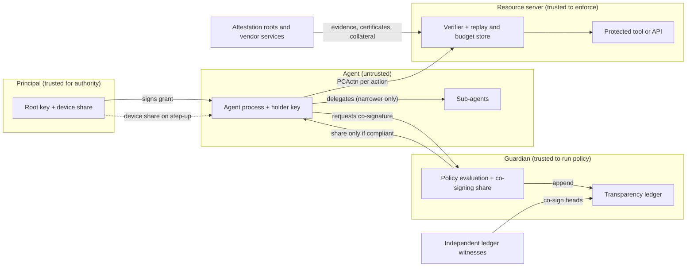

# PCA audit scope

This document is written for an independent security auditor who is scoping a review of Proof-Carrying Authority (PCA), release 0.4.2. It describes what PCA is made of, where its trust boundaries are, what the system claims, what evidence already exists for each claim (and of what kind), and where we think an audit would be most valuable. Any section may be quoted in an audit proposal or report.

**Status at the time of writing.** PCA is in preview. **No independent third-party security audit has been performed.** All review so far was done by or for the project itself. The evidence summarized in section 6 is real and found real defects, but it is not a substitute for an external audit, and it should not be cited as one.

## 1. What PCA is, in one paragraph

An AI agent that calls a protected tool or API presents, with each call, a signed object called a PCActn (proof-carrying action). The resource server verifies it offline. A valid PCActn proves that the action is a node of a plan the agent committed to beforehand, that the agent holds authority for it through an append-only capability chain rooted in a principal's grant, that it is addressed to this resource server inside a short validity window, and that it is signed by the key that chain is bound to. A resource server adds state (a strictly increasing counter per grant and holder) so each PCActn is accepted at most once. Optional extensions add post-quantum signatures, threshold co-signature with a human step-up, caveat and trust-budget policy, attestation, a transparency ledger, revocation and intent binding. The normative specification is the Internet-Draft *Proof-Carrying Authority (PCA): Execution Authentication for Autonomous Agents* (draft-atlas-pca-authf-01), which separates PCA Core from the extensions.

## 2. Components

Components are grouped into three priority tiers. Tier 1 is the minimum scope that would let a deployer rely on PCA's central claims. Tier 2 covers surfaces most production deployments will also use. Tier 3 is experimental or optional and should be in scope only if the deployment under review uses it.

### Tier 1: the Core and what every deployment runs

| Component | What it does | Language | Notes for the auditor |
|---|---|---|---|
| Strict JSON parser and canonical encoder | Parses untrusted bytes under a strict profile (no duplicate names, no lone surrogates, canonical numbers only, depth 32) and produces the one byte form that is hashed and signed | TypeScript reference; every native verifier has its own | Parser differentials are the classic way to break signed-JSON systems |
| Strict base64url and Ed25519 verification | Canonical base64url only; RFC 8032 verification that also rejects non-canonical scalars and points and small-order keys and nonces | All | Most Ed25519 libraries are more permissive by default |
| Capability chain | Hop signing and verification, hash links, holder continuity, append-only caveats, depth and caveat-count caps, root pinned to the verifier's stored grant | All | The attenuation property rests here |
| Plan commitment | RFC 6962-shaped Merkle tree with domain separation; inclusion proofs whose shape is bound to `(index, size)` | All | The leaf is recomputed from the action |
| PCActn verifier (Core checks) | `wire`, `version`, `audience`, `validity`, `cap_chain`, `grant_ref_bound`, `plan_inclusion`, `leaf_signature`, `counter` in a fixed order, fail-closed | All | The interoperability contract |
| Native verifiers | Independent implementations of the Core and most extensions in Go, Python, Rust, Java, Kotlin, .NET, PHP, Ruby and Swift | Nine languages | Each is held to the same conformance corpus |
| Replay guard and store contract | Counter monotonicity and optional nonce tracking, keyed on the bound grant reference and holder; runs only after verification | TypeScript, natives | Correctness depends on the store being atomic and durable |
| Resource-server guard (HTTP) | Extracts the PCActn from the `PCA-Action` header or the JSON body, verifies, enforces the required-check list, returns 401/403 | TypeScript, plus middleware in the Python, Go, Rust, Java, .NET, Ruby and PHP verifiers | Header decoding, error echoing, required-check defaults |
| Hosted verification API | Grant and plan registration, action admission (verification, counter, budget debit and ledger append in one database transaction), step-up, revocation, freeze | TypeScript service on PostgreSQL | Trust inputs must come from the server, never the request |

### Tier 2: surfaces most deployments use

| Component | What it does |
|---|---|
| Policy layer | Caveat evaluation (root caveats and delegated caveats, unknown types unsatisfied), predicate language, regular-expression engine, risk functional, trust budget |
| Threshold co-signature and step-up | Role-bound multi-signature (agent, guardian, principal), signer-set hashing, per-suite share validation; the step-up approval flow and what the human is shown |
| Post-quantum suites and key pinning | ML-DSA and SLH-DSA suites and hybrids, `holder_pq` commitments, verifier-side pins, the single choke point through which every post-quantum verification key must pass |
| Gateway enforcement | Envoy `ext_authz` (HTTP and gRPC), Cloudflare Workers and AWS API Gateway Lambda authorizer adapters; binding of the proof to method, path, query and body hash; optional single-use replay guard; header overwrite and removal so a client cannot smuggle a forged verdict. The gateway runs the stateless Core only, so the resource-server guard remains the backstop |
| MCP integration | A client-side wrapper that builds a PCActn per tool call, and an MCP resource-server component that serves Protected Resource Metadata (RFC 9728), enforces resource binding (RFC 8707) and issuer validation (RFC 9207), and issues step-up challenges |
| Framework adapters | Server middleware (Express, Fastify, Hono, Next.js) and agent-framework adapters (LangChain, LlamaIndex, Mastra, OpenAI Agents SDK, Vercel AI SDK, Anthropic and OpenAI tool calling; in Python: CrewAI, LangGraph, Pydantic AI, Google ADK, Haystack, FastMCP, Microsoft Agent Framework) |
| Starter templates | The project generator's templates, which many integrators will copy |
| Intent layer | The signed `intent` member and intent sessions: signed action schemas, accumulators that cap totals across actions, sequencer receipts, session revocation, parameter provenance, classifier verdicts |
| Revocation, beacons and kill switch | Revocation-set roots and non-membership proofs, liveness beacons, instance freeze |
| Transparency ledger | Append-only per-principal log, inclusion and consistency proofs (RFC 9162), witness co-signatures |
| Attestation | Software attestation documents and the hardware verifiers (AMD SEV-SNP, Intel TDX and DCAP, NVIDIA GPU, Azure Attestation, Google Confidential Space), allowlists and collateral freshness |

### Tier 3: experimental or optional

| Component | Status |
|---|---|
| FROST threshold signing and distributed key generation | Reference implementation; signing is checked against the RFC 9591 vectors, but the scalar arithmetic is not constant-time and there is no official DKG test vector |
| Zero-knowledge compliance backends (Groth16, STARK, folding, zkVM) | Experimental; several internal findings against these backends are recorded as limitations rather than fixed |
| Multi-party policy evaluation | Experimental; the oblivious-transfer parameters are argued, not proved |
| Attribute-based encryption and ratchet packages, payments mandates, optimistic bonded path | Optional extensions |

### Out of scope unless agreed otherwise

- The security of the underlying primitives (Ed25519, SHA-2 and SHA-3, ML-DSA, SLH-DSA, pairing and discrete-log assumptions).
- Third-party libraries, except how PCA configures and calls them.
- Proof toolchains (Dafny, Z3, Tamarin, ProVerif, EasyCrypt, Lean) and language runtimes.
- A customer's own deployment: key management, choice of trust anchors, the database or cache that backs the replay store, network configuration.
- Hardware vendors' attestation roots and services.

## 3. Trust boundaries

| Boundary | What crosses it | What the receiving side must not assume |
|---|---|---|
| Agent to resource server | PCActn, plaintext parameters, optional evidence | Anything in the PCActn that is not covered by a check; the agent's risk claim, taint level and any key it names |
| Agent to guardian | Action for co-signature | That the agent's plan or risk estimate is honest |
| Principal to agent | Grant, step-up share | (Principal is trusted; a compromised principal is a non-goal) |
| Request to hosted API | Grant, plan, PCActn, evidence | Any verifier-side parameter in the request: clock, trust anchors, pins, policy limits |
| Vendor services to verifier | Certificates, collateral, revocation status | Freshness beyond the configured window; a single vendor root when several are required |
| Verifier to its store | Counter, budget, nonce and epoch state | That a per-process memory store is shared across instances |

The agent is untrusted by design. The strongest guarantees require the principal, guardian and resource server to be operated by separate parties or at least separate machines: if one host holds every key share, compromising that host collapses the threshold.

## 4. Threat model summary

**Assets.** The principal's authority (the grant), the principal's root key and device share, guardian signing keys, the agent's holder key (assumed stealable), the trust budget, resource-server state (counters, budgets, nonces, revocation roots), attestation trust anchors, the ledger, and the data the agent can reach.

**Attackers considered.**

| Attacker | Claimed result |
|---|---|
| Passive network | Learns contents (PCA provides no confidentiality; use TLS) but cannot reuse a PCActn without fresh context |
| Active network | Cannot tamper, cannot replay to another audience, cannot replay at the same server if the server keeps counter state |
| Fully compromised agent (holds its own key) | Limited to in-plan, in-policy, low-risk actions within the trust budget; cannot produce a co-signature above threshold 1 alone; cannot widen its delegation |
| Prompt-injected agent | Out-of-plan actions fail plan inclusion; tainted lineage raises risk and forces step-up or refusal |
| Malicious tool or resource server | Cannot reuse a PCActn at another server or forge new actions; can misreport outcomes |
| Malicious sub-agent | Cannot exceed the parent's caveats, depth or budget allocation |
| Thief of a copied capability chain | Nothing without the holder key |
| Guardian shares below threshold | Cannot produce an accepted threshold signature |
| Compromised attestation vendor (with multiple roots required) | Cannot pass alone when independent roots must corroborate |
| Log operator | Cannot rewrite history undetectably when independent witnesses co-sign heads; can still censor |
| Quantum adversary | Cannot forge post-quantum or hybrid signatures; default surfaces are classical |
| Denial-of-service | Bounded parser, chain, schema and regex costs; volumetric flooding is not prevented |

**Non-goals.** A compromised principal; a compromised guardian at or above threshold; confidentiality; harm inside the authorized set; third-party hosts and silicon; classical roots surviving a quantum adversary; economic settlement of bonds; robustness of statistical semantic judges; state the resource server fails to keep; availability; Unicode normalization of identifiers in the integrator's own policy.

The full threat model has a numbered attack catalogue and a list of documented guarantees with their assumptions. Every catalogue entry and guarantee is mapped to automated tests, and the mapping is checked automatically.

## 5. Claims an audit should test

Each claim below is stated so that a counterexample would be a finding.

1. **Authenticity and integrity.** An accepted PCActn was signed by the holder of the last capability under the declared suite, over its canonical body; changing any signed field causes rejection.
2. **One encoding.** Every signed object has exactly one accepted byte form in every implementation. Any input that two implementations parse differently is a finding.
3. **Authority only narrows.** No delegated capability is accepted that drops, reorders or edits a parent caveat, exceeds the depth cap or grows a budget allocation.
4. **Plan binding.** An accepted action has a valid inclusion proof for a leaf recomputed from the action itself; a proof for one position or action cannot be reused for another.
5. **Freshness and audience.** An accepted action names this verifier's audience, is within its lifetime, is not future-dated beyond the skew allowance, and, with a correct store, is accepted at most once across every verifier instance.
6. **Bound state namespace.** A holder cannot obtain a fresh counter, nonce or budget namespace by choosing the grant reference it signs.
7. **Threshold.** An action requiring `t` co-signatures is accepted only with valid shares from `t` distinct registered keys; a share cannot be reused across roles, thresholds, signer sets or suites.
8. **Bounded autonomous risk.** Between two human recharges, admitted risk-weighted work does not exceed the configured budget, under any interleaving of concurrent admissions.
9. **No suite downgrade.** The suite and any post-quantum key are signed; unknown or unimplemented suites fail closed; a post-quantum key is accepted only when bound to an identity the verifier already trusts.
10. **Fail-closed policy.** An unknown caveat type, a missing context value, a malformed policy or an unverifiable proof denies.
11. **Bounded cost.** Hostile inputs cannot make verification exceed the stated size, depth, chain and caveat bounds, or make the regex engine or schema validator run super-linearly.
12. **Server-owned trust inputs.** The hosted API never takes its clock, trust anchors, pins or policy limits from a request.
13. **Revocation and liveness.** A revoked capability cannot present a valid non-membership proof; revocation epochs and beacons cannot be rolled back.
14. **Tamper-evident history.** Given independent witnesses, two different histories for one log size are provable.

## 6. Existing evidence

### 6.1 Machine-checked (formal) evidence

"Verified" here means "accepted by the named tool for the named model or code". It never means "the shipped system is secure".

| What | Tool | What it covers | What it does not cover |
|---|---|---|---|
| Decision core: verdict combination, chain walk and attenuation, caveat evaluation, threshold step-up, replay-guard decisions | Dafny, compiled to the JavaScript that ships | Correctness of these decisions against their specifications for all inputs; the shipped JavaScript is the compiled output | Parsing, cryptography, side channels |
| Proved modules wired into production in 0.4.2 | Dafny | Taint computation and gate, Merkle inclusion, attestation decisions and allowlists, threshold and admission kernels | As above |
| Proved modules available behind an opt-in switch | Dafny | Strict JSON and canonical encoding, regex engine, predicate and caveat evaluator, strict Merkle consistency and revocation membership, attestation nonce store | Not the default code path in 0.4.2 |
| Protocol properties: authorization, leaf-signature authenticity, attenuation, replay freedom, audience binding, step-up, attestation binding; each check shown necessary by an attack when removed | Tamarin and ProVerif (symbolic, perfect cryptography) | The models | Several lemmas are open or timed out (explicit-clock expiry on the shipped clock models, counter-store races, budget invariants, some FROST lemmas, allowlist rollback); a timeout is not a proof |
| Leaf and root authorization, depth-2 delegation, grant-reference binding | CryptoVerif (computational) | Those statements | Everything else rests on symbolic models |
| Action-authorization unforgeability with a concrete bound; role-bound multi-signature; hybrid signature combiner; commitment and range-proof algebra; MPC MAC-check soundness | EasyCrypt | Reductions to the named assumptions | Hardness of the primitives; some encoding-injectivity facts are stated as axioms |
| Authority only narrows along chains of any length; replay machine never double-accepts; counters strictly increase; forking lemma and related bounds | Lean 4 (no `sorry`), TLA+ | The models | Link to code is by identical definitions and differential tests, not extraction |
| Replay-store contract and store strategies (PostgreSQL variants, Redis, in-memory, file lock) | TLA+ (TLC, Apalache) | Exactly-once acceptance under bounded skew; known-bad strategies produce counterexamples | Bounded models; not a proof of a real database |
| Selected arithmetic and bounds in the Rust verifier and proof-system readers | Kani, Verus, Miri, CBMC | No panics or overflow for stated input ranges; no undefined behaviour on the conformance corpus | Several harnesses did not conclude; transliterations are related to code by inspection |

### 6.2 Tested evidence

**Mutation testing.** Every implementation (the TypeScript reference and the nine native verifiers) runs a mutation gate in continuous integration. A surviving mutant is either killed by a new test or recorded, one entry per mutation site, in a justified-equivalents ledger with a written reason; the gate fails on any unlisted survivor and on any ledger entry that has gone stale. At the 0.4.2 release gate all ten repositories passed, and the reference implementation's mutation score was 95.9 %. The native ledger lists about 1,500 justified-equivalent sites. Judging a mutant equivalent is a human decision, so an auditor may want to sample the ledger.

**Cross-language conformance.** One shared corpus is the interoperability contract:

- a curated core of 394 PCActn vectors (71 positive, 323 negative), each a single-rule change from a valid action, plus primitive vectors for canonical encoding, strict parsing, base64url, Merkle proofs, threshold shares, signer-set hashes, caveat evaluation, the HTTP header, malformed inputs and nesting depth;
- a full adversarial parser-differential set of 4,358 PCActn vectors and 1,178 primitive vectors (malformed JSON, base64url edge cases, canonical-encoding traps, weak Ed25519 keys and signatures, size-limit boundaries);
- seeded fuzzing on top.

A cross-language gate drives all ten implementations over the curated core, the full adversarial set and the fuzz cases, and fails on any disagreement in the verdict or in any per-check result. Each verifier declares which signature suites it implements; a vector needing a suite a verifier lacks must be refused with `unsupported_suite`, never accepted. A Core-only subset of the corpus (profile `pca-core/1`: 276 PCActn vectors plus the encoding, parsing, header, caveat, malformed-input and depth primitives) is defined for implementations that do not implement extensions.

**Model-to-code conformance.** The executable models are run against the real TypeScript implementation on millions of generated scenarios in a bounded configuration (few verbs, up to three hops, few holders, nonces and counters); deliberately broken model mutants are all detected. This is testing, not proof.

**Concurrency and state.** The anti-replay suite runs against real PostgreSQL with two independent server instances and separate processes: concurrent duplicate submissions, counter races, budget races, revocation racing admissions, the exact expiry instant, clock skew in both directions, restart and reconnect, injected transaction failures. Linearizability campaigns with crash injection were run against the PostgreSQL and Redis stores.

**Other.** Structure-aware fuzzing with crasher replay; static analysis with triaged findings; a supply-chain check (SBOM and lockfiles); a dudect-style timing harness.

### 6.3 Known gaps (not verified, not tested, or known weak)

- **No independent audit**, and no independent implementation: all ten implementations come from one organization.
- **Model to code.** Proofs are about hand-written models, except the Dafny-compiled decision code and the selected Rust code above.
- **Side channels.** The TypeScript, Go, Python and other verifiers were not checked for constant-time behaviour. The reference FROST and DKG scalar arithmetic is not constant-time, and LESS signing is measurably not constant-time.
- **Semantic gap.** A valid signature shows that the key holder signed an action, not that the principal intended it. Prompt injection that stays inside the committed plan is outside every symbolic model.
- **Deployer-provided state.** Replay-store atomicity and durability, clock integrity, key management and trust anchors are contracts the deployer must meet; the models check the contract, not the deployer's database.
- **Experimental backends.** Some findings against the zero-knowledge, zkVM, folding and STARK backends are documented limitations rather than fixes; the MPC oblivious-transfer parameters are argued, not proved.
- **Newest code.** The intent-session layer is the newest and largest surface; 0.4.2 fixed an over-admission race in its sequencer and a post-quantum key-pinning gap in hosted session roots.

### 6.4 Prior review

Six rounds of internal adversarial review were run, each by reviewers who had not written the code under review, working read-only and required to back every finding with either a runnable demonstration or a precise written argument. The first three rounds produced 50 numbered findings (the highest a single Critical) and are summarized publicly; fixes are recorded in the changelog. Separate written audits cover the cryptographic packages, the nine native verifiers, the proof-system backends, and the attribute-based-encryption and ratchet packages. The raw reports and proof-of-concept programs are not published; they can be shared with an engaged auditor under a confidentiality agreement.

## 7. Suggested audit focus areas

In priority order. Each item lists the question we would most like an outside reviewer to answer.

1. **Parser and canonicalization differentials across the ten implementations.** Can any byte sequence be accepted by one verifier and rejected by another, or hashed differently? Focus on duplicate names after unescaping, surrogate handling, number lexemes at the edges of the profile, base64url trailing bits, and the size and depth limits applied before parsing.
2. **Signature-suite dispatch and post-quantum key pinning.** Is there any path where a post-quantum or hybrid signature is verified under a key taken from the artifact rather than from a pin, a `holder_pq` commitment or the stored grant? Are unknown and unimplemented suites refused everywhere (leaf, hop, root, threshold share, and every other signed artifact)?
3. **Chain verification and the grant reference.** Root equality with the stored grant, holder continuity, caveat-prefix comparison, the caveat and depth caps, and the `grant_ref_bound` rule, in every language.
4. **Hosted admission transaction.** Do counter, budget, nonce, ledger append and revocation checks happen atomically under concurrency and failure? Can any request parameter influence the clock, trust anchors, pins or policy limits? Are expensive checks reachable before cheap authentication on unauthenticated routes?
5. **Policy layer.** Caveat evaluation (root and delegated, unknown types), the predicate language, the regular-expression engine's cost bounds, and the trust-budget arithmetic.
6. **Threshold and human step-up.** Signer-set well-formedness, share binding to role, threshold, signer set and suite, and whether what the approving human sees binds everything that is then authorized.
7. **Enforcement points.** The HTTP guard's required-check defaults and status mapping, the gateway's header overwrite and removal, the MCP resource server's metadata and resource binding, and the starter templates (do they verify policy, or only the Core?).
8. **Intent sessions.** Accumulator caps under concurrency and clock skew, sequencer receipts and key rotation, session revocation (rollback and drop protection), and the closed-world action schema.
9. **Attestation verifiers**, if the deployment uses them: certificate chains, family pinning, debug-mode rejection, collateral freshness, allowlist rollback, multi-root reconciliation.
10. **Experimental cryptography** (FROST and DKG, zero-knowledge backends, MPC), only if in the deployment's scope.
11. **Supply chain and build reproducibility** of the published packages.
12. **Spot checks of model-to-code correspondence** for the Dafny-compiled core and the symbolic models' message formats.

A Tier 1 review (items 1 to 4 and the Core parts of 7) is the smallest scope that would let a deployer rely on PCA's central claims.

## 8. What we provide to an auditor

- Read access to all source repositories, including the native verifiers and the formal models, at a pinned release commit.
- The conformance corpus and the cross-language gate, runnable on a fresh Linux machine.
- The formal artifacts with pinned tool versions and re-run instructions, and the recorded results.
- The threat model, the attack-to-test traceability table, the mutation equivalents ledgers, and (under a confidentiality agreement) the internal review reports and proof-of-concept programs.
- A technical contact for questions during the engagement, and a private channel for reporting findings before publication.
